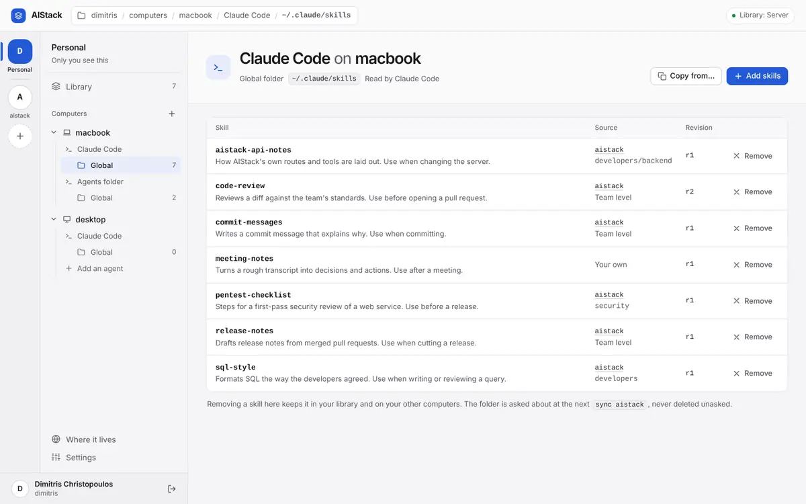
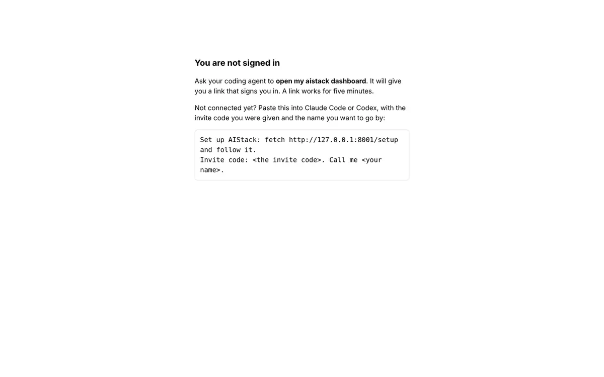
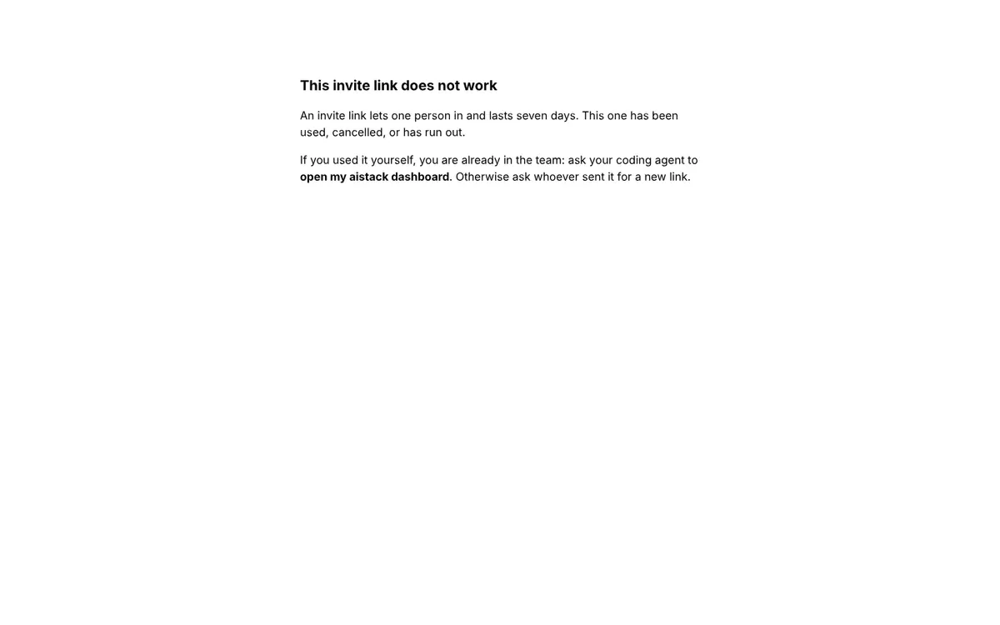

# Not industry standard

What a mature self-hosted product in this space does that AIStack does not, each compared with a named standard or product, and the smallest fix that meets it. Nothing here reverses an ADR without saying a new one is needed.

How far this was checked: each finding below was reproduced or traced line by line by whoever raised it, and **Confirmed** means exactly that. The independent second pass that tries to refute each finding was done only for the authorization and UX findings; there was no time for the rest. Where a finding was re-checked separately, its entry says so. Treat **Suspected** findings, and anything marked High or Critical without a second pass, as needing a reproduction before the fix lands; the reproduction is described in each.

| Id | Finding | Severity | Status | Effort |
|---|---|---|---|---|
| [STD-01](#std-01-a-stopped-servers-data-lives-in-aistackdb-wal-and-the-obvious-restore-or-the-promised-upgrade-rollback-silently-restores-nothing) | A stopped server's data lives in aistack.db-wal, and the obvious restore (or the promised upgrade rollback) silently restores nothing | High | Confirmed | M |
| [STD-02](#std-02-the-pypi-name-every-setup-sentence-runs-aistack-mcp-is-unregistered-and-anyone-can-take-it) | The PyPI name every setup sentence runs, aistack-mcp, is unregistered and anyone can take it | High | Confirmed | S |
| [STD-03](#std-03-a-dashboard-session-cannot-be-ended-not-by-signing-out-and-not-by-deleting-the-machine-that-opened-it) | A dashboard session cannot be ended: not by signing out, and not by deleting the machine that opened it | High | Confirmed | M |
| [STD-04](#std-04-a-person-cannot-see-when-each-computer-last-connected-or-remove-a-lost-one-and-a-stolen-tokens-push-lands-silently-on-their-other-computers) | A person cannot see when each computer last connected or remove a lost one, and a stolen token's push lands silently on their other computers | Medium | Confirmed | M |
| [STD-05](#std-05-failed-authentication-is-never-throttled-and-never-logged-with-a-client-address) | Failed authentication is never throttled and never logged with a client address | Medium | Confirmed | M |
| [STD-06](#std-06-health-checks-bearer-checks-and-the-invite-page-take-sqlites-write-lock-so-one-slow-write-turns-them-into-503-and-500) | Health checks, bearer checks and the invite page take SQLite's write lock, so one slow write turns them into 503 and 500 | Medium | Confirmed | S |
| [STD-07](#std-07-nothing-scans-or-updates-dependencies-and-the-shipped-lock-pins-pyjwt-2130-which-has-14-published-advisories) | Nothing scans or updates dependencies, and the shipped lock pins PyJWT 2.13.0, which has 14 published advisories | Medium | Confirmed | S |
| [STD-08](#std-08-every-build-calls-itself-010-so-adr-0024s-refusal-names-a-release-nobody-can-find) | Every build calls itself 0.1.0, so ADR-0024's refusal names a release nobody can find | Medium | Confirmed | S |
| [STD-09](#std-09-latest-is-every-commit-on-main-and-there-is-no-release-tag-or-changelog-to-stay-on) | `latest` is every commit on main, and there is no release, tag or changelog to stay on | Medium | Confirmed | S |
| [STD-10](#std-10-changes-made-on-the-dashboard-leave-no-log-line-shares-groups-group-privacy-takes-and-placements) | Changes made on the dashboard leave no log line: shares, groups, group privacy, takes and placements | Medium | Confirmed | S |
| [STD-12](#std-12-the-documented-deployment-publishes-plain-http-on-every-interface-and-keeps-logs-without-limit) | The documented deployment publishes plain HTTP on every interface and keeps logs without limit | Medium | Confirmed | S |
| [STD-15](#std-15-a-person-on-a-server-can-neither-export-their-library-nor-be-erased) | A person on a server can neither export their Library nor be erased | Medium | Confirmed | M |
| [STD-11](#std-11-the-server-log-mixes-two-formats-and-fastmcps-multi-line-rich-lines-ignore-aistack_log_level) | The server log mixes two formats, and FastMCP's multi-line Rich lines ignore AISTACK_LOG_LEVEL | Low | Confirmed | S |
| [STD-13](#std-13-no-hsts-even-when-aistack_public_url-is-https-inline-scripts-allowed-by-the-csp-and-a-server-banner-on-every-response) | No HSTS even when AISTACK_PUBLIC_URL is https, inline scripts allowed by the CSP, and a server banner on every response | Low | Confirmed | S |
| [STD-14](#std-14-aistack-serve-reads-the-current-folders-env-and-database_url-mistakes-a-foreign-database-for-an-old-aistack-one-and-blames-reachability) | `aistack serve` reads the current folder's .env and DATABASE_URL, mistakes a foreign database for an old AIStack one, and blames reachability | Low | Confirmed | S |
| [STD-16](#std-16-local-mode-installs-a-new-release-every-day-with-no-way-to-opt-out-or-pin-a-version) | Local mode installs a new release every day, with no way to opt out or pin a version | Low | Confirmed | S |
| [STD-17](#std-17-images-are-unsigned-and-carry-no-sbom-the-base-image-is-unpinned-and-rebuilt-only-on-commits-and-there-is-no-security-policy) | Images are unsigned and carry no SBOM, the base image is unpinned and rebuilt only on commits, and there is no security policy | Low | Confirmed | S |
| [STD-18](#std-18-the-pages-a-newcomer-sees-first-fail-wcag-22-level-a-and-dashboard-messages-disappear-on-a-timer) | The pages a newcomer sees first fail WCAG 2.2 Level A, and dashboard messages disappear on a timer | Low | Confirmed | S |
| [STD-19](#std-19-the-log-is-the-only-way-to-observe-a-server-no-metrics-no-request-ids-no-version) | The log is the only way to observe a server: no metrics, no request ids, no version | Info | Confirmed | M |
| [STD-20](#std-20-the-dashboard-is-english-only-by-construction-locale-fixed-to-en-and-strings-inline) | The dashboard is English-only by construction: locale fixed to 'en' and strings inline | Info | Confirmed | L |

Compared with mature self-hosted products, AIStack already does several things right. It ships a non-root, multi-arch image with a HEALTHCHECK. It publishes only after every test job passes, uses PyPI trusted publishing, keeps secrets out of logs and checks that in CI, and sends a strict CSP on the dashboard. The gaps are in operations, release engineering and the session lifecycle, and most are cheap to close. The most serious is backups. A stopped SQLite server keeps all of its data in aistack.db-wal, so a cold copy of 'the one file' is an empty database. Restore is not documented, and the obvious restore, and the rollback after a bad upgrade that OPERATING.md promises, silently does nothing. Second, the dashboard session cannot be revoked. Signing out does not end it, and neither does the operator deleting the stolen laptop that opened it. A person also cannot see when each computer last synced, or remove a lost one. Third, releases cannot be told apart. Every build is 0.1.0, `latest` is every commit on main, there are no tags or changelog, and the PyPI name every setup sentence runs is still unregistered. Nothing scans dependencies, and the lock pins PyJWT 2.13.0, which has 14 published advisories. Operationally: failed authentication is never throttled and never logged with a client address. Read-only paths take SQLite's write lock, so a slow write turns /health into 503 and a wrong bearer into 500. Dashboard actions leave no log line, FastMCP writes multi-line Rich output that ignores AISTACK_LOG_LEVEL, and the documented compose file publishes plain HTTP on every interface with unbounded logs.

### STD-01: A stopped server's data lives in aistack.db-wal, and the obvious restore (or the promised upgrade rollback) silently restores nothing

**Confirmed.** Severity **High**, effort **M**. Hurts: The operator, and everyone whose data a rollback was meant to recover. It hits hardest after a bad upgrade, when OPERATING.md says the backup is the only way back.

**Where.** docs/OPERATING.md:232-247 ('The database is one file in the volume', backup only, no restore) and :295; src/aistack/bootstrap/context/application_context.py:297-303 (engine disposed only in tests); src/aistack/mcp/mcp.py:65-76 (no shutdown hook); src/aistack/db/schema.py:37-45 (refusal says 'restore the backup from before the upgrade'); compose.yaml (no stop_grace_period)

**What is wrong.** The SQLite engine is never disposed when the server shuts down, so nothing checkpoints the WAL. After a graceful SIGTERM (what `docker stop` sends), aistack.db is a 4096-byte header and every row is in aistack.db-wal. The seeded server's WAL was 2.1 MB, below SQLite's 1000-page auto-checkpoint, so a small server may never move data into the main file. OPERATING.md calls the database 'one file', so a cold backup of that file is an empty database with 0 tables, and a server started on it makes the first person to join its admin. Restore is not documented. The natural restore, copying the backup over aistack.db, leaves the old -wal beside it. SQLite replays that WAL, and the 'restored' server holds the post-backup state while integrity_check reports ok. The documented rollback after a regretted upgrade fails the same way: the old release then refuses with 'upgraded by AIStack 0.1.0 (schema 0011) ... restore the backup from before the upgrade', which the operator has just done. Deleting -wal/-shm before starting fixes it, but nothing says so, and no test or CI step ever restores a backup. Docker's default 10 s stop timeout is also shorter than uvicorn's 20 s graceful shutdown (mcp.py:74). Standards: SQLite and the Vaultwarden backup wiki (WAL files are part of the database; back up with .backup or VACUUM INTO; remove -wal/-shm before restoring), Litestream for point-in-time recovery, and the rule that a backup only counts once a restore has been tested.

**How it was confirmed.** All scripts are under &lt;scratch&gt;/industry/probes/. (1) restore_drill.sh &lt;folder&gt; &lt;venv bin&gt; 8172 starts a server on a scratch SQLite file and runs join.py for 'before-backup'. It then runs OPERATING's sqlite3 backup snippet verbatim while the server is up, and joins 'after-backup'. Next it sends SIGTERM to the server's Python PID and confirms the process exited; ls shows aistack.db at 4096 B and aistack.db-wal at 321 KB. list_users.py (OPERATING's list query plus integrity_check) shows the backup alone holds ['before-backup']. The script then runs `cp backup.db aistack.db` and starts the server again: it holds ['after-backup','before-backup'] and integrity is ok. (2) upgrade_rollback_drill.py &lt;folder&gt; &lt;step&gt; runs each step in its own process that exits without closing connections, as the server does. It uses a copy of the migrations plus a stand-in 0011 with older_releases_compatible=False. Steps: build the old schema with data; back up while another process holds the database open; the new build migrates to 0011; copy the backup over aistack.db. The old release then raises NewerSchema. With -wal/-shm deleted first, it starts. (3) A server on err.db was stopped with SIGTERM to PID 17988 (confirmed exited). Copying err.db alone gives 0 tables; err.db together with its WAL has 16.

Corrected on review: the backup OPERATING.md documents (`sqlite3` `backup()` while the server runs) is correct and does include what is in the WAL. What fails is everything around it: OPERATING calls the database 'one file', so a cold copy of `aistack.db` alone (a volume snapshot of one file, `docker cp` of one file after a stop) can be empty; and restore is not documented, so the natural restore (copy the backup over `aistack.db` and start) replays the stale `-wal` beside it. Severity stays High because the second case is exactly the rollback ADR-0024's refusal sends the operator to.

**Proposed fix.** (a) Close the database at shutdown. Add a FastMCP lifespan or uvicorn shutdown hook in mcp/mcp.py that calls a new close_application_context() in application_context.py. On SQLite it runs `PRAGMA wal_checkpoint(TRUNCATE)` and then engine.dispose(), so a stopped server leaves one file. (b) Add `aistack backup <file>` and `aistack restore <file>` in bootstrap/__main__.py, both through build_engine. On SQLite, backup uses VACUUM INTO; on PostgreSQL it prints the pg_dump/pg_restore commands. restore refuses a file that fails PRAGMA integrity_check or has no alembic_version, and refuses while the server's /health answers. It then removes -wal/-shm and replaces the file atomically. (c) Rewrite OPERATING 'Backups': explain the three files, add a Restore section and an 'Upgrade rollback' section, and mention Litestream as optional continuous backup. (d) Add a restore drill to the container job in tests.yaml: backup, change, docker stop, restore, start, then assert the change is gone. (e) Add `stop_grace_period: 25s` to compose.yaml and `--stop-timeout 25` to OPERATING's docker run.

**Done when.** restore_drill.sh, rerun with the new restore command, lists only ['before-backup'] after the restore. After `docker stop`, /data holds aistack.db with the data and no -wal. upgrade_rollback_drill.py starts the old release after the documented rollback. A CI container step that restores a backup passes.

Related: [AUTO-16](automation.md#auto-16-an-upgrade-relies-on-the-operator-remembering-to-back-up-first-the-server-could-snapshot-sqlite-itself-before-migrating), [PH-18](plot-holes.md#ph-18-operating-has-no-restore-procedure-no-guidance-for-a-new-server-address-and-a-recovery-script-that-crashes-on-a-typo).

### STD-02: The PyPI name every setup sentence runs, aistack-mcp, is unregistered and anyone can take it

**Confirmed.** Severity **High**, effort **S**. Hurts: Every newcomer who pastes the README's first sentence into a coding agent, and that computer's machine tokens and files

**Where.** README.md:24-28 (`uvx aistack-mcp setup`); src/aistack/bundled/local/setup.md:22 (`uv tool install aistack-mcp`); docs/OPERATING.md:18-22 (`uvx aistack-mcp serve`); .github/workflows/tests.yaml:263-294 (the pypi job runs only on v* tags, and none exist)

**What is wrong.** The package is not on PyPI (LH-01). What follows from that: the name is unclaimed, PyPI gives a name to whoever uploads first, and a pending trusted publisher does not reserve it. The README's first instruction tells an agent to run whatever is published as `aistack-mcp`, and agents run it unattended with the user's privileges, next to ~/.claude.json, which holds machine tokens. A typo-squat or name-squat would turn AIStack's own onboarding into a delivery channel. Standards: reserve or publish a package name before documenting it (PyPI and npm squatting incidents); OpenSSF guidance on install paths.

**How it was confirmed.** `curl -s -o /dev/null -w '%{http_code}' https://pypi.org/pypi/aistack-mcp/json` returned 404 on 2026-10-15, and so did /simple/aistack-mcp/. `git tag` prints nothing, so the tag-only pypi job has never run.

**Proposed fix.** Cut v0.1.0 now through the existing pypi job; the trusted publisher must exist on pypi.org first. Until the first upload exists, change the README and bundled/local/setup.md to a pinned source, e.g. `uvx --from git+https://github.com/dchristopoulos/AIStack@<tag> aistack-mcp setup`. Add a check to the container job that fails when https://pypi.org/pypi/aistack-mcp/json does not name this repository in project_urls, so a squat is noticed.

**Done when.** https://pypi.org/pypi/aistack-mcp/json answers 200 with project_urls.Homepage = https://github.com/dchristopoulos/AIStack, and `uvx aistack-mcp setup` on a clean machine prints the setup steps.

Related: [AUTO-19](automation.md#auto-19-every-way-to-set-up-another-computer-in-local-mode-and-the-self-updater-depend-on-pypi), [IMP-01](improvements.md#imp-01-the-windows-job-gates-neither-merging-nor-publishing-and-local-mode-then-updates-itself-from-pypi), [IMP-05](improvements.md#imp-05-setup-can-run-from-github-today-but-the-steps-it-prints-still-install-from-pypi-follows-from-the-known-missing-release), [LH-01](plot-holes.md#lh-01-local-mode-cannot-be-installed-aistack-mcp-is-not-on-pypi-and-no-release-has-ever-been-tagged), [UX-10](ux.md#ux-10-the-dashboard-and-the-local-sync-skill-hand-out-uvx-aistack-mcp-setup-and-uv-tool-install-aistack-mcp-which-fail-today).

### STD-03: A dashboard session cannot be ended: not by signing out, and not by deleting the machine that opened it

**Confirmed.** Severity **High**, effort **M**. Hurts: Someone whose laptop is lost or stolen; anyone who signed out on a shared computer; the operator following OPERATING's lost-laptop procedure

**Where.** src/aistack/api/dashboard.py:145-151 (sign_out only deletes the cookie); src/aistack/services/transfer_ticket.py:122-128 (a stateless 8-hour session bound to user_id only); src/aistack/services/dashboard_service.py:86-95 (require_a_machine only checks that the user has some machine); docs/OPERATING.md:127-178

**What is wrong.** Logout only happens in the browser. A copy of the cookie keeps reading and writing for the rest of its 8 hours (OWASP ASVS 4.0.3 V3.3.1, Level 1). Worse, the session belongs to the user, not to the machine whose token minted it. OPERATING's lost-laptop procedure (rotate or delete that machine) stops the stolen token on /mcp, but not a dashboard session the thief opened with `open_dashboard`. While the victim has another computer, the thief keeps the dashboard for up to 8 hours. They can switch skills on for the victim's other computers (sync installs them silently), share into teams, and make team invites if allowed. Only a server restart ends the session, and the procedure does not mention one. There is no 'sign out everywhere' (ASVS V3.3.4; GitHub's Sessions page; Google's 'sign out of all devices').

**How it was confirmed.** Scripts are under &lt;scratch&gt;/industry/probes/. logout_replay.py &lt;base&gt; &lt;invite&gt; (own server, port 8170): join, open_dashboard, sign in (303), keep the cookie, POST /api/logout (200). A second client with the saved cookie then gets 200 on GET /api/state and 200 on POST /api/account. revoked_machine_session.py &lt;base&gt; &lt;invite&gt; &lt;db url&gt; (own server, port 8176): join as 'victim' with machine 'stolen-laptop' and add_machine 'desktop'. A thief client calls open_dashboard with the laptop's token and signs in (303). The script then runs OPERATING's delete-machine SQL verbatim (1 row removed). The laptop token now gets HTTPStatusError 401 on /mcp, but the thief's GET /api/state answers 200 listing ['desktop'], and POST /api/account answers 200.

**Proposed fix.** Keep the in-memory key (ADR-0010/0017) and add revocation that fits it. (1) The session ticket carries a jti, the minting machine_id, and the first 16 hex characters of that machine's token_hash (`sign_dashboard_session(user_id, machine_id, token_hash)`). (2) `_signed_in`, beside require_a_machine, checks in one indexed lookup that this machine still exists for the user with that hash prefix. Deleting or rotating the machine then ends its sessions. (3) sign_out puts the jti in a denylist kept like `_used_links`, in memory and forgotten at exp. (4) A 'Sign out everywhere' action keeps a per-user signed-out-before timestamp in memory, which lives as long as the key. Amend ADR-0017's 'A session ends with its user's last machine' to 'with the machine that opened it' in a short ADR note. Update OPERATING's lost-laptop text. Tests in tests/api: a cookie after logout gets 401; a cookie minted by a since-deleted machine gets 401 while the user has another machine.

**Done when.** Rerunning logout_replay.py and revoked_machine_session.py prints 401 for the replayed cookie and for the thief after the machine is deleted, and the new tests pass.

**Resolution (step 8).** Items (1) to (3) shipped: sessions name their computer and its token, and signing out ends the session on the server. Item (4), "Sign out everywhere", was not built: removing a computer (step 9) ends every session it opened, which covers the lost-laptop case it was for.

Related: [SEC-01](security.md#sec-01-a-stolen-machine-token-outlives-the-documented-revocation-sibling-tokens-dashboard-sessions-and-upload-urls-keep-working), [SEC-05](security.md#sec-05-signing-out-does-not-end-the-session-a-copied-cookie-keeps-working-for-the-rest-of-its-8-hours), [SEC-10](security.md#sec-10-a-sign-in-link-silently-replaces-the-browsers-existing-session-login-csrf).

### STD-04: A person cannot see when each computer last connected or remove a lost one, and a stolen token's push lands silently on their other computers

**Confirmed.** Severity **Medium**, effort **M**. Hurts: Someone with two laptops; a team member on a server they do not run

**Where.** src/aistack/db/models/machine.py:17-40 (no last-used column, no expiry); src/aistack/services/dashboard_service.py:126-147 (`_machines` returns id, name, os and harnesses, but neither created_on nor MachineHarness.last_synced_on, which is already stored at machine_harness.py:31); src/aistack/api/dashboard.py (no machine action); src/aistack/services/reconciliation.py:94-97 (ENABLED + STALE means a silent UPDATE)

**What is wrong.** README Known limits already says that revoking a machine is an operator script. Not said there: (a) the Computers view shows no 'added' or 'last synced' date, although the last sync is stored, so a person cannot spot a computer they do not recognise or tell when a lost one last connected; (b) a team member must find the operator to cut a lost laptop off; (c) a stolen machine token can push a new revision of an enabled skill. Every other computer's next sync then installs it without asking, with the victim's own name as pushed_by, so the 'visibility at the moment of risk' in DESIGN.md's security posture shows nothing unusual. Standards: GitHub shows when an SSH key or PAT was last used and offers expiry; Tailscale shows 'last seen', lets the owner remove a device, and expires node keys after 180 days by default; 1Password lets a user deauthorize a device remotely.

**How it was confirmed.** Traced the code above. Screenshot computer-desktop-light.png: the computer page has no dates and no way to remove the computer. The stolen-token push path follows reconciliation.py:97 (Desired.ENABLED, Observed.STALE) -&gt; Step.UPDATE.

**Proposed fix.** (1) Have `_machines` return created_on and max(MachineHarness.last_synced_on); the Computer page shows 'Added …, last synced …'. No migration is needed. (2) Add a dashboard action `@_action('/machines/{machine_id}/remove', local=False)` that calls a new onboarding_service.remove_machine(session, user_id, machine_id). It answers someone else's machine with the same NotFound sentence, refuses the user's last machine (removing it would lock them out), deletes the row (it cascades), and logs the removal. With STD-03's fix, this also ends the sessions that machine opened. (3) Optionally add a nullable machine.last_used_on column (older_releases_compatible=True), updated by the verifier at most once an hour so it stays off SQLite's write lock (STD-06). (4) Token expiry would reverse ADR-0003's permanent token and needs a new ADR.

**Done when.** A new tests/ui test removes a second computer from its page: /api/state no longer lists it and its token gets 401 on /mcp. The Computer page shows a 'last synced' time after a sync.

Related: [AUTO-02](automation.md#auto-02-on-a-server-a-person-cannot-cut-off-their-own-lost-or-stolen-computer), [AUTO-20](automation.md#auto-20-computers-cant-be-renamed-or-removed-and-a-reinstall-leaves-vm-and-vm-2-forever), [IMP-06](improvements.md#imp-06-the-dashboard-cannot-say-when-a-computer-last-synced-or-which-revision-it-holds), [IMP-09](improvements.md#imp-09-a-person-cannot-retire-revoke-or-rename-their-own-computer-only-the-operator-can), [PH-13](plot-holes.md#ph-13-owners-cannot-rename-or-remove-a-computer-and-nothing-shows-when-a-computer-last-synced), [SEC-01](security.md#sec-01-a-stolen-machine-token-outlives-the-documented-revocation-sibling-tokens-dashboard-sessions-and-upload-urls-keep-working).

### STD-05: Failed authentication is never throttled and never logged with a client address

**Confirmed.** Severity **Medium**, effort **M**. Hurts: The operator of an internet-facing server, and every user, whose calls slow down during a flood

**Where.** src/aistack/mcp/auth/aistack_token_verifier.py:59-67; src/aistack/api/dashboard.py:95-99; src/aistack/mcp/routes/invite.py:45-47; src/aistack/mcp/mcp.py:71-73 (access log off, so no line carries an address); src/aistack/bootstrap/configuration/settings/settings_config.py:162-178 (the server's invite code gets only a length check)

**What is wrong.** Nothing limits wrong machine tokens, dashboard links or team invite codes. 300 sequential wrong bearers took 2.4 s, all answered 401, never 429. Each rejection writes 3 log lines: AIStack's own, plus FastMCP's two-line Rich 'Auth error returned'. None of them carries a client address, and the access log is off by design, so the operator cannot see who is hammering or feed fail2ban/CrowdSec. The server's invite code is chosen by the operator with only a 16-character minimum (the README's public demo code `try-it-out-locally-1234` passes), so online guessing of a weak human-chosen code is unthrottled. During a 40-client flood, a real user's sync calls fell from 86 to 8 per 15 s, and the slowest took 2.5 s. Standards: OWASP ASVS V2.2.1 (anti-automation) and V7.2.1 (log authentication decisions with metadata); OWASP API4:2023; Vaultwarden logs failed logins with the IP for fail2ban and rate-limits logins.

**How it was confirmed.** A curl loop sent 300 POST /mcp requests with distinct wrong bearers: 300 x 401 in 2.38 s and 900 new log lines. &lt;scratch&gt;/industry/probes/flood.py &lt;base&gt; &lt;invite&gt; 40 15 runs 40 async clients sending wrong bearers while a newly joined user loops `sync`; it got 3,333 responses, all 401. With 0 clients (baseline), the user completed 86 syncs (slowest 0.3 s); during the flood, 8 (slowest 2.5 s). grep found no IP address on any log line.

**Proposed fix.** (1) Add a small in-memory per-address token bucket in a new mcp/auth/throttle.py (for example 10 failures a minute, burst 20). The verifier's rejection path, sign_in's InvalidTicket path and the invite page's NotFound path consult it; over the limit they answer 429 with Retry-After and touch no database. One process per server (OPERATING) makes memory enough. (2) Add `Client: '<request.client.host>'` to those rejection lines, never the path. Document uvicorn's FORWARDED_ALLOW_IPS so X-Forwarded-For is trusted only from the proxy, and give a fail2ban filter in OPERATING. (3) Floor the 'fastmcp' auth logger so one rejection is one line (see STD-11). (4) Have validate_invite_code refuse the README's demo code, as it refuses 'change-me'.

**Done when.** Wrong bearers from one address turn into 429 after the limit, rejection lines carry the client address, and a test in tests/mcp asserts both. flood.py, with the flooders on a different address than the user, shows the user's sync rate within 2x of baseline.

Related: [SEC-02](security.md#sec-02-no-rate-limit-or-lockout-on-any-credential-check-and-the-invite-code-strength-check-accepts-trivially-guessable-codes), [SEC-08](security.md#sec-08-one-team-invite-link-or-the-server-code-is-an-unlimited-oracle-for-every-username-and-team-name-on-the-server).

### STD-06: Health checks, bearer checks and the invite page take SQLite's write lock, so one slow write turns them into 503 and 500

**Confirmed.** Severity **Medium**, effort **S**. Hurts: The operator, whose container reads as unhealthy (an orchestrator restarts it), and users, who get a 500 instead of an answer

**Where.** src/aistack/db/engine.py:28 and 64-71 (every transaction starts with BEGIN IMMEDIATE); src/aistack/mcp/routes/health.py:33-35; src/aistack/mcp/auth/aistack_token_verifier.py:81-92; src/aistack/mcp/routes/invite.py:70-72; Dockerfile:52-53

**What is wrong.** ADR-0014's BEGIN IMMEDIATE applies to every session, including read-only ones that never write. A read in WAL mode never waits for a writer, but these do. With another connection holding the write lock for 7 s: GET /health answered 503 after 5.1 s; POST /mcp with a wrong bearer answered 500 instead of 401; GET /invite/&lt;wrong&gt; answered 500. A plain read took 0.000 s. A valid machine token goes through the same _find_machine. The health probe therefore reports the database unavailable whenever any write takes more than 5 s, and every unauthenticated request queues on the server's one write lock, which amplifies STD-05. Standards: Kubernetes probe guidance (keep probes cheap and free of contention with real work); SQLite (read-only transactions should be deferred).

**How it was confirmed.** &lt;scratch&gt;/industry/probes/write_lock_probe.py &lt;db file&gt; &lt;base&gt; opens the server's own database, runs BEGIN IMMEDIATE, holds it for 7 s, and times three unauthenticated requests: 503, 500 and 500 after 5.1 s each. The server log shows OperationalError on `BEGIN IMMEDIATE`. A plain sqlite3 read afterwards took 0.000 s.

**Proposed fix.** Keep IMMEDIATE for writers and give read-only work a deferred begin. In engine.py's `_begin_immediate`, emit plain BEGIN when the connection carries an execution option such as aistack_read_only=True. Add build_read_session_factory(engine) (a sessionmaker bound to engine.execution_options(aistack_read_only=True)), expose it as get_read_session_factory() in application_context, and use it in health._ping_database, the verifier's _find_machine and _is_team_invite, and invite._team_name. Amend ADR-0014 with one line ('read-only sessions use a deferred BEGIN'), since AGENTS.md states the rule for every transaction.

**Done when.** While the lock is held, write_lock_probe.py prints /health 200, wrong bearer 401 and invite 404, each well under a second. A test in tests/db holds the write lock on a temp-file database and asserts the verifier returns None instead of raising.

Related: [DB-01](schema.md#db-01-dashboard-list_skills-and-sync-count-every-revision-and-file-on-the-whole-server-for-each-request-under-sqlites-write-lock), [ENT-04](concurrency-and-reliability.md#ent-04-on-sqlite-every-read-waits-for-the-global-write-lock-past-5-s-auth-fails-with-a-bare-http-500-tools-fail-as-failed-unexpectedly-and-health-returns-503), [SEC-04](security.md#sec-04-unauthenticated-requests-take-sqlites-write-lock-token-checks-health-and-the-invite-page-all-run-begin-immediate).

### STD-07: Nothing scans or updates dependencies, and the shipped lock pins PyJWT 2.13.0, which has 14 published advisories

**Confirmed.** Severity **Medium**, effort **S**. Hurts: Operators running the container (it is built from poetry.lock), and maintainers

**Where.** poetry.lock:1699-1700 (pyjwt 2.13.0); pyproject.toml:27; .github/ (no dependabot.yml or renovate.json); .github/workflows/tests.yaml (no pip-audit, osv-scanner or Trivy step)

**What is wrong.** Nothing would notice a vulnerable or stale dependency. PyPI's advisory feed lists 14 distinct CVEs against PyJWT 2.13.0, fixed in 2.14.0 and 2.15.0 (the latest is 2.15.1). PyJWT verifies every transfer ticket, dashboard link and dashboard session. I checked the two advisories that touch HS256 use. GHSA-hxm8-2xgr-2p9m (signature-segment malleability) does not bypass single-use links, because they are keyed on jti (transfer_ticket.py:109-119). GHSA-8wjv-2p76-3863 (RecursionError escaping decode) needs a header around 65k levels deep, which does not fit in a URL path under uvicorn's limits. So no exploit is confirmed, but the image ships the vulnerable version and no job would flag it. The wheel resolves `PyJWT>=2.13.0` fresh, so PyPI users would get 2.15.x while container users get 2.13.0. Standards: Dependabot or Renovate (OpenSSF Scorecard Dependency-Update-Tool); pip-audit or osv-scanner in CI; Trivy or Grype on the image.

**How it was confirmed.** &lt;scratch&gt;/industry/probes/pypi_vulns.py /home/user/AIStack/poetry.lock queries https://pypi.org/pypi/&lt;name&gt;/&lt;version&gt;/json for all 84 locked packages. Only pyjwt 2.13.0 has advisories (GHSA-w6j9, -2gx3, -w2cx, -hxm8, -9v7f, -ffc3, -r6x4, -p4g4, -8wjv, -9j54, -jwrc, -42vr, -gvp8, -x33g). `jwt.__version__` in the project environment is 2.13.0.

Re-checked separately: poetry.lock pins pyjwt 2.13.0; PyPI's advisory data for that release lists 14 GHSA advisories (each with a PYSEC alias), fixed in 2.14.0 or 2.15.0; the latest is 2.15.1. Most concern JWKS clients or mixed symmetric/asymmetric allow-lists, which AIStack does not use (one in-memory HS256 key, algorithms pinned). GHSA-hxm8-2xgr-2p9m (signature segments with non-Base64URL characters accepted) does apply: a ticket with characters appended still verifies. The one-use sign-in link is tracked by its id, not its text, so that does not reopen reuse. A scan of all 84 locked packages against PyPI's advisory data found nothing else.

**Proposed fix.** Add .github/dependabot.yml covering pip (poetry.lock), github-actions and docker, weekly, with minor and patch updates grouped and fastmcp excluded from automatic bumps (it is pinned on purpose, per AGENTS.md). Add `pip-audit` (or `osv-scanner --lockfile poetry.lock`) to the pytest job, failing on any advisory not listed with a reason in an allowlist file. Add a Trivy scan of aistack:ci to the container job. Bump PyJWT to at least 2.15.1 in the lock now.

**Done when.** pypi_vulns.py lists no package with advisories. CI fails on a branch that locks a version with a known advisory. Dependabot pull requests appear.

### STD-08: Every build calls itself 0.1.0, so ADR-0024's refusal names a release nobody can find

**Confirmed.** Severity **Medium**, effort **S**. Hurts: Someone with two computers on one GitHub or PostgreSQL Library; the operator after a breaking upgrade

**Where.** pyproject.toml:5; src/aistack/db/schema.py:37-45 and 137-167 (written_by_release comes from metadata.version); src/aistack/bootstrap/context/application_context.py:107-110; src/aistack/bootstrap/self_update.py:54-57; src/aistack/mcp/mcp.py:82-85 (the startup line has no version)

**What is wrong.** The version has been 0.1.0 since it was set, and there are no tags, so every image and wheel built from main says 0.1.0. ADR-0024 relies on that name: the database records written_by_release, and the refusal tells people which release to run. After a breaking migration on main, a 0.1.0 process is told: 'This database was upgraded by AIStack 0.1.0 (schema '0011')... Run that release or a newer one'. Local mode tells the agent 'updated by AIStack 0.1.0 on another computer, and this computer runs an older AIStack. Run `uv tool upgrade aistack-mcp`'. Self-update compares version numbers, so it never sees anything newer to install. Neither the startup log nor the dashboard says which build is running. Standards: SemVer 2.0.0 (a breaking change bumps MAJOR, or MINOR before 1.0); build metadata such as 0.1.0+g&lt;sha&gt;; the version in the startup log line.

**How it was confirmed.** &lt;scratch&gt;/industry/probes/version_label.py &lt;folder&gt; uses a copy of the migrations plus a stand-in 0011 with older_releases_compatible=False. It migrates a temp database with that copy, then runs the real migrate_schema, which raises NewerSchema with the text above; upgraded_by is 'AIStack 0.1.0'. On a fresh server, `select * from schema_compatibility` returns (1,'0006','0.1.0',…).

**Proposed fix.** (1) Add a CI step in tests.yaml that fails when a migration with `older_releases_compatible = False` is added without a version bump in pyproject.toml (compare with main's merge base). (2) Stamp image builds from main with the commit, for example set `version` in the build to `<version>+g<sha7>`; PyPI uploads stay tag-only. (3) Log 'AIStack &lt;version&gt;' in run_http_stream_server and serve_local, and show it on the dashboard's Settings page. (4) In NewerSchema, when written_by equals this release, say 'a newer build of AIStack' and name the image tag or commit.

**Done when.** version_label.py's refusal names a version different from the running one. The startup line includes the version. The new CI step fails on a branch that adds a breaking migration without a bump.

Related: [AUTO-07](automation.md#auto-07-a-computer-on-an-upgraded-library-is-told-to-run-uv-tool-upgrade-by-hand-while-the-self-updater-sits-out-its-24-hour-wait), [STD-09](#std-09-latest-is-every-commit-on-main-and-there-is-no-release-tag-or-changelog-to-stay-on), [STD-16](#std-16-local-mode-installs-a-new-release-every-day-with-no-way-to-opt-out-or-pin-a-version).

### STD-09: `latest` is every commit on main, and there is no release, tag or changelog to stay on

**Confirmed.** Severity **Medium**, effort **S**. Hurts: The operator, especially one who pulls automatically (Watchtower), and their team

**Where.** .github/workflows/tests.yaml:243-253 (`type=raw,value=latest,enable={{is_default_branch}}`); docs/OPERATING.md:8-16 and 266-268; compose.yaml:9; README.md 'Running a server'; no CHANGELOG.md; `git tag` is empty

**What is wrong.** OPERATING's run command and compose.yaml use :latest, which 'follows main'. AGENTS.md lets planned work, trust-boundary changes included, merge without the owner. Every merged pull request therefore reaches any operator who pulls, including breaking schema migrations that ADR-0024 says older releases refuse. There is no version tag to pin, no release notes saying 'this upgrade cannot be undone without a backup', and no GitHub Release. Standards: Gitea's and Vaultwarden's `latest` is the newest release, with nightly or testing tags for main; Keep a Changelog 1.1.0; SemVer.

**How it was confirmed.** Read the cited lines; `git tag` prints nothing.

**Proposed fix.** In tests.yaml's metadata-action, publish main as `edge` (plus sha-…) and `latest` only on v* tags (`type=raw,value=latest,enable=${{ startsWith(github.ref, 'refs/tags/v') }}`). Change OPERATING, compose.yaml and the README to a version tag such as :0.1, and document :edge for testers. Add CHANGELOG.md in Keep a Changelog form, with an 'Upgrade notes' entry for every migration whose older_releases_compatible is False, and create the GitHub Release from it in the tag pipeline. Cut v0.1.0, which also closes STD-02.

**Done when.** ghcr.io/dchristopoulos/aistack:latest resolves to the newest v* tag, not main's head. CHANGELOG.md has a 0.1.0 entry. OPERATING's commands name a version tag.

Related: [AUTO-07](automation.md#auto-07-a-computer-on-an-upgraded-library-is-told-to-run-uv-tool-upgrade-by-hand-while-the-self-updater-sits-out-its-24-hour-wait), [STD-08](#std-08-every-build-calls-itself-010-so-adr-0024s-refusal-names-a-release-nobody-can-find), [STD-16](#std-16-local-mode-installs-a-new-release-every-day-with-no-way-to-opt-out-or-pin-a-version).

### STD-10: Changes made on the dashboard leave no log line: shares, groups, group privacy, takes and placements

**Confirmed.** Severity **Medium**, effort **S**. Hurts: A team admin asking who made a private group open or who shared a skill; the operator doing incident response

**Where.** src/aistack/services/team_service.py:300 (set_subscribed), 361 (create_group), 385 (set_group), 392 (set_group_member), 409 (move_skill): no logger call; src/aistack/services/skill_service.py:203 (take_from_team), 244 (share), 300 (remove_from_my_skills), 399 (set_enabled); src/aistack/services/onboarding_service.py:139 (set_full_name); src/aistack/api/dashboard.py:145-151 (sign_out) and 157-178 (`_action` logs nothing on success); compare src/aistack/mcp/tools/skills.py:148, where an MCP share is logged

**What is wrong.** DESIGN.md §4 defers an audit trail on purpose. This finding is narrower: the server log is the only record there is, and it covers an action when an agent does it but not when a person clicks it. Seeding the demo through the dashboard wrote zero lines for 7 shares (one into a private group), 3 groups (one private), 1 group membership, 2 takes, 4 placements, 3 full-name changes and a sign-out. The team actions that are logged name users and teams only by UUID, so reading them needs a database query. Standards: OWASP ASVS V7.1.3/V7.2 (log security-relevant events with who, what and when); GitHub's organization audit log; Gitea's system notices.

**How it was confirmed.** Started my own server on port 8170, ran scripts/demo_seed.py against it, and grepped server.log for aistack.api and aistack.services lines. Only create_team, invite made and team joined appear (7 lines). `grep -ci 'share|group|took|placed|enabled|full name'` over AIStack's lines returns 0.

**Proposed fix.** Log at INFO inside the services, so the tool and dashboard paths both get a line and the tool-level copies can go: share, take_from_team, remove_from_my_skills, set_enabled, create_group, set_group (old and new privacy), set_group_member, set_subscribed, move_skill, set_full_name, and the dashboard sign-out. Include the team name and usernames through loggable(), next to the ids. Add a test in tests/services that captures logs for every team_service and skill_service mutator and fails when one writes nothing, as a table like OUTSIDER_VIEW, so a new mutator must declare its line. A proper audit table stays the deferred item.

**Done when.** Rerunning demo_seed.py writes one INFO line per dashboard action, naming the actor and the team. The new test fails when a mutator without a log line is added.

Related: [IMP-18](improvements.md#imp-18-most-of-the-server-log-is-mcp-sdk-chatter), [STD-11](#std-11-the-server-log-mixes-two-formats-and-fastmcps-multi-line-rich-lines-ignore-aistack_log_level), [STD-19](#std-19-the-log-is-the-only-way-to-observe-a-server-no-metrics-no-request-ids-no-version).

### STD-12: The documented deployment publishes plain HTTP on every interface and keeps logs without limit

**Confirmed.** Severity **Medium**, effort **S**. Hurts: The operator of a VPS deployment, and users who type the http:// address

**Where.** compose.yaml:12-13 (`"8000:8000"`; no logging limit, read_only, cap_drop, security_opt or stop_grace_period); docs/OPERATING.md:8-13 (`-p 8000:8000`) and 66-78 (Caddy proxies to 127.0.0.1:8000)

**What is wrong.** OPERATING says never to serve AIStack over plain HTTP on the internet and puts Caddy in front of 127.0.0.1:8000. Yet the run command and compose.yaml publish 8000 on 0.0.0.0. Docker's published ports bypass ufw and firewalld INPUT rules, so on a typical VPS the plain-HTTP port is open to the internet next to Caddy's HTTPS, and a machine token sent to http://host:8000 travels in the clear. Docker's default json-file log driver has no size limit; with STD-05's unthrottled rejections (3 lines each, about 100 KB/s in my flood) the host disk fills. No CIS hardening flags are set, although the server writes nothing outside its data folder. Standards: CIS Docker Benchmark (read-only root filesystem, dropped capabilities, no-new-privileges, log limits); Docker's documentation on ufw; Vaultwarden's proxy examples bind the container to 127.0.0.1.

**How it was confirmed.** Read the cited lines. Ran a server under `strace -f -e trace=openat,mkdir,mkdirat,rename,unlink,unlinkat` through startup, a join and SIGTERM, and filtered for writes: none outside the data folder (trace at &lt;scratch&gt;/industry/ro/trace.txt). That suggests --read-only works, but it was not tested in a container: no Docker daemon was available. Log growth was measured in STD-05.

**Proposed fix.** In compose.yaml: `ports: ["${AISTACK_BIND:-127.0.0.1}:8000:8000"]` with a comment on when to bind wider (Tailscale), `read_only: true`, `tmpfs: [/tmp]`, `cap_drop: [ALL]`, `security_opt: ["no-new-privileges:true"]`, `logging: {driver: local, options: {max-size: 10m, max-file: "3"}}` and `stop_grace_period: 25s`. Put the same flags in OPERATING's docker run (`-p 127.0.0.1:8000:8000 --read-only --tmpfs /tmp --cap-drop ALL --security-opt no-new-privileges --log-driver local --stop-timeout 25`), with the Tailscale variant explained. Run the CI container job's image with these flags so a regression fails.

**Done when.** CI's container job passes with --read-only --cap-drop ALL; `docker compose up` binds 127.0.0.1:8000; `docker inspect` shows a log size limit.

### STD-15: A person on a server can neither export their Library nor be erased

**Confirmed.** Severity **Medium**, effort **M**. Hurts: A team member leaving a company; an operator in the EU handling an access or erasure request; someone moving from a server to local mode

**Where.** docs/OPERATING.md:199-205 ('Never delete a user'); src/aistack/bootstrap/__main__.py:146-172 (export exists only in local mode); src/aistack/services/skill_service.py:383 (export_library exists but no server route uses it); src/aistack/db/models/user.py:21 (the new optional full_name)

**What is wrong.** On a server, a person cannot export their own Library. The README's `aistack-mcp export` runs only in local mode, and the reverse move, from a server to local mode or to another server, has no path short of enabling and syncing every skill. Nobody can be erased either. OPERATING forbids deleting a user and only offers removing their machines, so the username and the newly added full name stay on every team's member list and every revision. Standards: ASVS 4.0.3 V8.3.2 (users can remove or export their data on demand, Level 1); GDPR Art. 15, 17 and 20; Gitea moves a deleted user's content to a 'Ghost' user, and GitHub does the same with its 'ghost' account; Bitwarden offers a vault export.

**How it was confirmed.** Read the cited code. A grep under src/ finds no code that deletes or anonymizes a User.

**Proposed fix.** (1) Add a dashboard 'Download my Library' route (GET /api/library.tar.gz, on the server and the localhost dashboard) that streams skill_service.export_library's output as one archive, built with build_archive. (2) Add an operator script to OPERATING, 'Forget a person', going through build_engine. It deletes their machines, removes their team memberships (keeping each team's admin invariant), archives their personal-team skills, clears full_name, and renames the username to `former-<8 hex>`, so pushed_by points at a stable pseudonym. That changes what provenance shows, so it needs a short ADR amending ADR-0015 and the 'Pushed by' entry in CONTEXT.md.

**Done when.** A signed-in user downloads an archive whose files hash to the Library's content hashes. After the forget script, member lists and revisions show `former-…` and full_name is null.

### STD-11: The server log mixes two formats, and FastMCP's multi-line Rich lines ignore AISTACK_LOG_LEVEL

**Confirmed.** Severity **Low**, effort **S**. Hurts: The operator shipping logs to Loki, CloudWatch or journald, or grepping `docker logs`

**Where.** src/aistack/bootstrap/__main__.py:30-43 (configure_logging sets the root logger and WIRE_LOGGERS only); FastMCP configures its own 'fastmcp' logger at import with a RichHandler and propagate=False, at FASTMCP_LOG_LEVEL (fastmcp/utilities/logging.py:29-73 in the installed package)

**What is wrong.** With AISTACK_LOG_LEVEL=ERROR, the server still prints `[10/15/26 15:19:13] INFO Auth error returned: middleware.py:175` followed by a continuation line `invalid_token (status=401)`. Later lines in the same second carry no timestamp at all, and the date is a locale-style MM/DD/YY. AIStack's own lines use local time with no offset. In a normal run about 70% of the lines are library noise: the seeded run wrote 121 mcp.server lines, including 'Terminating session: None' twice per request, against 49 AIStack lines. There is no JSON option and no request id tying one call's lines together. Standards: 12-factor logs (one event per line on stdout); structured JSON with RFC 3339 timestamps (the OpenTelemetry log data model); one log-level setting.

**How it was confirmed.** Ran my own server with AISTACK_LOG_LEVEL=ERROR on port 8171 and sent 3 wrong bearers; the log held only the 6 Rich lines. Counted logger names in the seeded server's log (`awk` over the first 200 lines).

**Proposed fix.** In configure_logging, take over the 'fastmcp' logger: remove its handlers, set propagate=True and give it AISTACK_LOG_LEVEL. Floor `mcp.server.streamable_http` and `mcp.server.lowlevel.server` at WARNING; that only raises their floor, as AGENTS.md allows. Use datefmt `%Y-%m-%dT%H:%M:%S%z`. Add AISTACK_LOG_FORMAT=json for one JSON object per line, with a request id set per request in a contextvar. Add a test asserting that after configure_logging('ERROR') no logger emits an INFO record.

**Done when.** With AISTACK_LOG_LEVEL=ERROR, wrong bearers leave the log empty. Every line of a normal run matches one regex, or parses as JSON with the option set.

Related: [IMP-18](improvements.md#imp-18-most-of-the-server-log-is-mcp-sdk-chatter), [STD-10](#std-10-changes-made-on-the-dashboard-leave-no-log-line-shares-groups-group-privacy-takes-and-placements), [STD-19](#std-19-the-log-is-the-only-way-to-observe-a-server-no-metrics-no-request-ids-no-version).

### STD-13: No HSTS even when AISTACK_PUBLIC_URL is https, inline scripts allowed by the CSP, and a server banner on every response

**Confirmed.** Severity **Low**, effort **S**. Hurts: Users of an https server, whose first visit can be downgraded; members viewing skill text written by others

**Where.** src/aistack/api/dashboard.py:51 (cookie name), 62-71 (_PAGE_HEADERS/_API_HEADERS), 102-113; src/aistack/mcp/mcp.py:65-76 (server_header left on); docs/OPERATING.md:72-78 (Caddyfile)

**What is wrong.** With AISTACK_PUBLIC_URL=https://aistack.example.com, /app answers with no Strict-Transport-Security header (ASVS V14.4.5, Level 1). The documented Caddyfile does not add it either: Caddy redirects to https but sends no HSTS unless configured to. The CSP allows `script-src 'unsafe-inline'`, yet the page has exactly two inline &lt;script&gt; blocks and no inline event handlers, so a hash-based CSP would work. The page renders skill names and descriptions written by other members, so defence in depth against XSS matters. Every response carries `server: uvicorn` (ASVS V14.3.3). The session cookie is not __Host- prefixed on https (OWASP Session Management Cheat Sheet).

**How it was confirmed.** Started my own server with AISTACK_PUBLIC_URL=https://aistack.example.com on port 8173. `curl -D - /app` showed the CSP with 'unsafe-inline', `server: uvicorn`, and 0 Strict-Transport-Security lines. `grep -c '<script' dashboard.html` gives 2, and grep finds no on*= attributes.

**Proposed fix.** Compute a 'sha256-…' for each &lt;script&gt; block of dashboard_page() once at import and use `script-src 'sha256-A' 'sha256-B'`; keep style-src 'unsafe-inline' for the style attributes. Add `Strict-Transport-Security: max-age=31536000` to the page and API headers when `_served_over_https(request)`. Name the cookie `__Host-aistack_session` when it is Secure; local mode keeps its port-named cookie. Set `server_header=False` in `_uvicorn_config`. Add the HSTS `header` directive to OPERATING's Caddyfile. Add header assertions in tests/api.

**Done when.** On an https-configured server, /app returns HSTS and a script-src without 'unsafe-inline', and no `server` header. The browser tests still pass in all three engines.

### STD-14: `aistack serve` reads the current folder's .env and DATABASE_URL, mistakes a foreign database for an old AIStack one, and blames reachability

**Confirmed.** Severity **Low**, effort **S**. Hurts: An operator who runs `uvx aistack-mcp serve` or the README's 'Try it' from inside a project folder; a newcomer trying the demo on a shared network

**Where.** src/aistack/bootstrap/configuration/settings/settings_config.py:16-30 (env_file='.env', unprefixed DATABASE_URL), 39-43 (host defaults to 0.0.0.0), 162-178 (only 'change-me' is refused); src/aistack/db/schema.py:170-172 (`_predates_migrations` accepts any non-empty database with no alembic_version); src/aistack/bootstrap/__main__.py:232-238 (says 'the Library's database' in server mode too); README 'Try it in two minutes'

**What is wrong.** LocalSettings deliberately ignores .env and DATABASE_URL, because a project's own file names its application's database (settings_config.py:95-101). The server's Settings still reads both from the current folder. Started in a folder whose .env points at an app's SQLite database containing an `orders` table, the server stamped that database as an AIStack baseline and attempted migration 0002. It failed with 'AIStack cannot start: it could not reach the Library's database. no such table: skill'. The one-transaction rule rolled everything back, but an empty app database would have received 16 tables, and the message points the operator at the wrong cause. The README demo also runs `aistack serve` with a published invite code, and the server binds 0.0.0.0 by default, so anyone on the same café or office network can join that demo server. There is no _FILE variant for the invite code (Docker and Kubernetes secrets), so it has to sit in the environment, where `docker inspect` shows it. Standards: 12-factor config; the official postgres image's POSTGRES_PASSWORD_FILE convention; development servers bind loopback by default (Django runserver, Flask, Vite).

**How it was confirmed.** Created &lt;scratch&gt;/industry/someproject/.env with DATABASE_URL pointing at app.db (holding an `orders` table) and ran `aistack serve` there with only AISTACK_INVITE_CODE and AISTACK_PORT=8175. The log shows 'Running stamp_revision -&gt; 0001', 'Running upgrade 0001 -&gt; 0002', then the error above. app.db afterwards still holds only `orders`.

**Proposed fix.** (1) Make `_predates_migrations` require the baseline's own tables (machine, skill, "user") before stamping. Otherwise raise an AIStackError saying 'This database holds other tables and none of AIStack's; point DATABASE_URL at an empty database.' (2) Word the OperationalError handler by mode: 'the server's database' or 'the Library's database'. (3) Accept AISTACK_INVITE_CODE_FILE, read during context assembly and never echoed. (4) Put AISTACK_HOST=127.0.0.1 in the README demo command, and refuse the demo code unless the host is loopback. (5) Keep .env support, because compose.yaml and .env.example rely on it, but log 'Read configuration from ./.env' at startup.

**Done when.** The someproject run exits with the new sentence before any stamp. The README demo binds 127.0.0.1. A test in tests/db asserts that a non-empty foreign database is refused unchanged.

### STD-16: Local mode installs a new release every day, with no way to opt out or pin a version

**Confirmed.** Severity **Low**, effort **S**. Hurts: Someone with two computers on one Library who needs both on the same release; a company that reviews updates before installing them

**Where.** src/aistack/bootstrap/self_update.py:28-62; src/aistack/bootstrap/__main__.py:69; src/aistack/bundled/local/setup.md:22

**What is wrong.** serve_local starts a thread that runs `uv tool upgrade aistack-mcp` once a day whenever PyPI has a higher version. Nobody is asked, and the only record is a stderr line the agent keeps. No setting turns it off or pins a version, and it does not stop at a major version. Under ADR-0024, a breaking release installed on one computer can lock the others out until they update too. Standards: Tailscale makes auto-update an opt-in per device (`tailscale set --auto-update`); Homebrew has HOMEBREW_NO_AUTO_UPDATE; VS Code has `update.mode`.

**How it was confirmed.** Read the code: self_update.py reads no environment variable or setting, and setup.md says AIStack 'updates itself in the background once a day'.

**Proposed fix.** Add `auto_update: bool = True` to LocalSettings (AISTACK_AUTO_UPDATE=0 disables it) and check it in start_in_background. Never cross a major version (a minor one before 1.0) automatically; report it through the existing refusal channel so the agent tells the person. Document the variable in setup.md and the README. Add a test in tests/bootstrap: with AISTACK_AUTO_UPDATE=0, check_and_upgrade runs nothing.

**Done when.** The tests/bootstrap test passes, and setup.md names the variable.

Related: [AUTO-07](automation.md#auto-07-a-computer-on-an-upgraded-library-is-told-to-run-uv-tool-upgrade-by-hand-while-the-self-updater-sits-out-its-24-hour-wait), [STD-08](#std-08-every-build-calls-itself-010-so-adr-0024s-refusal-names-a-release-nobody-can-find), [STD-09](#std-09-latest-is-every-commit-on-main-and-there-is-no-release-tag-or-changelog-to-stay-on).

### STD-17: Images are unsigned and carry no SBOM, the base image is unpinned and rebuilt only on commits, and there is no security policy

**Confirmed.** Severity **Low**, effort **S**. Hurts: Operators who verify what they run; security researchers with no private way to report; maintainers

**Where.** Dockerfile:4 and 25 (`python:3.13-slim` by tag, not digest); .github/workflows/tests.yaml:255-261 (build-push-action without `sbom: true` and without cosign), 294 (`pypa/gh-action-pypi-publish@release/v1`, a branch, in the job holding id-token: write), actions referenced by mutable major tags throughout, no top-level `permissions:`; no SECURITY.md at the repository root

**What is wrong.** Images are not signed (keyless Sigstore signing is free in Actions) and carry no SBOM attestation, so an operator can only trust that GHCR's `latest` came from this workflow. The base image is refreshed only when a commit lands on main, so OS CVEs in python:3.13-slim stay in `latest` through quiet weeks; there is no scheduled rebuild. The job that publishes to PyPI references its action by branch, which is the pattern OpenSSF Scorecard's Pinned-Dependencies check flags after the tj-actions/changed-files compromise of March 2025. There is no SECURITY.md or private reporting channel, so someone who finds an auth bypass has only public issues. Standards: SLSA build provenance; Sigstore; OpenSSF Scorecard checks Signed-Releases, Pinned-Dependencies, Token-Permissions and Security-Policy.

**How it was confirmed.** Read the cited lines and listed the repository root.

**Proposed fix.** Set `provenance: mode=max` and `sbom: true` on build-push-action. Add sigstore/cosign-installer and `cosign sign --yes ghcr.io/…@${digest}` (with id-token: write on the publish job only). Pin actions in the publish and pypi jobs by full SHA with the tag in a comment, kept current by Dependabot (STD-07). Add `permissions: contents: read` at the top of the workflow. Add a weekly `schedule:` trigger that rebuilds the latest release on a refreshed base. Change FROM to python:3.13-slim@sha256:…, maintained by Dependabot's docker ecosystem. Add SECURITY.md pointing at GitHub private vulnerability reporting, with a response window.

**Done when.** `cosign verify ghcr.io/dchristopoulos/aistack:<tag> --certificate-identity-regexp '.*/tests.yaml@.*' --certificate-oidc-issuer https://token.actions.githubusercontent.com` succeeds. `docker buildx imagetools inspect` shows an SBOM. SECURITY.md exists. A Scorecard run passes those four checks.

Related: [PUSH-01](security.md#push-01-the-jobs-that-hold-publishing-credentials-run-third-party-actions-by-moving-tags-and-an-unpinned-poetry).

### STD-18: The pages a newcomer sees first fail WCAG 2.2 Level A, and dashboard messages disappear on a timer

**Confirmed.** Severity **Low**, effort **S**. Hurts: Screen-reader users, slow readers and people using magnification; newcomers opening an invite link

**Where.** src/aistack/api/dashboard.py:370-381 (signed-out page) and src/aistack/mcp/routes/invite.py:33-36 (invite page): no &lt;html lang&gt;, no &lt;main&gt;; src/aistack/bundled/dashboard.html:980-988 (toasts removed after 6 s or 10 s, with no pause)

**What is wrong.** axe reports html-has-lang (serious) and landmark-one-main on the signed-out and invite-wrong pages in both themes, a failure of WCAG 3.1.1 Language of Page (Level A). Toasts, including error toasts that say what to do next, disappear after 10 s and do not pause on hover or focus, which fails WCAG 2.2.1 Timing Adjustable (Level A). The dashboard page itself has lang="en" and a &lt;main&gt;.

**How it was confirmed.** Entries signed-out-light, signed-out-dark, invite-wrong-light and invite-wrong-dark in &lt;scratch&gt;/shots/axe.json; the code lines cited.

**Proposed fix.** Start both inline pages with `<!doctype html><html lang=en>` and wrap their bodies in &lt;main&gt;. In toast(), keep error toasts until dismissed and pause the timer of others on pointerenter and focusin. Add tests/ui checks: an error toast is still present after 11 s, and the signed-out and invite pages declare a language.

**Done when.** axe on signed-out and invite-wrong reports neither html-has-lang nor landmark-one-main, and the new UI checks pass.

Related: [UI-17](ui.md#ui-17-the-signed-out-and-invite-pages-have-no-lang-no-dark-theme-no-main-landmark-and-the-signed-out-pages-title-does-not-say-signed-out).

### STD-19: The log is the only way to observe a server: no metrics, no request ids, no version

**Confirmed.** Severity **Info**, effort **M**. Hurts: The operator of a team server asking 'is it slow, and since when?'

**Where.** src/aistack/mcp/routes/health.py (the only operational route); src/aistack/mcp/mcp.py:79-86 (the startup line has no version); src/aistack/mcp/mcp_error_handler.py and src/aistack/mcp/routes/route_error_handler.py, which already time every call but only for failures

**What is wrong.** There is no Prometheus or OpenMetrics endpoint (requests by route and status, tool latency, sync outcomes, transfer bytes, database errors), no OpenTelemetry traces, no request id, and no version anywhere at runtime. For one person that is fine; for a team server it leaves performance and error-rate questions unanswerable. Standards: Gitea exposes /metrics behind `[metrics] ENABLED` and a bearer TOKEN; Vaultwarden has an admin diagnostics page.

**How it was confirmed.** Read the code: no metrics library in pyproject.toml, and no route besides health, setup, invite, transfer and the dashboard.

**Proposed fix.** Add an optional AISTACK_METRICS_TOKEN. When it is set, /metrics (prometheus_client) answers only that bearer and 404 otherwise, and is never mentioned on public pages. Count calls in the existing error decorators, which already time each call. Leave /health unchanged, since it must show no counts without a credential. Set a request id per request in a contextvar and add it to log lines (STD-11).

**Done when.** With the token set, `curl -H 'Authorization: Bearer <token>' /metrics` lists aistack_tool_calls_total{tool="sync",outcome="ok"}; without the token it answers 404.

Related: [IMP-18](improvements.md#imp-18-most-of-the-server-log-is-mcp-sdk-chatter), [STD-10](#std-10-changes-made-on-the-dashboard-leave-no-log-line-shares-groups-group-privacy-takes-and-placements), [STD-11](#std-11-the-server-log-mixes-two-formats-and-fastmcps-multi-line-rich-lines-ignore-aistack_log_level).

### STD-20: The dashboard is English-only by construction: locale fixed to 'en' and strings inline

**Confirmed.** Severity **Info**, effort **L**. Hurts: Non-English teams, if translation is ever wanted

**Where.** src/aistack/bundled/dashboard.html:951 (plural() appends 's'), 953 (`new Intl.RelativeTimeFormat('en', …)`), and user-facing strings inline across about 2,700 lines

**What is wrong.** Relative dates are always English, while the tooltip next to them uses the browser's locale. Plurals are made by appending 's'. There is no string table, and the CSS uses left/right rather than logical properties, so right-to-left text was not considered. This is not a defect for today's audience, but it makes a later translation a large job. Standards: Intl.PluralRules and locale-aware Intl formatting; logical CSS properties for RTL.

**How it was confirmed.** Read the cited lines.

**Proposed fix.** Smallest step: replace plural() with Intl.PluralRules, and move the dashboard's user-facing strings into one object at the top of the script, so a translation becomes a data change. Switch the relative-time locale to navigator.language only once the strings are translated.

**Done when.** Every user-facing string in dashboard.html comes from one table, and plural() uses Intl.PluralRules.

## Checked and holding up

- The container runs as a fixed non-root uid 10001 (Dockerfile:28), and CI asserts it (tests.yaml:174-175).
- Images are multi-arch (amd64 and arm64) and published only after the pytest, browsers and container jobs pass, never from a pull request (tests.yaml:220-261).
- The image has a HEALTHCHECK with a start interval, and CI waits on the image's own check (Dockerfile:52-53, scripts/wait_until_healthy.sh).
- PyPI publishing uses OIDC trusted publishing with no stored token and checks the tag against pyproject's version (tests.yaml:263-294).
- No secret reached a log line under load: 3,000+ wrong bearers, 100 guessed invite codes and 100 guessed sign-in links left 0 matches for the presented values or for aist_ tokens in server.log.
- The dashboard and invite pages send a strict CSP (default-src 'none', frame-ancestors 'none', form-action 'none'), nosniff, Referrer-Policy no-referrer and Cache-Control no-store; the API sends no-store and nosniff.
- Dashboard sign-in links are single-use and keyed on jti, so PyJWT's signature-malleability advisory (GHSA-hxm8-2xgr-2p9m) does not bypass the check (transfer_ticket.py:105-120).
- Uploads are bounded by size and a 30 s read deadline before any parsing (transfer.py:90-116).
- The uvicorn access log is off and graceful shutdown is set (20 s) in one shared config (mcp.py:65-76).
- Migrations run in one transaction: a foreign database that was wrongly stamped was rolled back to exactly its prior tables (STD-14 run).
- OPERATING's online backup snippet (sqlite3 backup API) itself produces a consistent copy; in the drill, the backup alone passed integrity_check with exactly the pre-backup data.
- A server run writes nothing outside its data folder (strace of startup, join, health and SIGTERM), so a read-only root filesystem is plausible.
- Machine tokens are stored as sha256 and resolved by indexed lookup; a rejected bearer is never echoed.
- Self-update runs only for uv tool installs, never in the container or a checkout (self_update.py:72-75).
- PostgreSQL connections use pool_pre_ping for poolers that close idle connections (engine.py:30-33).
- All 84 locked packages were checked against PyPI's advisory feed; only pyjwt has advisories (STD-07).
