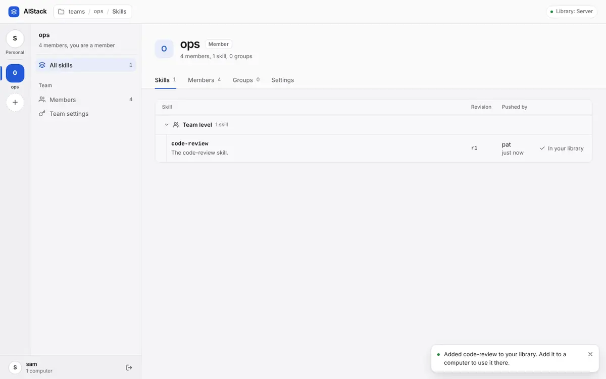
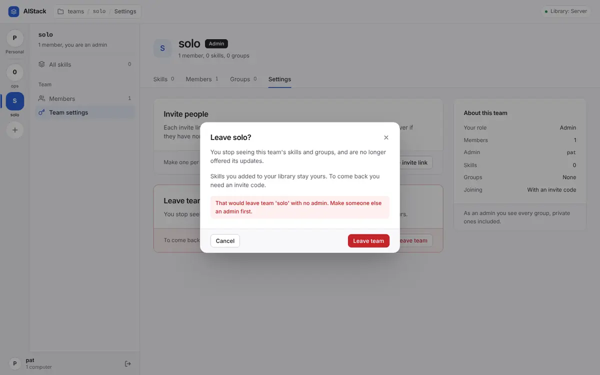
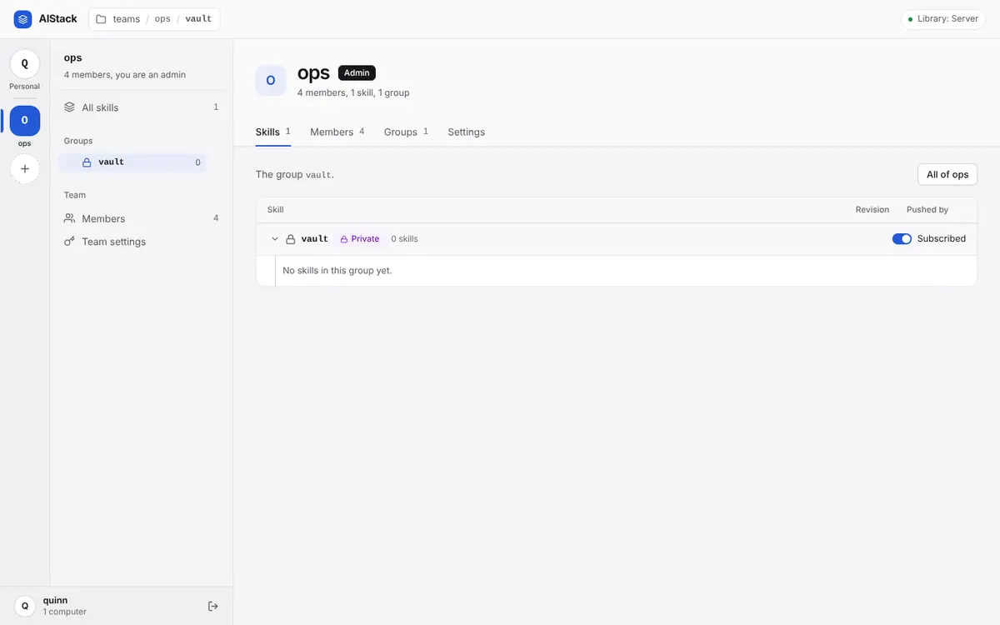

# Plot holes

Flows that dead-end, states the product cannot get out of, promises the documents make that the code does not keep, and what breaks between two computers, two releases, or a server and local mode.

How far this was checked: each finding below was reproduced or traced line by line by whoever raised it, and **Confirmed** means exactly that. The independent second pass that tries to refute each finding was done only for the authorization and UX findings; there was no time for the rest. Where a finding was re-checked separately, its entry says so. Treat **Suspected** findings, and anything marked High or Critical without a second pass, as needing a reproduction before the fix lands; the reproduction is described in each.

| Id | Finding | Severity | Status | Effort |
|---|---|---|---|---|
| [LH-01](#lh-01-local-mode-cannot-be-installed-aistack-mcp-is-not-on-pypi-and-no-release-has-ever-been-tagged) | Local mode cannot be installed: `aistack-mcp` is not on PyPI and no release has ever been tagged | Critical | Confirmed | S |
| [PH-01](#ph-01-taking-a-team-skill-whose-name-matches-one-of-your-own-silently-replaces-yours-on-every-computer) | Taking a team skill whose name matches one of your own silently replaces yours on every computer | High | Confirmed | M |
| [PH-02](#ph-02-invites-outlive-the-person-who-made-them-so-removed-members-and-people-taken-off-the-server-keep-letting-new-accounts-in) | Invites outlive the person who made them, so removed members and people taken off the server keep letting new accounts in | High | Confirmed | S |
| [LH-02](#lh-02-a-home-folder-restored-onto-a-new-computer-makes-two-computers-one-the-machine-id-and-on-a-server-the-token-travel-with-it) | A home folder restored onto a new computer makes two computers one: the machine id, and on a server the token, travel with it | Medium | Confirmed | M |
| [PH-03](#ph-03-sharing-an-edit-of-an-older-team-revision-silently-overwrites-a-teammates-newer-one) | Sharing an edit of an older team revision silently overwrites a teammate's newer one | Medium | Confirmed | S |
| [PH-04](#ph-04-a-team-or-group-can-never-be-deleted-or-renamed-a-lone-admin-can-never-leave-team-names-take-usernames-for-good) | A team or group can never be deleted or renamed; a lone admin can never leave; team names take usernames for good | Medium | Confirmed | M |
| [PH-05](#ph-05-taking-a-teams-only-admin-off-the-server-leaves-the-team-with-nobody-who-can-manage-it-and-operating-has-no-fix) | Taking a team's only admin off the server leaves the team with nobody who can manage it, and OPERATING has no fix | Medium | Confirmed | S |
| [PH-06](#ph-06-a-codex-only-second-computer-added-with-add_machine-never-gets-the-sync-skill-or-the-offer-of-the-library) | A Codex-only second computer added with add_machine never gets the sync skill or the offer of the Library | Medium | Confirmed | M |
| [PH-07](#ph-07-a-library-skill-follows-only-one-team-sharing-it-into-another-team-silently-ends-update-offers-from-the-team-it-came-from) | A Library skill follows only one team: sharing it into another team silently ends update offers from the team it came from | Medium | Confirmed | S |
| [PH-08](#ph-08-it-stays-in-your-history-is-a-promise-nothing-can-keep-no-tool-page-or-script-reads-or-restores-an-older-revision) | "It stays in your history" is a promise nothing can keep: no tool, page or script reads or restores an older revision | Medium | Confirmed | M |
| [PH-09](#ph-09-setup-step-1-stops-at-already-connected-for-any-aistack-connection-a-pasted-team-invite-is-dropped-and-another-server-or-local-mode-dead-ends) | Setup step 1 stops at "already connected" for any aistack connection: a pasted team invite is dropped, and another server or local mode dead-ends | Medium | Confirmed | S |
| [PH-10](#ph-10-a-setup-that-stops-after-join-locks-the-newcomer-out-the-re-run-refuses-the-used-invite-then-the-username) | A setup that stops after join locks the newcomer out: the re-run refuses the used invite, then the username | Medium | Confirmed | S |
| [PH-11](#ph-11-after-removing-a-skill-from-the-library-a-computer-that-never-decided-about-it-is-asked-enableskip-forever-and-the-skill-can-no-longer-be-found) | After removing a skill from the Library, a computer that never decided about it is asked enable/skip forever, and the skill can no longer be found | Low | Confirmed | S |
| [PH-12](#ph-12-an-admin-outside-a-private-group-sees-it-as-empty-gets-a-subscribe-switch-that-fails-and-can-remove-skills-by-name-they-cannot-see) | An admin outside a private group sees it as empty, gets a subscribe switch that fails, and can remove skills by name they cannot see | Low | Confirmed | S |
| [PH-13](#ph-13-owners-cannot-rename-or-remove-a-computer-and-nothing-shows-when-a-computer-last-synced) | Owners cannot rename or remove a computer, and nothing shows when a computer last synced | Low | Confirmed | M |
| [PH-14](#ph-14-readmes-move-to-a-teams-server-starts-with-an-export-that-cannot-see-a-github-or-postgresql-library-and-reports-exported-0-skills) | README's move to a team's server starts with an export that cannot see a GitHub or PostgreSQL Library and reports "Exported 0 skills" | Low | Confirmed | S |
| [PH-15](#ph-15-the-sync-tools-sync-skill-download-fails-on-exactly-the-computers-it-exists-for) | The sync tool's sync-skill download fails on exactly the computers it exists for | Low | Confirmed | S |
| [PH-16](#ph-16-a-username-is-permanent-shares-a-namespace-with-team-names-and-a-taken-one-is-always-explained-as-this-is-you-on-a-new-computer) | A username is permanent, shares a namespace with team names, and a taken one is always explained as "this is you on a new computer" | Low | Confirmed | S |
| [PH-17](#ph-17-design-operating-and-context-describe-a-server-that-has-since-changed) | DESIGN, OPERATING and CONTEXT describe a server that has since changed | Low | Confirmed | S |
| [PH-18](#ph-18-operating-has-no-restore-procedure-no-guidance-for-a-new-server-address-and-a-recovery-script-that-crashes-on-a-typo) | OPERATING has no restore procedure, no guidance for a new server address, and a recovery script that crashes on a typo | Low | Confirmed | S |

## Server mode, and what the documents promise

Server mode's basic loop works as the docs say. Join, add_machine, push, share, take, sync, restarts, and the five OPERATING.md scripts all behaved as documented on a fresh server (port 8150, SQLite). The 13-tool count and the dashboard route paths also match the code. The gaps are at the edges of a person's or a team's life. Taking a team skill whose name matches one of your own silently replaces yours on every computer. Sharing an edit made from an older revision silently overwrites a teammate's newer one. Invites keep working after the person who made them is removed from the team or taken off the server, so the documented off-boarding has a back door. Several states have no way out: a team whose only admin is also its only member, a team whose only admin was taken off the server, a mistyped group, a computer that is gone, a removed skill, and a newcomer whose first setup stopped after `join`. The docs promise a "history" that nothing can read, an add-my-Codex-computer flow that never delivers the sync skill, and a move-to-a-team's-server path that stops at setup step 1.

### PH-01: Taking a team skill whose name matches one of your own silently replaces yours on every computer

**Confirmed.** Severity **High**, effort **M**. Hurts: A member who already has their own skill with a common name (code-review, commit-messages) and clicks "Add to library" or says "install code-review from &lt;team&gt;"

**Where.** src/aistack/services/skill_service.py:203-223 (take_from_team stacks the team's revision on the user's existing, unrelated same-named skill); src/aistack/bundled/dashboard.html:1760-1767 and 1960-1966 ("Add to library" button and toast); src/aistack/services/reconciliation.py:97 (ENABLED+STALE updates without asking)

**What is wrong.** take_from_team looks the name up in the Library and adds the team's latest revision on top of whatever skill is there, even when it was never linked to that team. Sharing in the other direction is flagged as possibly_unrelated (ADR-0015:22); taking is not flagged at all. The team page offers "Add to library" because in_library is false. The toast then says "Added code-review to your library. Add it to a computer to use it there." In fact the skill is already placed on the user's computers, and each one replaces the user's own files with the teammate's at its next sync, reported only as an "update". The replaced version supposedly "stays in your history", but nothing can read that history (PH-08).

**How it was confirmed.** Ran &lt;scratch&gt;/plot-holes-server/p2_skills.py (section 1) against my own server on 8150. eve pushed her own code-review (rev 1) from her laptop, placed it on her desktop, and the desktop installed it. lead shared an unrelated code-review to team acme2. eve sent POST /api/teams/acme2/take {name: code-review} and got {"ok": true}. The desktop's sync, with eve's own copy on disk, then returned update code-review from_revision 1 to_revision 2, pushed_by lead, with no ask entry. p7_shots.py repeated this in Chromium: screenshot ph-take-over-own.png shows the toast. /api/state then showed revision 2 pushed_by pat, with the existing placement still there. Output is in p2.out.

Re-traced separately: `skill_service.take_from_team` (src/aistack/services/skill_service.py:203-223) calls `_find_or_create_skill` on the caller's personal team by name and stores the team's revision on top, with no check that the existing skill was ever linked to the team's (the check `share` makes for `possibly_unrelated`).

**Proposed fix.** In skill_service.take_from_team, when `mine` exists, is not archived, its source_skill_id is not this team skill, and its latest content hash differs from the team's, raise a Conflict unless the caller confirmed. The sentence should name the user's own skill, its revision, and the computers it is on, and say that taking the team's copy replaces it there at the next sync. Carry the confirmation as `replace: true` in the body of POST /api/teams/{team}/take and as an optional get_skill argument named in the Conflict sentence. On the dashboard, show a confirm dialog listing the affected computers before taking, and reword the toast when placements already exist. Document the new body key in DESIGN.md's route table.

**Done when.** A service test where a user has their own unrelated `x` placed on two machines: take_from_team without confirmation raises Conflict naming them, and with confirmation succeeds. A tests/ui test: clicking "Add to library" on a team skill whose name collides with one of your own shows a confirm dialog naming your computers.

Related: [PH-03](#ph-03-sharing-an-edit-of-an-older-team-revision-silently-overwrites-a-teammates-newer-one), [PH-08](#ph-08-it-stays-in-your-history-is-a-promise-nothing-can-keep-no-tool-page-or-script-reads-or-restores-an-older-revision), [UX-01](ux.md#ux-01-taking-a-team-update-replaces-the-persons-own-backed-up-edits-on-every-computer-and-the-offer-never-says-so), [UX-06](ux.md#ux-06-sharing-over-a-teammates-unrelated-namesake-is-flagged-only-afterwards-and-teammates-who-took-the-original-are-offered-it-as-an-ordinary-update), [UX-V01](ux.md#ux-v01-add-to-library-on-a-team-skill-named-like-an-unrelated-skill-of-your-own-replaces-yours-on-every-computer-with-no-warning-and-the-toast-says-added).

### PH-02: Invites outlive the person who made them, so removed members and people taken off the server keep letting new accounts in

**Confirmed.** Severity **High**, effort **S**. Hurts: The operator and team admins: OPERATING.md's "take them off the server" procedure leaves a door open for seven days, including for the leaver themselves

**Where.** src/aistack/services/team_service.py:133-150 (invited_to checks only the invite's own status), 325-332 and 499-504 (remove_member/_drop_member leave the member's invites), 317-322 (leave_team), 335-358 (set_member can_invite=False); docs/OPERATING.md:201-205

**What is wrong.** An invite stays valid whatever happens to its maker: removed from the team, left it, had can_invite revoked, or had every machine deleted by the operator. A member whose can_invite was revoked can no longer even see or cancel their own pending invites (_as_inviter refuses them). Each invite creates a server account (ADR-0019), so someone taken off the server can re-enter under a new username with an invite they made earlier; one sits in their chat transcript. Rotating AISTACK_INVITE_CODE, OPERATING's last step, does not touch team invites. The dashboard's "Remove member" dialog says nothing about this.

**How it was confirmed.** p1_teams.py: the admin let bob invite, bob made an invite, and the admin removed bob. The acme invites list still showed bob's invite as PENDING, and carol then ran `join` with it, getting a new account and acme membership (output in p1.out). p3_setup_ops.py, ops/delete_machine.py and p3_after.py, all under &lt;scratch&gt;/plot-holes-server/: ops/delete_machine.py is OPERATING's script extracted verbatim, with only the names set, and run as `python - < ops/delete_machine.py` with DATABASE_URL pointing at my s.db. User gone made an invite to gteam, and the operator deleted gone's only machine. gone's /api/state then answered 401, but `join` with gone's pending invite created the new account "newbie" as a member of gteam (p3.out).

**Proposed fix.** Add team_service._cancel_invites_by(session, team_id, user_id), which sets cancelled_on on that person's pending invites. Call it from _drop_member (covers remove and leave) and from set_member when a member loses the right to invite. In invited_to, also refuse an invite whose creator is no longer a team member allowed to invite, or has no machine left; that covers the operator's path without new scripts. Answer it with the same not-an-invite sentence (ADR-0022), so a dead code reads like any other. In OPERATING "Someone left", say that their pending invites stop working. Add one line to the dashboard's remove-member dialog.

**Done when.** Service tests: an invite made by a member who was then removed, who left, whose can_invite was revoked, or whose machines were all deleted is refused by both join and join_team with the not-an-invite sentence. An HTTP test that follows OPERATING's off-boarding steps finds no usable invite.

Related: [AUTHZ-01](security.md#authz-01-removing-demoting-or-offboarding-an-inviter-leaves-their-invite-links-working-so-the-person-can-rejoin-the-team-or-create-a-new-account-on-the-server), [DB-06](schema.md#db-06-a-team-invite-outlives-its-makers-right-to-invite-offboarding-by-deleting-machines-removal-from-the-team-and-revoking-can_invite-all-leave-it-working), [ENT-09](concurrency-and-reliability.md#ent-09-an-admin-is-told-an-invite-was-cancelled-while-the-same-invite-admits-its-holder), [SEC-06](security.md#sec-06-on-postgresql-an-admins-cancel-can-report-success-while-the-person-it-was-meant-to-stop-joins), [SEC-07](security.md#sec-07-a-used-team-invite-code-still-authenticates-as-a-bearer-so-used-and-unknown-codes-answer-differently).

### PH-03: Sharing an edit of an older team revision silently overwrites a teammate's newer one

**Confirmed.** Severity **Medium**, effort **S**. Hurts: Teammates whose change is dropped from the team's latest revision, and who are then offered the regression as an "update"

**Where.** src/aistack/services/skill_service.py:244-297 (share never compares mine.source_revision with the team's latest); src/aistack/bundled/dashboard.html:1783-1813 (the share dialog warns only on possibly_unrelated); src/aistack/mcp/tools/skills.py:113-139

**What is wrong.** A member takes revision 1, a teammate shares revision 2, and the member edits their revision-1 copy and shares it. That becomes revision 3 without revision 2's change, and nothing in the result says so: possibly_unrelated is false because the copies are linked. The teammate is then offered revision 3 as a team update, and accepting it replaces their own copy. The product added edited_from for exactly this case inside the Library (commit ed3e04f). Sharing has no equivalent, even though the sharer's own /api/state already showed update_available true.

**How it was confirmed.** Ran &lt;scratch&gt;/plot-holes-server/p9_share_over_newer.py. dim9 shared style-guide r1 and mar9 took it. dim9 shared r2, adding "rule B". mar9 pushed her r1-based edit ("rule C"); just before sharing, her Library entry showed source revision 1, latest_revision 2, update_available true. Her share returned revision 3, possibly_unrelated false, previous_pushed_by dim9, with no other flag. The team's latest is now mar9's content without rule B (p9.out).

**Proposed fix.** In skill_service.share, when the target exists and is linked (mine.source_skill_id == target.skill_id) and mine.source_revision &lt; the team's latest revision, return a fact such as `replaces_newer: {revision, pushed_by}`. Have the share_skill description tell the agent to say "this replaces revision 2 from dim9, which you never took". Have the dashboard's share dialog show the warning before submitting when s.source.update_available is true. This is additive and mirrors edited_from; no ADR change.

**Done when.** A service test: take r1, a teammate shares r2, share again, and the result carries replaces_newer with revision 2 and the teammate's name. A UI test: the share dialog for a skill with an update waiting shows the warning.

Related: [PH-01](#ph-01-taking-a-team-skill-whose-name-matches-one-of-your-own-silently-replaces-yours-on-every-computer), [PH-08](#ph-08-it-stays-in-your-history-is-a-promise-nothing-can-keep-no-tool-page-or-script-reads-or-restores-an-older-revision), [UX-01](ux.md#ux-01-taking-a-team-update-replaces-the-persons-own-backed-up-edits-on-every-computer-and-the-offer-never-says-so), [UX-06](ux.md#ux-06-sharing-over-a-teammates-unrelated-namesake-is-flagged-only-afterwards-and-teammates-who-took-the-original-are-offered-it-as-an-ordinary-update), [UX-V01](ux.md#ux-v01-add-to-library-on-a-team-skill-named-like-an-unrelated-skill-of-your-own-replaces-yours-on-every-computer-with-no-warning-and-the-toast-says-added).

### PH-04: A team or group can never be deleted or renamed; a lone admin can never leave; team names take usernames for good

**Confirmed.** Severity **Medium**, effort **M**. Hurts: Anyone who created a team to try it out or with a typo, admins with a mistyped group, and a newcomer whose handle was taken by someone's team

**Where.** src/aistack/services/team_service.py:317-322 and 487-496 (_keep_an_admin refuses even when the admin is the only member); src/aistack/api/dashboard.py:221-302 (no delete or rename route for a team or a group); src/aistack/bundled/dashboard.html:2350-2361 ("Leave team" offered to the lone admin) versus the demo mock at 2636-2641, which lets an only-member admin leave and drops the team; src/aistack/services/team_service.py:95-108; src/aistack/services/onboarding_service.py:56-68

**What is wrong.** An admin who is the team's only member is refused both leave and demote ("Make someone else an admin first"), and there is nobody else. No route deletes or renames a team or a group, so a test team or a mistyped group stays in every member's tree forever. The page's own demo API allows a lone admin to leave and removes the team, so the real server contradicts the dashboard's intended behaviour. Team names share the username namespace, so a team that can never go away also blocks that username forever.

**How it was confirmed.** p1_teams.py: a lone admin's POST /api/teams/acme/leave returned 409 "That would leave team 'acme' with no admin. Make someone else an admin first.", and self-demote returned the same. POSTs to /teams/acme/delete, /teams/acme/rename, /teams/acme/groups/backedn/remove and /teams/acme/group/remove all returned 404. owner created team "dave", and dave's `join` was refused as a taken username (p1.out). p7_shots.py screenshot ph-sole-admin-leave.png shows the dialog with the 409 text.

**Proposed fix.** Add team_service.delete_team(session, user_id, team), admin only. It deletes the team's skills through the same path as remove_skill (Library copies keep their revisions, ADR-0015), and its groups, invites and members by cascade. Let leave_team delete the team when the leaver is its only member, as the demo already does. Add delete_group, which moves the group's skills to its parent or to team level, and rename_group, which rewrites the path of the group and every group under it in one transaction. Expose them as /api/teams/{team}/delete, /api/teams/{team}/group/delete and /api/teams/{team}/group/rename, add them to DESIGN.md's route table, and add a Delete team card to team Settings.

**Done when.** A lone admin who is the only member can remove the team from Settings, and it disappears from /api/state, which frees the name. A mistyped group can be deleted or renamed. Tests in tests/services/test_team_service.py and tests/ui.

Related: [AUTHZ-05](security.md#authz-05-the-only-member-of-a-team-can-never-leave-it-and-no-team-can-be-deleted-the-pages-own-demo-lets-them), [PH-16](#ph-16-a-username-is-permanent-shares-a-namespace-with-team-names-and-a-taken-one-is-always-explained-as-this-is-you-on-a-new-computer), [UX-03](ux.md#ux-03-a-team-made-by-mistake-can-never-be-removed-its-only-member-cannot-leave-and-nothing-deletes-or-renames-a-team-or-group).

### PH-05: Taking a team's only admin off the server leaves the team with nobody who can manage it, and OPERATING has no fix

**Confirmed.** Severity **Medium**, effort **S**. Hurts: Every remaining member of a team whose admin left the company, and the operator, who has no documented remedy

**Where.** docs/OPERATING.md:201-205 (the "Someone left" procedure); src/aistack/services/team_service.py:487-496; CONTEXT.md "Team admin" ("a team always has one")

**What is wrong.** The documented off-boarding deletes the person's machines. If they were a team's only admin, the team keeps an admin row for someone who can never act again. No other member can invite, change roles, manage groups, or remove skills, and OPERATING has no script to hand the team over. The member list keeps showing that person as Admin, with no sign they are off the server.

**How it was confirmed.** p3_setup_ops.py plus the verbatim ops/delete_machine.py plus p3_after.py (paths under &lt;scratch&gt;/plot-holes-server/). gone was gteam's only admin and stay was a member. After the operator script removed gone's machine, stay's /api/state still listed gone as ADMIN. stay's POST /teams/gteam/invite, POST /teams/gteam/members/stay {role: ADMIN} and POST /teams/gteam/members/newbie/remove all returned 400 "Only an admin of team 'gteam' ..." (p3.out).

**Proposed fix.** Add to OPERATING "Someone left" a script that lists the teams where the person is the only admin, and a script that promotes a named member. Better, the script should call a new service function, team_service.hand_over(session, team_name, username), through build_engine, so it runs the same on SQLite and PostgreSQL. Optionally mark in /api/state teams[].members[] whether a member still has a computer, so the page can show "off the server".

**Done when.** OPERATING has a tested hand-over script. A test that takes a sole admin off the server and runs the documented steps leaves every team with an admin who has a computer.

Related: [AUTHZ-04](security.md#authz-04-the-team-keeps-an-admin-check-counts-first-and-writes-later-without-a-lock-on-postgresql-two-simultaneous-leaves-or-demotions-leave-a-team-with-no-admin), [AUTHZ-V01](security.md#authz-v01-offboarding-a-teams-only-admin-as-docsoperatingmd-says-leaves-the-team-with-an-admin-nobody-can-reach-and-no-way-to-name-a-new-one), [AUTO-13](automation.md#auto-13-the-documented-offboarding-leaves-a-team-whose-only-admin-left-with-no-admin-anyone-can-reach), [DB-05](schema.md#db-05-teams-can-be-left-with-no-admin-or-no-members-on-postgresql-the-last-admin-check-is-a-racy-count), [DB-07](schema.md#db-07-offboarding-a-teams-only-admin-leaves-the-team-permanently-unmanaged-and-no-operator-script-exists-to-repair-it), [ENT-01](concurrency-and-reliability.md#ent-01-two-admins-acting-at-once-on-postgresql-leave-a-team-with-no-admin).

### PH-06: A Codex-only second computer added with add_machine never gets the sync skill or the offer of the Library

**Confirmed.** Severity **Medium**, effort **M**. Hurts: Someone with two computers whose second one runs only Codex, Gemini CLI or another agent that reads ~/.agents/skills

**Where.** src/aistack/services/sync_service.py:172-174 (refresh only for claude_code, or where sync-aistack is already on disk); src/aistack/mcp/tools/sync.py:98 ("first_sync ... See the sync-aistack skill"); src/aistack/mcp/tools/onboarding.py:94-120; README.md:343 versus README.md:293; docs/DESIGN.md:195

**What is wrong.** add_machine now returns a Codex config.toml block and tells the user to start that agent and say "sync aistack". Nothing puts the sync skill on that computer: setup's step 2 never runs, and for the agents harness sync sends sync_skill_url only when sync-aistack is already in the folder. The first-sync offer of the Library's skills exists only in that skill (step 5), so the new computer reports nothing to do and never offers what the Library holds. DESIGN.md:195 credits sync_skill_url as how an add_machine computer gets the skill, which is false here. README's known limits (line 343) still say Codex-only computers cannot be added this way, contradicting line 293 and the code.

**How it was confirmed.** Ran &lt;scratch&gt;/plot-holes-server/p4_codex_only.py. kim pushed wizard and called add_machine (the result included codex_config). With the new token, sync(local={}, harness=agents) returned sync_skill_url null and first_sync true, and a second sync also returned null. list_skills showed wizard, but no field of the report offered it (p4.out).

**Proposed fix.** In sync_service.sync, also set refresh_sync_skill for the agents harness when this machine has never synced claude_code (no MachineHarness or MachineSkill row for it). On such a computer the connected agent is the one reading ~/.agents/skills, so ADR-0021's concern about telling unconnected agents to sync does not apply. Move the first-sync Library offer into the report as an additive field (for example `in_library_not_here: [names]` when first_sync), so it does not depend on the skill being loaded. Add to codex_config's instructions the same mkdir and curl that setup step 2 runs. Fix README.md:343 and DESIGN.md:195.

**Done when.** A test: add_machine, then sync(agents, {}) on a machine that never synced claude_code returns sync_skill_url and lists the Library's skills that are not on this computer. README no longer contradicts itself.

Related: [AUTO-09](automation.md#auto-09-a-computer-connected-with-add_machine-is-never-offered-the-session-start-hook-and-a-codex-only-one-never-gets-the-sync-skill), [PH-15](#ph-15-the-sync-tools-sync-skill-download-fails-on-exactly-the-computers-it-exists-for), [UX-07](ux.md#ux-07-a-second-computer-that-has-only-codex-never-gets-the-sync-skill-or-the-first-sync-library-offer-and-the-dashboard-shows-it-a-claude-code-folder-before-it-syncs).

### PH-07: A Library skill follows only one team: sharing it into another team silently ends update offers from the team it came from

**Confirmed.** Severity **Medium**, effort **S**. Hurts: A member in two teams who takes a skill from one and passes it on to the other

**Where.** src/aistack/services/skill_service.py:284-286 (share overwrites mine.source_skill_id and source_revision), 221-222 (take overwrites them likewise); src/aistack/services/sync_service.py:299-330; src/aistack/services/dashboard_service.py:35

**What is wrong.** A Library skill has one source pointer, and share and take both overwrite it without saying so. After taking lint-rules from acme2 and sharing it with beta2, acme2's later revisions are never offered again. Sync's team_updates is empty, the Library row's source shows beta2, and acme2's copy shows "Add to library" again, as if the user never had it. Taking the same name from a second team swaps the source the same way.

**How it was confirmed.** p2_skills.py (section 2), under &lt;scratch&gt;/plot-holes-server/. eve took lint-rules from acme2 with get_skill(team=acme2) and shared it with beta2, then lead shared v2 to acme2. eve's sync returned team_updates []. /api/state showed eve's source as {team: beta2}, and acme2's lint-rules had in_library false (p2.out).

**Proposed fix.** Smallest fix: in skill_service.share, do not overwrite a source that points into a different team. Only set source_skill_id when the copy has none or already points into this team, and say in the share result that updates still come from the original team. Fuller fix: an additive link table (personal skill to team skill, with revision) so a copy can follow several teams. That needs a migration with older_releases_compatible True, and a DESIGN.md update rather than a new ADR.

**Done when.** A test: take from team A, share to team B, A publishes r2, and sync offers A's r2 under team_updates.

### PH-08: "It stays in your history" is a promise nothing can keep: no tool, page or script reads or restores an older revision

**Confirmed.** Severity **Medium**, effort **M**. Hurts: Anyone who took a team's version over their own, accepted an offer by mistake, or pushed a bad edit

**Where.** README.md:338, src/aistack/bundled/skills/sync-aistack/SKILL.md:122, docs/adr/0015-teams-and-groups.md:45 (the promise); src/aistack/services/skill_service.py:162-200 (get_skill always uses _latest_version) and 338-373 (archive_of serves only the revision a ticket was minted for); src/aistack/api/dashboard.py (no history route); src/aistack/services/dashboard_service.py (latest revision only)

**What is wrong.** README, ADR-0015 and the sync skill all present history as the safety net ("taking the team's replaces your latest, which stays in your history"; "older revisions stay in the history"). In practice a download ticket is minted only for the latest revision, and no tool, dashboard route or OPERATING script lists or restores an older one. Once sync has replaced the folders, the user's version is gone from every place they can reach.

**How it was confirmed.** Traced the code paths above. In p2_skills.py, after PH-01's take, eve's revision 1 still exists in skill_version, but get_skill returns revision 2, /api/state shows only revision 2, and DownloadTicket is signed only inside get_skill for the latest skill_version_id (src/aistack/mcp/tools/skills.py:281-288).

**Proposed fix.** Add a read-only revision list for one of the user's own skills, as revisions[] in the skill panel or a GET route. Add a restore action, skill_service.restore_revision(session, user_id, name, revision), that stores revision N's files as a new latest revision pushed_by the user. That keeps versions immutable and is not version pinning, so no ADR is reversed. Expose it as POST /api/skills/{name}/restore with body {revision}, and list it in DESIGN.md. Until then, remove the history promise from README.md:338 and SKILL.md:122.

**Done when.** A UI test: after taking a team's version over your own, the skill panel lists revision 1, and Restore creates revision 3 with revision 1's content, which the next sync installs.

Related: [PH-01](#ph-01-taking-a-team-skill-whose-name-matches-one-of-your-own-silently-replaces-yours-on-every-computer), [PH-03](#ph-03-sharing-an-edit-of-an-older-team-revision-silently-overwrites-a-teammates-newer-one), [UX-01](ux.md#ux-01-taking-a-team-update-replaces-the-persons-own-backed-up-edits-on-every-computer-and-the-offer-never-says-so), [UX-06](ux.md#ux-06-sharing-over-a-teammates-unrelated-namesake-is-flagged-only-afterwards-and-teammates-who-took-the-original-are-offered-it-as-an-ordinary-update), [UX-V01](ux.md#ux-v01-add-to-library-on-a-team-skill-named-like-an-unrelated-skill-of-your-own-replaces-yours-on-every-computer-with-no-warning-and-the-toast-says-added).

### PH-09: Setup step 1 stops at "already connected" for any aistack connection: a pasted team invite is dropped, and another server or local mode dead-ends

**Confirmed.** Severity **Medium**, effort **S**. Hurts: An existing user who follows a team invite link's main instruction; someone using local mode, or another server, who is invited to a team; anyone following README's move-to-a-team's-server path

**Where.** src/aistack/bundled/setup-aistack.md:17-33; src/aistack/mcp/routes/invite.py:57-67; README.md:30 and 345; src/aistack/bundled/local/setup.md:9 and 69 (local mode registers under the same name, aistack)

**What is wrong.** The invite page leads with "Set up AIStack: fetch &lt;server&gt;/setup and follow it. Invite code: aistinv_...". Setup step 1 runs `claude mcp get aistack`, and if any server answers, it says "stop. This computer is already connected... they can say sync aistack". Nothing then uses the aistinv_ code the user pasted: an already-connected user is never put in the team, and is told everything is fine. Step 1 does not compare the address, so a computer on another server, or in local mode (same MCP name), is told it is connected and to sync, though it is syncing somewhere else. README.md:30's move to a team's server ("Then connect that computer to the server") stops at the same step, and nobody tells the user to remove the local connection first.

**How it was confirmed.** Traced the served text: GET http://127.0.0.1:8150/setup contains the step-1 wording at setup-aistack.md:31-33, and the invite page body is invite.py:57-67. Local mode adds `claude mcp add --scope user ... aistack -- <aistack-mcp>` (local/setup.md:69), so `claude mcp get aistack` succeeds there too. README.md:30 has no `claude mcp remove` step. Agent behaviour itself was not run.

**Proposed fix.** Rewrite setup-aistack.md step 1 for three cases. (1) The server shown is {mcp_url} and the user gave an aistinv_ code: call join_team with it, or tell them to say "join a team with this code". (2) It is a different address or a stdio command: tell the user plainly that this computer uses another AIStack, that one computer belongs to one server (README.md:345), and how to switch (`claude mcp remove aistack --scope user`, after `aistack-mcp export` for local mode). (3) Otherwise stop as now. Add the remove step to README.md:30.

**Done when.** The /setup text covers the three cases. A test on the setup route asserts that step 1 mentions join_team and a different address.

Related: [AUTO-11](automation.md#auto-11-running-setup-in-the-second-agent-on-an-already-connected-computer-registers-the-same-computer-twice-and-the-two-then-undo-each-other), [AUTO-21](automation.md#auto-21-joining-drops-the-name-the-person-gave-and-asks-questions-local-mode-answers-itself), [ENT-11](concurrency-and-reliability.md#ent-11-a-lost-join-response-locks-a-newcomer-out-of-their-username), [PH-10](#ph-10-a-setup-that-stops-after-join-locks-the-newcomer-out-the-re-run-refuses-the-used-invite-then-the-username), [UX-11](ux.md#ux-11-joining-asks-for-the-name-you-want-to-go-by-but-join-needs-a-lowercase-username-and-has-no-place-for-the-full-name), [UX-12](ux.md#ux-12-an-existing-user-who-pastes-the-invite-pages-setup-sentence-may-never-be-put-in-the-team-setup-has-no-branch-for-a-team-code).

### PH-10: A setup that stops after join locks the newcomer out: the re-run refuses the used invite, then the username

**Confirmed.** Severity **Medium**, effort **S**. Hurts: A newcomer invited by link whose first setup was interrupted between step 3 (join) and step 4 (connect the agent)

**Where.** src/aistack/services/onboarding_service.py:47-68 (the invite is resolved before the username check, then the username Conflict); src/aistack/services/team_service.py:133-150; src/aistack/bundled/setup-aistack.md:63-73 and 99

**What is wrong.** The token appears once, in a response file that setup tells the agent to delete. If the session ends or step 4 fails, a re-run of setup with the same link is told the invite does not work and to ask for a new one. With a new link, the username is taken, and both the error and setup step 3 say to "add my other computer" from a computer that is already connected, which this person does not have. The only ways out are the operator's rotate script, which nothing points them to, or a new username, which leaves a ghost account in the team for good.

**How it was confirmed.** Ran &lt;scratch&gt;/plot-holes-server/p6_rerun_setup.py. zed joined with team6's invite and the token was discarded. Re-joining with the same invite returned "That is not a team invite code that works... ask someone in the team for a new one." A fresh invite, with the same or a different machine name, returned "Username 'zed' is already taken... add the machine from a computer that is already registered", and so did the server's own code (p6.out).

**Proposed fix.** setup-aistack.md: delete the response file only after `claude mcp get aistack` or `codex mcp get aistack` succeeds; on a re-run, look for a leftover response file before calling join again. Add the first-computer case to the username-taken advice: if this is your only computer, ask whoever runs the server to issue a new token (OPERATING's rotate script). Point OPERATING's rotate section at this case too. Do not let a used invite re-authenticate an account: that would let any holder of a used link take the account over.

**Done when.** The setup text and the username-taken guidance name a path that works for someone with no connected computer. A re-run after a simulated failure in step 4 completes from the saved response.

Related: [AUTO-11](automation.md#auto-11-running-setup-in-the-second-agent-on-an-already-connected-computer-registers-the-same-computer-twice-and-the-two-then-undo-each-other), [AUTO-21](automation.md#auto-21-joining-drops-the-name-the-person-gave-and-asks-questions-local-mode-answers-itself), [ENT-11](concurrency-and-reliability.md#ent-11-a-lost-join-response-locks-a-newcomer-out-of-their-username), [PH-09](#ph-09-setup-step-1-stops-at-already-connected-for-any-aistack-connection-a-pasted-team-invite-is-dropped-and-another-server-or-local-mode-dead-ends), [UX-11](ux.md#ux-11-joining-asks-for-the-name-you-want-to-go-by-but-join-needs-a-lowercase-username-and-has-no-place-for-the-full-name), [UX-12](ux.md#ux-12-an-existing-user-who-pastes-the-invite-pages-setup-sentence-may-never-be-put-in-the-team-setup-has-no-branch-for-a-team-code).

### PH-11: After removing a skill from the Library, a computer that never decided about it is asked enable/skip forever, and the skill can no longer be found

**Confirmed.** Severity **Low**, effort **S**. Hurts: A user with the skill's folder on a computer that never chose it; a user who removed a skill by mistake

**Where.** src/aistack/services/skill_service.py:300-314 (remove only updates existing machine_skill rows) and 177-179 (get_skill with removed_too un-removes); src/aistack/services/sync_service.py:276-296; src/aistack/services/reconciliation.py:109-112; src/aistack/services/visibility.py:52-68 and 66-67; src/aistack/bundled/dashboard.html:1818-1824; docs/DESIGN.md:134; docs/adr/0015-teams-and-groups.md:30

**What is wrong.** DESIGN and ADR-0015 say every machine is asked whether to delete the folder. A computer with no decision row instead gets an undecided ask with options enable or skip: no remove option, nothing saying the skill was removed, and the same ask on every sync. Choosing "enable" quietly puts the skill back in the Library. disable_skill refuses because the skill was never enabled there. The removed skill is gone from list_skills and the dashboard, and share_skill says "You have no skill named 'wizard'", yet get_skill with the exact name restores it. No surface tells the user that.

**How it was confirmed.** p2_skills.py (section 3): the desktop held an identical notes folder with no decision, and its ask stayed undecided with enable/skip before and after POST /api/skills/notes/remove; disable_skill returned "was never enabled on this machine". p8_restore.py: after removing wizard, list_skills returned [] and /api/state had no skills; share_skill returned "You have no skill named 'wizard'"; get_skill(name=wizard) returned revision 2, and wizard was back in list_skills (outputs p2.out, p8.out under &lt;scratch&gt;/plot-holes-server/).

**Proposed fix.** In sync_service, treat an archived skill as Desired.DISABLED on every machine, whether or not a row exists. That is an input to the reconciliation table, not a new `if` on the verdict, so the table's invariant tests hold. Add an additive `removed_from_library` field to the Question, so the agent can say why it is asking. Add a "Removed" filter to the Library page with a Restore action calling the same service as get_skill's un-remove. Reword required_my_skill's not-found sentence for an archived skill.

**Done when.** A test: an archived skill plus a computer with no decision plus the folder on disk is asked with a remove option and removed_from_library true. A UI test shows removed skills and restores one.

### PH-12: An admin outside a private group sees it as empty, gets a subscribe switch that fails, and can remove skills by name they cannot see

**Confirmed.** Severity **Low**, effort **S**. Hurts: A team's second admin

**Where.** src/aistack/services/visibility.py:85-124 (role is not considered, only sees_all_groups); src/aistack/services/team_service.py:284-297 (admins are listed every group), 300-314 (set_subscribed requires the group to be visible), 420-433 (remove_skill by name with no visibility check); src/aistack/bundled/dashboard.html:1954 and 2340

**What is wrong.** Team Settings tells an admin "As an admin you see every group, private ones included." The admin is listed every group, but sees no skills in a private group they were not added to. The page shows "0 skills" and "No skills in this group yet." for a group that holds skills. Its Subscribed switch answers 404 "Team 'sec' has no group 'vault'" for a group the admin is looking at. Yet the admin can remove that group's skills through the API by guessing their names.

**How it was confirmed.** Ran &lt;scratch&gt;/plot-holes-server/p5_groups.py. ann created the private group vault and added mo; mo shared secret-skill into it. Admin ben's /api/state listed the vault group with skills []. His POST /teams/sec/group {path: vault, subscribed: false} returned 404 "Team 'sec' has no group 'vault'.", and POST /teams/sec/skills/secret-skill/remove returned 200. p7_shots.py screenshot ph-admin-private-group.png shows the empty group.

**Proposed fix.** Keep who sees what as ADR-0015 has it, but make the page honest. Send admins a private group they are not in as `member: false, visible: false`, with no skill count; show "Private: add yourself to see its skills" and an add-yourself action instead of the empty hint, with no subscribe switch. In team_service.move_skill and remove_skill, refuse a skill the admin cannot see with the same NotFound, through visibility.team_skill.

**Done when.** An admin outside a private group sees it marked as not joined, with no "No skills" hint and no switch. A test shows remove on a skill they cannot see answers like a missing one.

### PH-13: Owners cannot rename or remove a computer, and nothing shows when a computer last synced

**Confirmed.** Severity **Low**, effort **M**. Hurts: Anyone who replaced or reinstalled a laptop: the old one stays on the dashboard, still taking placements, until the operator deletes it

**Where.** src/aistack/api/dashboard.py:181-302 (no machine route besides placements); src/aistack/services/dashboard_service.py:126-147 (no last_synced_on); src/aistack/services/sync_service.py:250-267 (writes last_synced_on, which nothing reads); src/aistack/services/onboarding_service.py:124-130 (names unique per user); README.md:133 and 347

**What is wrong.** README says sync records when each folder last synced, but that value is written and never read by any route, tool, page or script. A computer that will never sync again looks the same as one that synced an hour ago, and "Add to computer" still promises the skills arrive "at the next sync" there. The owner cannot rename it (a reinstall needs a new name, because names are unique per user) or remove it. The only remedy is an operator script, though removing one's own computer is not server administration.

**How it was confirmed.** Searched for last_synced_on: it appears only at sync_service.py:262 and 266 and in the model. POSTs to invented rename and remove routes return 404 (p1). /api/state machines carry only id, name, os and harnesses.

**Proposed fix.** Add last_synced_on per harness to /api/state machines[].harnesses (additive) and show "Last synced …" or "Never synced" on the computer page. Add owner-scoped POST /api/machines/{machine_id}/rename and /remove through new dashboard_service functions that look the machine up by id and user_id, as set_on_machine does. Refuse to remove the computer the session's own user would lose last, or warn. Document both in DESIGN.md.

**Done when.** A UI test: a computer shows when it last synced. Removing it drops it from /api/state, and its token then answers 401.

Related: [AUTO-02](automation.md#auto-02-on-a-server-a-person-cannot-cut-off-their-own-lost-or-stolen-computer), [AUTO-20](automation.md#auto-20-computers-cant-be-renamed-or-removed-and-a-reinstall-leaves-vm-and-vm-2-forever), [IMP-06](improvements.md#imp-06-the-dashboard-cannot-say-when-a-computer-last-synced-or-which-revision-it-holds), [IMP-09](improvements.md#imp-09-a-person-cannot-retire-revoke-or-rename-their-own-computer-only-the-operator-can), [SEC-01](security.md#sec-01-a-stolen-machine-token-outlives-the-documented-revocation-sibling-tokens-dashboard-sessions-and-upload-urls-keep-working), [STD-04](industry-standards.md#std-04-a-person-cannot-see-when-each-computer-last-connected-or-remove-a-lost-one-and-a-stolen-tokens-push-lands-silently-on-their-other-computers).

### PH-14: README's move to a team's server starts with an export that cannot see a GitHub or PostgreSQL Library and reports "Exported 0 skills"

**Confirmed.** Severity **Low**, effort **S**. Hurts: A local-mode user with a Library on GitHub or PostgreSQL who follows README.md:30 to join a team's server

**Where.** README.md:30; src/aistack/bootstrap/__main__.py:146-172 and 217 (LocalSettings is read from the environment only, falling back to ~/.aistack/aistack.db); src/aistack/bundled/local/setup.md:69 (the Library's settings live only in the agent's MCP config)

**What is wrong.** README says to run `aistack-mcp export` on a computer that has the Library. From a shell, the AISTACK_LIBRARY_REPO or AISTACK_DATABASE_URL that local setup put in the agent's MCP config is absent. Export then creates a new, empty Library on this computer, registers the computer in it, and prints "Exported 0 skills" with no hint why. The local sync skill does say to pass the settings that `claude mcp get aistack` shows; README does not.

**How it was confirmed.** From &lt;scratch&gt;/plot-holes-server/exp, ran `env -i HOME=<that folder>/home PATH=/usr/bin:/bin <poetry venv>/bin/aistack-mcp export`. It printed "Exported 0 skills to aistack-library." and created home/.aistack/aistack.db and machine-id.

**Proposed fix.** In export_library, refuse when the Library is new: check before build_local_context whether the SQLite file exists, or whether the Library has a user. Answer with a sentence naming AISTACK_LIBRARY_REPO and AISTACK_DATABASE_URL and `claude mcp get aistack`, and create nothing. Reword README.md:30 to match the local sync skill's move steps, including removing the old connection (PH-09).

**Done when.** A test: export with no Library configured exits with that sentence and leaves no ~/.aistack behind.

Related: [AUTO-03](automation.md#auto-03-terminal-commands-silently-open-a-different-empty-library-unless-the-agents-settings-are-repeated), [AUTO-05](automation.md#auto-05-after-moving-a-library-the-other-computers-stop-at-setup-step-1-and-quietly-stay-on-the-old-one), [AUTO-06](automation.md#auto-06-moving-a-library-is-a-hand-re-import-that-loses-history-placements-and-removals-though-publishing-the-existing-log-already-works), [UX-18](ux.md#ux-18-the-move-here-dialog-says-the-same-thing-for-every-destination-wrong-for-only-this-computer-silent-on-history-and-restart).

### PH-15: The sync tool's sync-skill download fails on exactly the computers it exists for

**Confirmed.** Severity **Low**, effort **S**. Hurts: A second computer connected with add_machine, which never ran setup

**Where.** src/aistack/mcp/tools/sync.py:96-97; docs/DESIGN.md:140 and 195; src/aistack/mcp/tools/onboarding.py:94-120

**What is wrong.** For a missing sync skill, the tool tells the agent to `curl -sS -o <folder>/sync-aistack/SKILL.md`. On an add_machine computer, the only kind without the skill, that folder does not exist, and curl does not create it. Suspected: add_machine also skips setup step 2's "create the skills directory first". By DESIGN.md:140, a skills folder created after Claude Code started is not watched, so what the first sync installs there may not load until a restart.

**How it was confirmed.** `curl -sS -o <scratch>/plot-holes-server/curltest/skills/sync-aistack/SKILL.md http://127.0.0.1:8150/setup/sync-aistack/SKILL.md` printed "curl: (23) Failure writing output to destination" and exited 23. The live-load part was not run (it needs Claude Code).

**Proposed fix.** Change the tool text to "mkdir -p &lt;folder&gt;/sync-aistack, then curl -sS -o ...", or use `curl --create-dirs`. In add_machine's description, have the agent tell the user to create ~/.claude/skills (or ~/.agents/skills) before starting the agent on the new computer, as setup step 2 does.

**Done when.** The sync tool description includes the mkdir, a test asserts it, and add_machine's description names the folder to create.

Related: [AUTO-09](automation.md#auto-09-a-computer-connected-with-add_machine-is-never-offered-the-session-start-hook-and-a-codex-only-one-never-gets-the-sync-skill), [PH-06](#ph-06-a-codex-only-second-computer-added-with-add_machine-never-gets-the-sync-skill-or-the-offer-of-the-library), [UX-07](ux.md#ux-07-a-second-computer-that-has-only-codex-never-gets-the-sync-skill-or-the-first-sync-library-offer-and-the-dashboard-shows-it-a-claude-code-folder-before-it-syncs).

### PH-16: A username is permanent, shares a namespace with team names, and a taken one is always explained as "this is you on a new computer"

**Confirmed.** Severity **Low**, effort **S**. Hurts: A newcomer whose handle is taken by a team, or whose agent picked a handle they dislike

**Where.** src/aistack/services/onboarding_service.py:54-68; src/aistack/services/team_service.py:95-108; no rename path anywhere

**What is wrong.** join reports a team-name collision with the same sentence as a user-name collision ("if this is you on a new computer, add the machine..."), which misleads a newcomer whose name is a team's. Nothing renames a user, not even an operator script, although provenance references user_id, so a rename would keep every pushed_by intact. Setup's "Call me &lt;your name&gt;" leaves the agent to derive the handle.

**How it was confirmed.** p1_teams.py: owner created team "dave"; dave's join with the server code returned "Username 'dave' is already taken. Pick a different one, or, if this is you on a new computer, add the machine..." (p1.out).

**Proposed fix.** In onboarding_service.join, tell the two IntegrityErrors apart by checking whether a User or a Team holds the name, and word each. Add an OPERATING script, through a service function, that renames a user and their personal team together. Document that a handle is otherwise permanent.

**Done when.** Joining with a name a team holds says a team uses it. OPERATING has a tested rename script.

Related: [AUTHZ-05](security.md#authz-05-the-only-member-of-a-team-can-never-leave-it-and-no-team-can-be-deleted-the-pages-own-demo-lets-them), [PH-04](#ph-04-a-team-or-group-can-never-be-deleted-or-renamed-a-lone-admin-can-never-leave-team-names-take-usernames-for-good), [UX-03](ux.md#ux-03-a-team-made-by-mistake-can-never-be-removed-its-only-member-cannot-leave-and-nothing-deletes-or-renames-a-team-or-group).

### PH-17: DESIGN, OPERATING and CONTEXT describe a server that has since changed

**Confirmed.** Severity **Low**, effort **S**. Hurts: Anyone writing a client against the documented API, and operators reading OPERATING

**Where.** docs/DESIGN.md:319 (members route without can_invite) versus src/aistack/api/dashboard.py:252-259; docs/DESIGN.md:331-375 (the /api/state sample lacks teams[].can_invite and teams[].invites) versus src/aistack/services/dashboard_service.py:48 and 67-73; docs/DESIGN.md:284 ("the server-wide one last", retired by ADR-0019); docs/DESIGN.md:71 and 555 ("No CLI") versus the setup, export, github and check commands; docs/OPERATING.md:203 ("ends within eight hours"); docs/OPERATING.md:34 and CONTEXT.md "Admin" (is_admin is written once and never read)

**What is wrong.** DESIGN.md says the route table exists so the page is not the only way to learn the routes, but a documented route takes a key the table omits, and /api/state returns fields the sample lacks. OPERATING says a removed person's dashboard session lasts up to eight hours; the server actually closes it immediately (require_a_machine). OPERATING asks the operator to join first so they become the server's admin, but no code reads is_admin, so that role grants nothing.

**How it was confirmed.** Read the docs against the code. p3_after.py showed gone's session answering 401 immediately after the operator script. Searching for is_admin found only the write at onboarding_service.py:149-172 and a log line.

**Proposed fix.** Update DESIGN.md's route table and /api/state sample, drop the stale rail and "No CLI" sentences, correct OPERATING.md:203, and say plainly in OPERATING and CONTEXT that is_admin has no effect today. Extend tests/api/test_dashboard_routes_are_documented.py to compare body keys, and add a test comparing /api/state's keys with the documented sample.

**Done when.** The extended route test fails on a body key missing from the table and passes once the docs are updated.

Related: [IMP-10](improvements.md#imp-10-designmd-the-document-that-wins-on-conflict-contradicts-the-code-in-a-dozen-places), [IMP-14](improvements.md#imp-14-readme-has-drifted-adr-list-size-claims-a-stale-known-limit-a-built-roadmap-item-and-old-screenshots).

### PH-18: OPERATING has no restore procedure, no guidance for a new server address, and a recovery script that crashes on a typo

**Confirmed.** Severity **Low**, effort **S**. Hurts: The operator after an upgrade they regret, after moving the server, or while recovering a locked-out user

**Where.** docs/OPERATING.md:232-247 (backup only), 270 and 295 ("The way back ... is the backup"), 180-197 (the no-machine-left script); docs/OPERATING.md:50-82 (choosing an address, nothing about changing it)

**What is wrong.** OPERATING tells the operator to back up before upgrading. After a breaking migration, older releases refuse to start (ADR-0024), so the backup is the only way back, and there are no steps to restore it into the volume or into PostgreSQL. The no-machine-left script crashes with AttributeError on a mistyped username, and unlike the rotate section it prints a token without the reconnect command. Moving the server (from Tailscale to a VPS, say) strands every computer, whose MCP configuration holds the old address, and nothing explains what each computer should change.

**How it was confirmed.** Extracted the five OPERATING scripts verbatim into &lt;scratch&gt;/plot-holes-server/ops/ and ran each as `python - < script` with DATABASE_URL pointing at my s.db while the server ran. List users, list teams, delete machine, no-machine-left and rotate all worked on SQLite. ops/no_machine_left_typo.py raised "AttributeError: 'NoneType' object has no attribute 'user_id'". PostgreSQL could not be checked, because 127.0.0.1:5433 was down during this audit.

**Proposed fix.** Add a Restore section: stop the container, copy the backup into the volume with a helper container (docker run --rm -v aistack-data:/data ...), then start the image that matches the backup; for PostgreSQL, pg_restore. Make each script print "No user named X" instead of crashing. Append the claude mcp add command and the Codex block to the no-machine-left section. Add a "Changing the server's address" section: on each computer, `claude mcp get aistack` shows the current header; remove and re-add the connection with the new URL and the same token.

**Done when.** OPERATING has Restore and address-change sections that were run against a real database. The scripts exit with a sentence on unknown names.

Related: [AUTO-16](automation.md#auto-16-an-upgrade-relies-on-the-operator-remembering-to-back-up-first-the-server-could-snapshot-sqlite-itself-before-migrating), [STD-01](industry-standards.md#std-01-a-stopped-servers-data-lives-in-aistackdb-wal-and-the-obvious-restore-or-the-promised-upgrade-rollback-silently-restores-nothing).

## Local mode and moving between modes

Local mode did not get a pass of its own in this audit. Its log, clock and rebuild problems were found in the concurrency work and are in [concurrency-and-reliability.md](concurrency-and-reliability.md) (ENT-03, ENT-06); its setup, terminal commands and moving a Library are in [automation.md](automation.md) (AUTO-01, AUTO-03, AUTO-05 to AUTO-08, AUTO-12, AUTO-19). What follows is a smaller pass that ran local mode over stdio and the localhost dashboard in a scratch home.

### LH-01: Local mode cannot be installed: `aistack-mcp` is not on PyPI and no release has ever been tagged

**Confirmed.** Severity **Critical**, effort **S**. Hurts: every newcomer who follows the README: three of the four places a Library can live start with `uvx aistack-mcp setup`, and each further computer with `uv tool install aistack-mcp`

**Where.** README.md:20-26 (`uvx aistack-mcp setup`), src/aistack/bundled/local/setup.md (step 3, `uv tool install aistack-mcp`), the dashboard's Add a computer and Move here dialogs, src/aistack/bootstrap/self_update.py (upgrades from PyPI), .github/workflows/tests.yaml:263-294 (the `pypi` job runs only on a `v*` tag)

**What is wrong.** The README leads with local mode, and local mode exists only on PyPI, where the name `aistack-mcp` has never been published. `https://pypi.org/pypi/aistack-mcp/json` answers 404, and `origin` has no tags, so the publishing job has never run. A newcomer's agent runs `uvx aistack-mcp setup`, gets 'not found', and either stops or improvises. The self-updater has nothing to update from, so ADR-0024's 'restarting the agent fetches the update' is not true for anyone either. The container image is published (`ghcr.io/dchristopoulos/aistack:latest` resolves), so server mode is the only way in that works today, and it is the one the README presents last.

**How it was confirmed.** `curl -s -o /dev/null -w '%{http_code}' https://pypi.org/pypi/aistack-mcp/json` printed 404 on 2026-10-15, and so did the simple index. `git ls-remote origin` lists branches and pull refs and no tags. The `pypi` job's `if: startsWith(github.ref, 'refs/tags/v')` and its `test "$GITHUB_REF_NAME" = "v$(poetry version -s)"` step mean nothing publishes without a `v0.1.0` tag. The image manifest for `latest` answered 200 from ghcr.io.

**Proposed fix.** Claim the name today: tag `v0.1.0` on a green `main` so the `pypi` job publishes, after the Windows job is made a gate (IMP-01) and PyJWT is bumped (STD-07). Until it is published, make every sentence that installs it work from the repository instead (`uvx --from git+https://github.com/dchristopoulos/AIStack aistack-mcp setup`), which IMP-05 found already runs. Add a CI check that fails when the README's install command does not resolve, so a rename or a yanked release is caught.

**Done when.** In a fresh container with only uv, `uvx aistack-mcp setup` prints the setup steps, and `uv tool install aistack-mcp` installs a command whose `--help` lists `github`. PyPI shows `aistack-mcp` owned by the project.

Related: [AUTO-19](automation.md#auto-19-every-way-to-set-up-another-computer-in-local-mode-and-the-self-updater-depend-on-pypi), [IMP-01](improvements.md#imp-01-the-windows-job-gates-neither-merging-nor-publishing-and-local-mode-then-updates-itself-from-pypi), [IMP-05](improvements.md#imp-05-setup-can-run-from-github-today-but-the-steps-it-prints-still-install-from-pypi-follows-from-the-known-missing-release), [STD-02](industry-standards.md#std-02-the-pypi-name-every-setup-sentence-runs-aistack-mcp-is-unregistered-and-anyone-can-take-it), [UX-10](ux.md#ux-10-the-dashboard-and-the-local-sync-skill-hand-out-uvx-aistack-mcp-setup-and-uv-tool-install-aistack-mcp-which-fail-today).

### LH-02: A home folder restored onto a new computer makes two computers one: the machine id, and on a server the token, travel with it

**Confirmed.** Severity **Medium**, effort **M**. Hurts: someone who sets up a new laptop from a backup or with Migration Assistant and keeps using the old one for a while, in local mode or on a server

**Where.** src/aistack/bootstrap/context/application_context.py:144 and :244-262 (`_claimed_machine_id` reads `~/.aistack/machine-id`), src/aistack/services/local_identity.py:18-44; on a server the token in `~/.claude.json` and `~/.codex/config.toml`

**What is wrong.** A computer's identity is a file in the home folder: `AISTACK_HOME/machine-id` in local mode, the machine token in the agent's configuration on a server. Nothing ties either to the hardware. Restore a home folder onto a new computer, which is what Migration Assistant, Time Machine and a dotfiles sync all do, and the new computer is the old one to AIStack: one row in `machine`, one set of placements, one `machine_harness` row whose `first_sync` has already happened, one folder in a GitHub Library's log. A skill placed on one appears on both; removing one from the dashboard (once that exists, AUTO-02) removes both; the dashboard shows one computer. The person never learns why.

**How it was confirmed.** Traced: `build_local_context` calls `_claimed_machine_id(settings.home / _MACHINE_ID_FILE)`, which returns whatever UUID the file holds (`_read_machine_id`) and only mints one when the file is missing. `local_machine` then finds that machine row and returns it. No hardware fact is read for a known machine (the hardware model is read only to name a new one). The effect on two physical computers was not run here.

**Proposed fix.** Store beside the id a one-way fingerprint of the hardware (macOS `IOPlatformUUID`, Linux `/etc/machine-id`, Windows `MachineGuid`, hashed with the id as salt). On a mismatch, claim a new id, register it as a new computer named by its model, and report it once in the next sync's result (`new_computer: true`, the agent says 'this looks like a new computer restored from another one's backup'). On a server, record the fingerprint hash on `machine` (a nullable column, compatible) and have `sync` refuse with one sentence and the add_machine path when the fingerprint changes.

**Done when.** A test copies one computer's `AISTACK_HOME` into a second home with a different fingerprint, starts local mode there, and finds a second `machine` row; the original keeps its own placements.

Related: [AUTO-20](automation.md#auto-20-computers-cant-be-renamed-or-removed-and-a-reinstall-leaves-vm-and-vm-2-forever).

## Checked and holding up

- The "thirteen tools" claim holds: a machine token lists 12 tools and the server's invite code lists only join (p1).
- Every DESIGN.md /api route path exists in api/dashboard.py and no other route answers (invented paths return 404); only body keys and state fields drifted (PH-17).
- /setup step 3 works as written: the curl join returns 200 application/json with structuredContent.token, and a taken username comes back as isError true with the sentence.
- Server restart: an old session cookie answers 401 with the sign-in sentence, an unused sign-in link answers 401, machine tokens keep working (p10), and an open tab shows "Your session has ended" (dashboard.html:1010, 2476-2484).
- Leaving a team, being removed from one, or an admin removing a team's copy takes nothing from a Library: Library copies stay with source null, and sharing again creates a fresh team copy (p5).
- A skill removed from the Library and pushed again from another computer comes back; computers that disabled it are asked enable-and-update or remove, and it is never backed up twice (p2).
- The last admin of a team cannot leave, be removed, or be demoted (p1), as DESIGN intends, though see PH-04 for the lone-member case.
- Taking a person off the server per OPERATING closes their MCP token and dashboard session at once (401).
- A username-taken join with a team invite does not use the invite up (the transaction rolls back), and an invite used by someone already in the team stays pending for its intended recipient.
- OPERATING's list-users, list-teams, delete-machine, no-machine-left and rotate scripts run verbatim on SQLite while the server is up. PostgreSQL could not be checked: 5433 was down, and I did not start a cluster outside my folder.
- Already covered by LH-01 and not repeated here: OPERATING.md:18-22's `uvx aistack-mcp serve` path fails today because the package is not on PyPI; the container path is unaffected.
- Own server on 8150 (SQLite, scripts and outputs in &lt;scratch&gt;/plot-holes-server/) was stopped; the demo server on 8000 still answers ok; git status in /home/user/AIStack is clean.
- Local mode's six tools over stdio behave as documented in a scratch home: first sync backs up, `get_skill` writes the folder with its executable bit, `disable_skill` removes it, an edited copy is asked about with `edited_from`, and rejections name what to fix (a name that does not match its frontmatter, a binary file, a path-like name).
- `aistack check` and `aistack dashboard` work against a scratch `AISTACK_HOME`; the localhost dashboard names its cookie by port and refuses a Host other than 127.0.0.1.
