# UI misses against the design system

The dashboard against [docs/design-system.md](../../design-system.md): consistency, accessibility (contrast, focus, keyboard, screen reader), responsive layout, and both themes. Contrast was checked with axe on twelve screens, every accent, both themes; layout at 390, 820, 821, 834, 900, 1024 and 1440px, with names at their allowed maximum length.

How far this was checked: each finding below was reproduced or traced line by line by whoever raised it, and **Confirmed** means exactly that. The independent second pass that tries to refute each finding was done only for the authorization and UX findings; there was no time for the rest. Where a finding was re-checked separately, its entry says so. Treat **Suspected** findings, and anything marked High or Critical without a second pass, as needing a reproduction before the fix lands; the reproduction is described in each.

| Id | Finding | Severity | Status | Effort |
|---|---|---|---|---|
| [UI-01](#ui-01-between-821-and-900px-the-desktop-library-and-groups-tables-overlap-themselves-ipad-pro-11-portrait-834px) | Between 821 and ~900px the desktop Library and Groups tables overlap themselves (iPad Pro 11 portrait, 834px) | High | Confirmed | M |
| [UI-02](#ui-02-deep-group-paths-overflow-their-chips-in-members-and-print-over-the-next-column-the-page-scrolls-sideways-at-every-width) | Deep group paths overflow their chips in Members and print over the next column; the page scrolls sideways at every width | Medium | Confirmed | S |
| [UI-03](#ui-03-nowrap-on-user-supplied-names-pushes-the-page-sideways-a-long-computer-name-a-long-username-and-all-of-team) | nowrap on user-supplied names pushes the page sideways: a long computer name, a long username, and 'All of &lt;team&gt;' | Medium | Confirmed | S |
| [UI-04](#ui-04-no-skip-link-18-tab-stops-before-the-first-control-in-main-and-more-for-every-team-and-computer) | No skip link: 18 tab stops before the first control in main, and more for every team and computer | Medium | Confirmed | S |
| [UI-05](#ui-05-focus-falls-to-body-after-every-sidebar-navigation-and-after-actions-that-remove-their-own-button) | Focus falls to &lt;body&gt; after every sidebar navigation and after actions that remove their own button | Medium | Confirmed | M |
| [UI-06](#ui-06-the-phone-drawer-is-not-modal-tab-walks-out-from-under-the-scrim-into-the-page-behind) | The phone drawer is not modal: Tab walks out from under the scrim into the page behind | Medium | Confirmed | S |
| [UI-07](#ui-07-confirm-dialogs-open-with-focus-on-the-destructive-button-holding-enter-on-leave-team-leaves-the-team) | Confirm dialogs open with focus on the destructive button: holding Enter on 'Leave team' leaves the team | Medium | Confirmed | S |
| [UI-08](#ui-08-an-actions-outcome-toast-is-inserted-while-the-modal-is-still-open-then-disappears-on-its-own-after-6s-or-10s-warnings-included) | An action's outcome toast is inserted while the modal is still open, then disappears on its own after 6s or 10s, warnings included | Medium | Confirmed | S |
| [UI-09](#ui-09-local-mode-forgets-the-theme-accent-and-picked-agents-every-run-each-dashboard-gets-a-new-port-and-so-a-new-origin) | Local mode forgets the theme, accent and picked agents every run: each dashboard gets a new port, and so a new origin | Medium | Confirmed | M |
| [UI-10](#ui-10-inputs-selects-and-the-focused-menu-item-fall-below-31-non-text-contrast) | Inputs, selects and the focused menu item fall below 3:1 non-text contrast | Medium | Confirmed | S |
| [UI-11](#ui-11-icon-only-controls-the-design-system-forbids-the-member-remove-trash-and-the-phones-library-pill-whose-name-becomes--connected) | Icon-only controls the design system forbids: the member Remove trash, and the phone's Library pill whose name becomes ', connected' | Medium | Confirmed | S |
| [UI-23](#ui-23-explanations-sit-on-the-page-where-one-line-and-a-click-would-do-dialogs-footnotes-and-zero-value-tiles-clutter-the-screens-people-open-most) | Explanations sit on the page where one line and a click would do: dialogs, footnotes and zero-value tiles clutter the screens people open most | Medium | Confirmed | M |
| [UI-12](#ui-12-the-back-button-leaves-an-open-destructive-dialog-on-top-of-a-different-view) | The Back button leaves an open (destructive) dialog on top of a different view | Low | Confirmed | S |
| [UI-13](#ui-13-switches-the-name-contradicts-the-visible-word-when-off-a-disabled-switchs-explanation-cannot-be-reached-tooltips-cannot-be-dismissed) | Switches: the name contradicts the visible word when off; a disabled switch's explanation cannot be reached; tooltips cannot be dismissed | Low | Confirmed | S |
| [UI-14](#ui-14-row-buttons-whose-names-do-not-say-which-skill-or-group-add-to-computer-take-update-add-to-library-people) | Row buttons whose names do not say which skill or group: 'Add to computer', 'Take update', 'Add to library', 'People…' | Low | Confirmed | S |
| [UI-15](#ui-15-table-and-landmark-semantics-rows-with-different-cell-counts-aria-label-on-a-plain-div-avatar-letters-read-aloud-the-account-bar-outside-every-landmark) | Table and landmark semantics: rows with different cell counts, aria-label on a plain div, avatar letters read aloud, the account bar outside every landmark | Low | Confirmed | S |
| [UI-16](#ui-16-page-titles-the-team-tabs-share-one-title-and-titles-are-joined-with----which-the-design-system-forbids) | Page titles: the team tabs share one title, and titles are joined with ' · ', which the design system forbids | Low | Confirmed | S |
| [UI-17](#ui-17-the-signed-out-and-invite-pages-have-no-lang-no-dark-theme-no-main-landmark-and-the-signed-out-pages-title-does-not-say-signed-out) | The signed-out and invite pages have no lang, no dark theme, no main landmark, and the signed-out page's title does not say signed out | Low | Confirmed | S |
| [UI-18](#ui-18-type-rules-broken-rail-names-at-105px-avatars-at-11px-monospace-uppercase-letters-and-usernames-in-monospace) | Type rules broken: rail names at 10.5px, avatars at 11px, monospace uppercase letters, and usernames in monospace | Low | Confirmed | S |
| [UI-19](#ui-19-with-the-graphite-accent-the-current-sidebar-item-looks-the-same-as-a-hovered-one) | With the Graphite accent, the current sidebar item looks the same as a hovered one | Low | Confirmed | S |
| [UI-20](#ui-20-add-an-agent-cannot-be-undone-a-picked-agent-stays-on-that-computer-in-this-browser-forever) | 'Add an agent' cannot be undone: a picked agent stays on that computer in this browser forever | Low | Confirmed | S |
| [UI-21](#ui-21-phone-details-the-current-place-in-the-path-is-cut-to-one-letter-and-the-library-stat-tiles-hide-their-content-behind-hover-titles) | Phone details: the current place in the path is cut to one letter, and the Library stat tiles hide their content behind hover titles | Low | Confirmed | S |
| [UI-22](#ui-22-no-icon-is-declared-so-every-page-load-asks-for-faviconico-gets-404-and-the-browser-tests-fail-in-a-full-browser) | No icon is declared, so every page load asks for `/favicon.ico`, gets 404, and the browser tests fail in a full browser | Low | Confirmed | S |

The dashboard follows most of its own design system. Every token pair passes contrast for all six accents in both themes: axe color-contrast came back clean on 12 screens × 6 accents × 2 themes, and the token arithmetic gives at least 4.9:1. Labels use the real ellipsis "…", no button carries "→", reduced motion turns off every animation and transition, and Escape closes dialogs, menus and the phone drawer and gives focus back. The layout is where it breaks. Between 821 and about 900px (for example an iPad Pro 11 in portrait at 834px), the desktop Library and Groups tables overlap themselves even with the demo's short names. Names at their allowed maximum push the page sideways at every width: a 64-character computer name, a username, or an 8-deep group path. Keyboard and screen-reader support has gaps: there is no skip link; focus falls to the page body after every sidebar navigation and after actions that remove their own button; the phone drawer does not keep focus inside it; holding Enter on a destructive button confirms the dialog it just opened; and success toasts are inserted while the modal is still open, then disappear on their own after 6 or 10 seconds. In local mode the dashboard gets a new port, and so a new browser origin, on every run. That loses the "kept in this browser" theme, accent and picked agents each time, which contradicts what the Settings page says.

### UI-01: Between 821 and ~900px the desktop Library and Groups tables overlap themselves (iPad Pro 11 portrait, 834px)

**Confirmed.** Severity **High**, effort **M**. Hurts: Anyone on a tablet in portrait or in a narrow desktop window: an admin managing groups, any person reading their Library

**Where.** src/aistack/bundled/dashboard.html:454 (.tbl.library columns minmax(240px,1fr) fit-content(180px) minmax(0,1.1fr) auto), :2098 (groups columns minmax(300px,1.6fr) … auto auto auto), :162 (the nav column is 72px + 264px), :744 (the only breakpoint is max-width 820px)

**What is wrong.** The switch to stacked cards happens at 820px of viewport. From 821px the 336px rail and sidebar come back, which leaves about 420–560px for a table whose fixed and auto columns need more than that. The grid does not scroll: its cells overlap. In the Library, the 'Add to computer' and 'Details' buttons sit on top of the skill description and the Source column, and the agent links run off the card. In the Groups table, the People and Skills columns collapse to about one character wide, so text renders one letter per line, the 'Subscribed' switch overlaps the 'Private' switch and 'People…', and the page scrolls sideways (866px at 821). This happens with the page's own short demo names. The existing test_nothing_scrolls_sideways_on_a_phone only checks 390px.

**How it was confirmed.** Ran &lt;scratch&gt;/ui/probe_demo_widths.py. It opens dashboard.html?demo straight from disk at 821–1180px and compares scrollWidth with clientWidth: #/library scrolls at 821, 860 and 900px, and #/t/aistack/groups at 821 and 860px. Then ran probe_834.py, which measures intersecting child boxes of the cells in each .tr at 834×1194: 19 overlaps in the Library (for example 'code-review…' with 'Add to computer'), 12 in Groups ('Subscribed' with 'Private' and 'People…'), and 1 in Members.

**Proposed fix.** Decide card versus table by the room the content area has, not by the viewport width. Add `container-type: inline-size` to `main`, and move the 'tables become stacked cards' block of the max-width:820px media query into `@container (max-width: 760px)` (or whatever width the widest table needs). The drawer and top-bar rules stay in the viewport media query. Alternatively, raise the table breakpoint to about 1100px while the rail and sidebar are visible. Also give `.tbl` `min-width: 0` and make sure no column's minimum exceeds the space it has.

**Done when.** A parametrized test in tests/ui/test_dashboard_page.py opens #/library, #/t/aistack/groups and #/t/aistack/members at 834×1194 and 900×900. It asserts that scrollWidth ≤ innerWidth and that no two cells' child boxes in a row intersect. It fails today and passes after the fix.

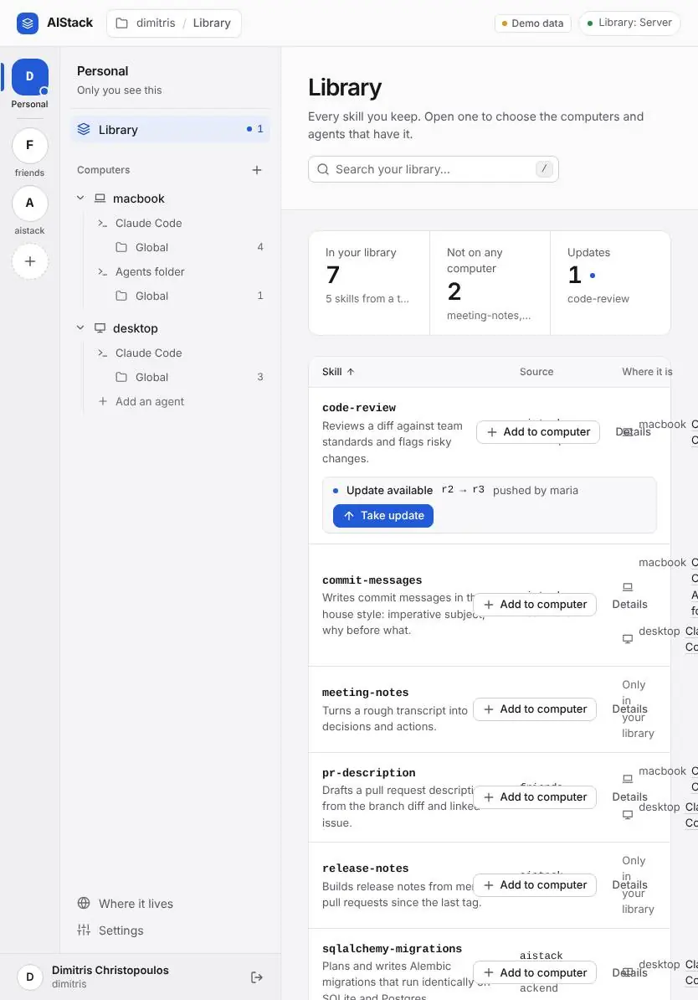

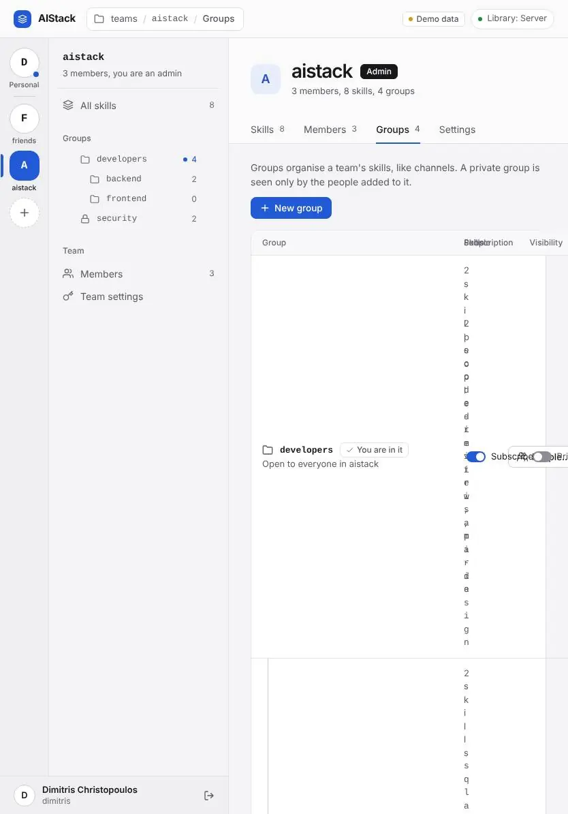

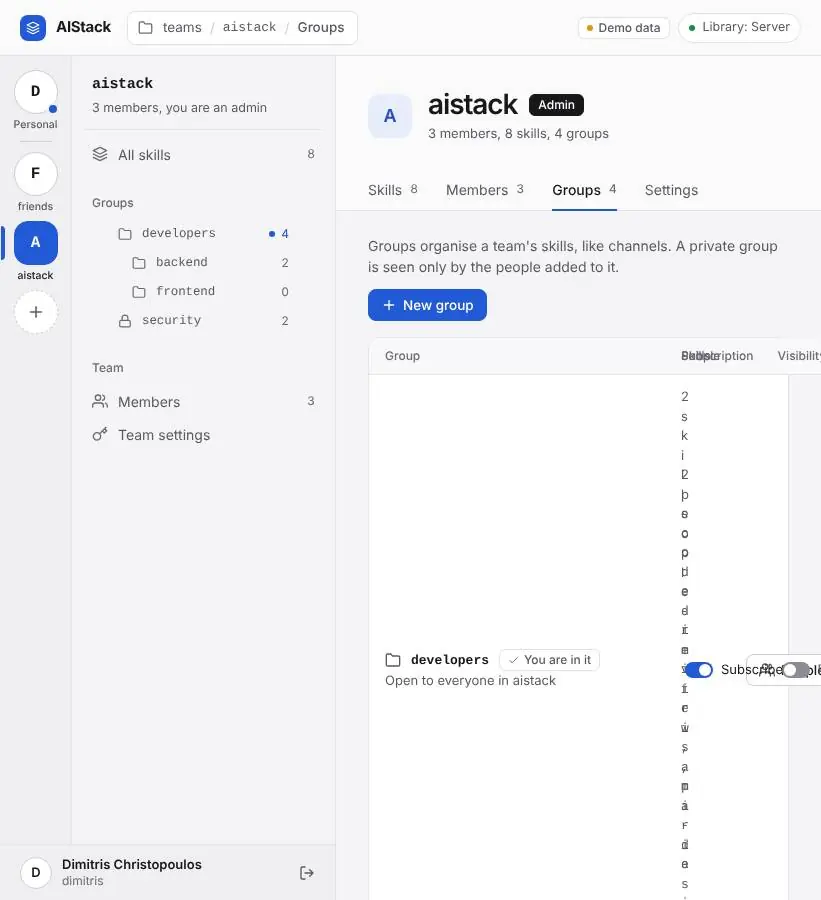

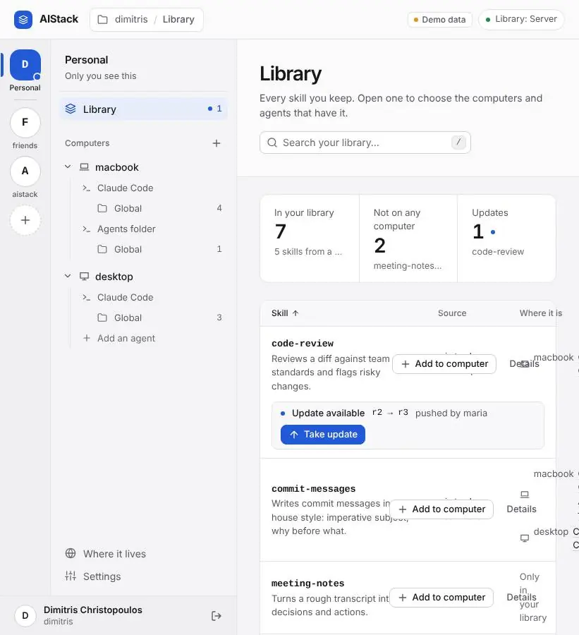

### UI-02: Deep group paths overflow their chips in Members and print over the next column; the page scrolls sideways at every width

**Confirmed.** Severity **Medium**, effort **S**. Hurts: A team admin of any team that nests groups, on desktop and phone

**Where.** src/aistack/bundled/dashboard.html:436 and :438 (.badge: white-space:nowrap, fixed 22px height; .badge.mono), :2061-2062 (membersTab renders each group path as a badge)

**What is wrong.** A member's groups are shown as one `.badge.mono` per full path. A badge never wraps, so a path that is longer than its column (an 8-deep path is allowed: GROUP_MAX_DEPTH 8, 255 characters) spills out of its chip and over the 'Pushed' column. The two texts become unreadable on top of each other. The page then scrolls sideways at every width tested: 390→965px, 821→1493px, 1440→1498px. The design system promises that nothing scrolls sideways.

**How it was confirmed.** I started my own server on port 8200 and seeded it with &lt;scratch&gt;/ui/seed_long.py. That script runs demo_seed, then creates through the real tools and dashboard API: a 64-character team, an 8-deep group path (engineering/…/nightly), a 64-character username with a 100-character full name, and a 64-character computer name. probe_overflow.py then opened #/t/&lt;team&gt;/members at 390, 600, 820, 821, 1024 and 1440px, and documentElement.scrollWidth was larger than clientWidth at every width. The screenshots show the overlap.

**Proposed fix.** In membersTab, show the group's last segment in the chip with the full path in `title` and an sr-only prefix, as the sidebar does (`node.path.slice(host.length+1)`). Or let `.chips .badge` wrap: `height:auto; min-height:22px; white-space:normal; overflow-wrap:anywhere; text-align:left`. Give `.badge.mono` `max-width:100%` with `overflow-wrap:anywhere` in every table cell.

**Done when.** The UI test seed gains a member in an 8-deep group. #/t/&lt;team&gt;/members has scrollWidth ≤ innerWidth at 390 and 1440px, and no badge's right edge passes its cell's right edge.

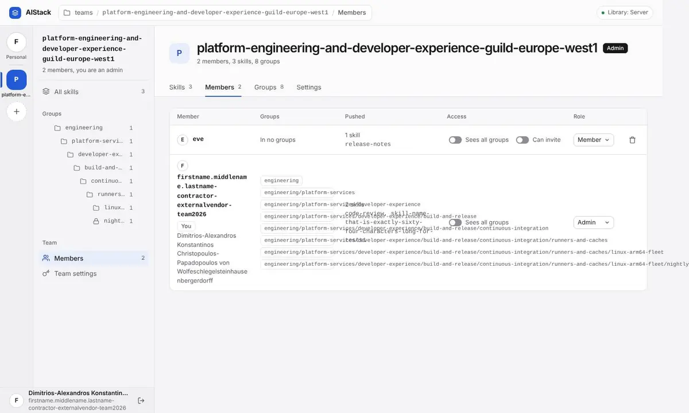

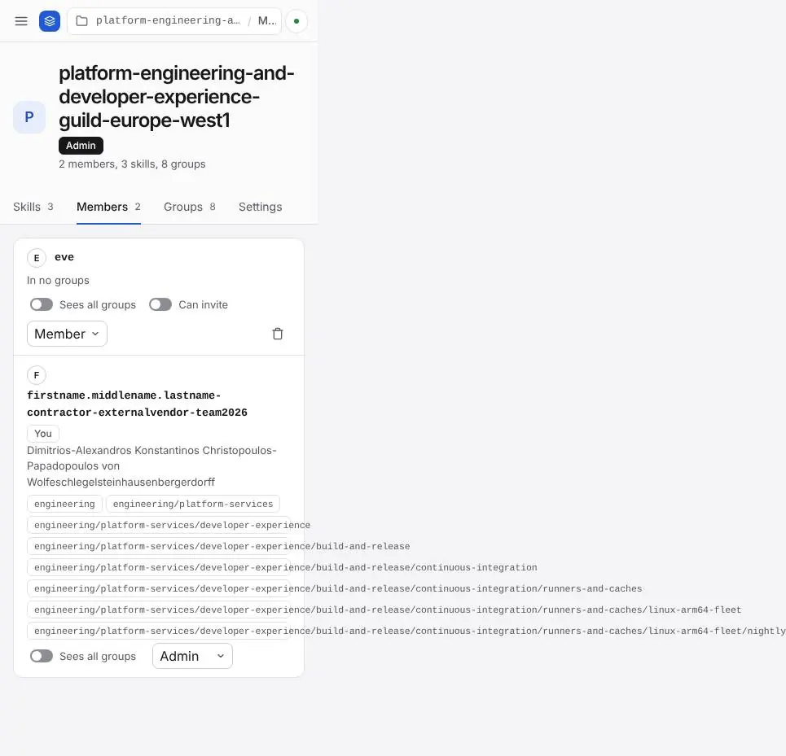

### UI-03: nowrap on user-supplied names pushes the page sideways: a long computer name, a long username, and 'All of &lt;team&gt;'

**Confirmed.** Severity **Medium**, effort **S**. Hurts: Someone whose computer has a long hardware-model name (computers are now named by their model), people with long usernames, and teams with long names, on a phone and at 821–1024px

**Where.** src/aistack/bundled/dashboard.html:239 (.where-line .on {white-space:nowrap}), :485 (.td.nowrap) used for pushed_by at :1974-1976, :346 (.btn white-space:nowrap) on the 'All of &lt;team&gt;' link at :1918, :526 and :294 (group names truncated in the tree and the sidebar)

**What is wrong.** (1) A 64-character computer name in a Library row's 'Where it is' line never wraps. The agent links land outside the card, and the page scrolls to 528px at 390 wide, 1232px at 821, and 1296px at 1024. The skill panel at 821–1024px does the same. (2) A team skill's 'Pushed by' cell is nowrap, so a 64-character username overflows the card on both sides at 390px (its first letters are cut off on the left). (3) The 'All of &lt;team&gt;' button on a group view is nowrap and scrolls the page at 390 and 821px. (4) In the skills tree at 390px, the 8-deep group names shrink to 'li…' and the deepest one disappears behind its Private badge. In the sidebar they shrink to 'linux…' and 'night…'. Each has only a hover title, so a touch user cannot read them.

**How it was confirmed.** Ran probe_overflow.py on my seeded server (see UI-02): library@390 SCROLLS 390→528, library@821 821→1232, library@1024 1024→1296, team-skills@390 390→513 (span.t1 with the username at left:-59), team-group8@390 and @821 (A.btn 'All of platform-engineering-…'). Results are in &lt;scratch&gt;/ui/overflow.json.

**Proposed fix.** Drop `white-space:nowrap` from `.where-line .on` and add `overflow-wrap:anywhere; min-width:0`, and let the agent links wrap under the name. Remove `nowrap` from the 'Pushed by' cell (keep it on the revision cell only), or truncate it with `text-overflow:ellipsis` and a full-name title. Make the 'All of &lt;team&gt;' control a link that may wrap (`white-space:normal` for `.panel-head .btn`), or label it 'All skills' as the sidebar does. In the tree, let `.gname` wrap at depth &gt; 3 on a phone, or show the path relative to the nearest visible ancestor in full.

**Done when.** test_nothing_scrolls_sideways_on_a_phone gains a seed with a 64-character computer name, a 64-character username and an 8-deep group. It passes at 390, 834 and 1024px.

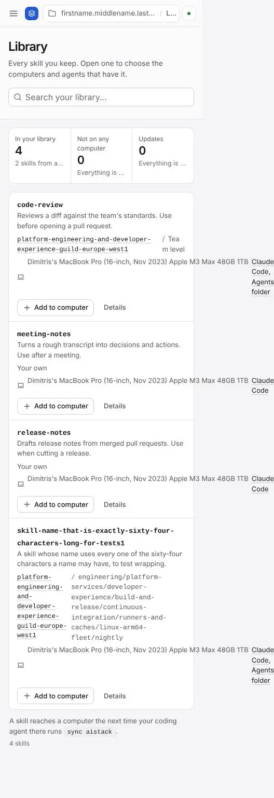

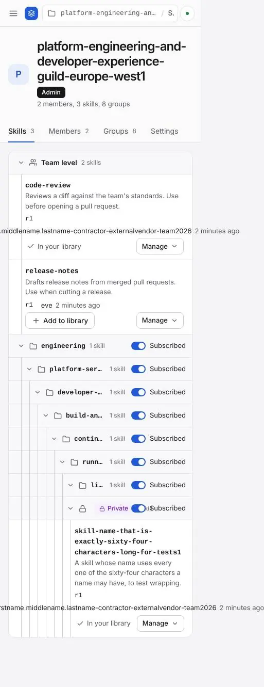

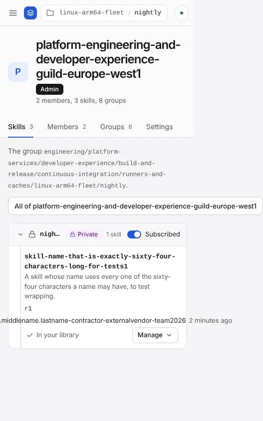

### UI-04: No skip link: 18 tab stops before the first control in main, and more for every team and computer

**Confirmed.** Severity **Medium**, effort **S**. Hurts: Keyboard and switch users, on every page load and every view

**Where.** src/aistack/bundled/dashboard.html:831-850 (#app starts with the top bar, then the rail, sidebar and account bar; main has tabindex=-1 but nothing links or moves focus to it); :1573 (the '/' hint is aria-hidden and the search input has no aria-keyshortcuts)

**What is wrong.** There is no 'Skip to content' link. From a fresh load of #/library with the demo data (2 teams, 2 computers, 3 agent folders), it takes 18 Tabs to reach the search box. Each team adds one stop, each computer adds 2–4, and each agent folder adds one. `main` is already focusable (tabindex -1) but nothing targets it. The '/' shortcut works, but it cannot be discovered with a screen reader because its hint is aria-hidden.

**How it was confirmed.** probe_keyboard.py (in my folder) loads the demo page at 1440px and presses Tab 40 times, recording document.activeElement. Stops 1–18 are the top bar, rail, sidebar and Sign out. Stop 19 is 'Search your library' (tabs_to_reach_main = 19). No stop is a skip link.

**Proposed fix.** Add `<a class="skip" href="#main">Skip to content</a>` as the first child of `<body>`. Style it visually hidden until `:focus-visible`, using the tokens. On click, call `$main.focus()` instead of changing the hash, because the router owns the hash. Add `aria-keyshortcuts="/"` to `#search`.

**Done when.** A UI test presses Tab once on #/library and sees a link named 'Skip to content'. Pressing Enter on it puts focus in `main`, and the next Tab lands on 'Search your library'.

### UI-05: Focus falls to &lt;body&gt; after every sidebar navigation and after actions that remove their own button

**Confirmed.** Severity **Medium**, effort **M**. Hurts: Keyboard and screen-reader users: every view change, Take update, Add to library, Remove on a computer page, Cancel on an invite

**Where.** src/aistack/bundled/dashboard.html:1251-1260 (render() restores focus only by data-fk), :1303 (sidebar links get no fk), :1367 (the sidebar is rebuilt on every render), :2504 (hashchange renders and scrolls, but never moves focus), :1032-1052 (run() reloads state, so a button that no longer exists cannot be refocused), :1619, :1962-1966, :1704, :2378

**What is wrong.** Following a sidebar link with Enter rebuilds the sidebar, which destroys the focused link. focus() is then never called, so activeElement is BODY. A screen reader hears nothing about the new view: the title changes, but nothing is focused or announced. The same happens after 'Take update' (the update row goes away), 'Add to library' (it becomes 'In your library'), 'Remove' on a computer page (the row goes away), and 'Cancel' on an invite. The person has to find their place again.

**How it was confirmed.** probe_keyboard.py. (2) Focusing the 'Settings' link and pressing Enter gives after_sidebar_enter = {tag:'BODY'}. (5) Focusing 'Add to library' in #/t/friends/skills and pressing Enter gives after_add_to_library_focus = BODY, while the toast says 'Added onboarding…'. (6) 'Take update' in the Library gives BODY.

**Proposed fix.** In the hashchange handler (after render), move focus to the new view's h1. Give the h1 `tabindex="-1"`, focus it with `preventScroll`, or focus `$main`. Do this only when focus was on &lt;body&gt; or in the sidebar, so a focus key still wins. Give nav links a focus key (`fk: 'nav:' + hash`) so the drawer and sidebar keep focus while you are in them. In run(), when the control's fk no longer resolves after load(), fall back to a stated successor. For example, give `link()`/`btn` an optional `nextFk`: Take update → the row's name button; Add to library → the row's Manage button or name; Remove → the next row's Remove, or the empty state's 'Add skills'.

**Done when.** UI tests: after Enter on the sidebar 'Settings' link, document.activeElement is the Settings h1 (or main). After Enter on 'Take update', it is the same skill's name button, not BODY.

### UI-06: The phone drawer is not modal: Tab walks out from under the scrim into the page behind

**Confirmed.** Severity **Medium**, effort **S**. Hurts: Keyboard and screen-reader users on a phone or tablet (VoiceOver swipe navigation, an external keyboard)

**Where.** src/aistack/bundled/dashboard.html:752-762 (the drawer is a fixed div over a scrim), :840 (#nav-shell is a plain div with no role), :2488-2503 (setDrawer moves focus in and handles Escape, but traps nothing and leaves main and the top bar reachable)

**What is wrong.** Opening the drawer moves focus to 'Close navigation', and Escape closes it and gives focus back, which is good. But after 11 Tabs focus leaves the drawer and goes into main ('Search your library', the skill rows), which is hidden behind the scrim. The drawer has no role=dialog or aria-modal, and main is not inert, so a screen reader also reads the covered page. The design system says 'the drawer traps focus on a phone'.

**How it was confirmed.** probe_keyboard.py, step 11, at 390×844: Enter on 'Open navigation', then 45 Tabs. drawer_tab_walk_wheres runs 'nav' ×11 and then 'main' ×34; drawer_dialog_semantics = {role:null, modal:null, mainInert:false}.

**Proposed fix.** When the drawer opens below 820px, set `inert` on `main`, `.topbar` (except the drawer button) and `#toasts`, and remove it on close. Or give #nav-shell `role="dialog" aria-modal="true" aria-label="Navigation"` and wrap Tab from the last focusable back to the first. Inert is simpler and also stops screen-reader browsing.

**Done when.** A UI test at 390px opens the drawer and presses Tab 60 times. Every activeElement is inside #nav-shell. After Escape, focus is on 'Open navigation'.

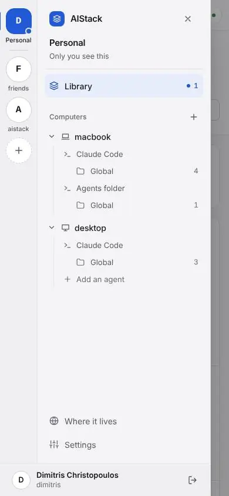

### UI-07: Confirm dialogs open with focus on the destructive button: holding Enter on 'Leave team' leaves the team

**Confirmed.** Severity **Medium**, effort **S**. Hurts: Any member or admin who uses the keyboard: Leave team, Remove from library, Remove member, Remove from team

**Where.** src/aistack/bundled/dashboard.html:1100-1101 (with no input, focus goes to the submit button), :1105-1107 (confirmDialog adds no aria-describedby), :1069 (a danger submit is the default button)

**What is wrong.** confirmDialog has no inputs, so openDialog focuses its submit button, which is the red 'Leave team' or 'Remove…'. An Enter that opened the dialog and is still held auto-repeats, and the next keydown activates the confirm. Nothing says the person meant it. The dialog also has no aria-describedby, so a screen reader announces only the title and 'Leave team, button', never the lines that say what is kept.

**How it was confirmed.** probe_enter_repeat.py (in my folder), on the demo page #/t/friends/settings: focus 'Leave team', keyboard.down('Enter') (the dialog opens, with focus on its 'Leave team'), then keyboard.down('Enter') again, as a held key's repeat. Result: hash '#/library', rail ['Personal','aistack'], toast 'You left friends.'. probe_keyboard.py step 4: confirm_initial_focus is the 'btn danger solid' button 'Leave team', and confirm_described is null.

**Proposed fix.** In confirmDialog, focus the Cancel button (pass a `focus: 'cancel'` option to openDialog), and ignore a submit whose keydown has `repeat === true` (a keydown listener on the form that calls preventDefault when ev.repeat). Give the body an id and set `aria-describedby` on the dialog to it, so the consequences are read.

**Done when.** The repeat test above leaves the user in 'friends'. A UI test asserts that a confirm dialog opens with focus on 'Cancel' and that the dialog's accessible description contains 'Skills you added to your library stay yours'.

### UI-08: An action's outcome toast is inserted while the modal is still open, then disappears on its own after 6s or 10s, warnings included

**Confirmed.** Severity **Medium**, effort **S**. Hurts: Screen-reader users (the success message may never be announced) and anyone slow to read, notably the warning 'Shared, but check it: &lt;team&gt; already had a different skill named …'

**Where.** src/aistack/bundled/dashboard.html:1079-1090 (run() toasts inside the submit handler, and dlg.close() runs after it), :980-988 (toast removes itself after 6000/10000ms, with no pause on hover or focus), :866 (#toasts lives outside the dialog, which showModal makes inert), :1806-1808 (the warning toast)

**What is wrong.** For every dialog that saves, run() calls toast() before the dialog closes. At that moment showModal() has made everything outside the dialog inert, #toasts included, so the polite live region changes while it is out of the accessibility tree. Browsers generally do not announce such a change. Every toast then removes itself after 6s (ok) or 10s (warn and error), with no pause on hover or focus and nothing that records it afterwards. For the warning about overwriting a different team skill of the same name, 10 seconds is the only place the person learns of it (WCAG 2.2.1).

**How it was confirmed.** probe_keyboard.py step 7: a MutationObserver on #toasts records {modalOpen: true, text: 'Saved where code-review is…'} for the toast added by saving 'Add to computer'. The timeouts are read from the code at :987. That the toast goes unannounced is the expected consequence of inert. I did not check it with a real screen reader.

**Proposed fix.** Toast after the dialog closes. In openDialog's submit handler, collect the run() result and call toast() after `dlg.close()`, for example by having run() return the message instead of toasting when called from openDialog. Pause the timer while the toast is hovered or has focus. Do not auto-dismiss 'warn' and 'error' toasts (they keep their Dismiss button). Consider putting the possibly_unrelated warning into a dialog the person acknowledges.

**Done when.** The MutationObserver test records modalOpen:false for every toast. A UI test shows that a warn toast is still present after 15s, and an ok toast is still present after 7s while it is hovered.

### UI-09: Local mode forgets the theme, accent and picked agents every run: each dashboard gets a new port, and so a new origin

**Confirmed.** Severity **Medium**, effort **M**. Hurts: Every local-mode user (the default setup), each time the agent session or `aistack dashboard` restarts

**Where.** src/aistack/mcp/local_dashboard.py:30 (socket.create_server(('127.0.0.1', 0))), src/aistack/bootstrap/__main__.py:90-92 (port 0), src/aistack/bundled/dashboard.html:13 and :1384 (localStorage keys), :2307 ('Kept in this browser only. Each browser you open the dashboard in remembers its own.')

**What is wrong.** localStorage belongs to the origin, which is scheme, host and port. The local dashboard listens on a port the system picks on every run, so Settings → Dark + Rose, or an agent picked with 'Add an agent', is gone the next time the person opens the dashboard. The Settings footer and docs/design-system.md ('Choices kept in the browser … The page works without them') promise the opposite. The page shows no error. It just comes back light and blue, and a picked agent vanishes from the computer tree.

**How it was confirmed.** probe_local_storage.py (in my folder), on a copy of the local2 run: start `aistack dashboard` (port 33903) in a persistent Chromium profile, choose Dark and Rose in Settings, and stop it. Start it again (port 40485) in the same profile: theme 'light', accent 'blue', localStorage 'aistack.appearance.v1' = null.

**Proposed fix.** Try a stable preferred port first, and fall back to 0 only if that port is taken. For example, derive the port from AISTACK_HOME in a high range (49152 + hash % 10000). Put this in one helper used by both local_dashboard.dashboard_link() and serve_dashboard(). Alternatively, keep appearance and picked agents in the local Library as a per-user preference, which is a bigger change. ADR-0020 does not fix the port, so no new ADR is needed. Until then, make the Settings footer text depend on `state.server === false`.

**Done when.** Running the probe above shows the same port on both runs and theme 'dark' / accent 'rose' on the second. A test in tests/ui/test_local_dashboard_page.py starts the local dashboard twice and asserts that both links have the same origin.

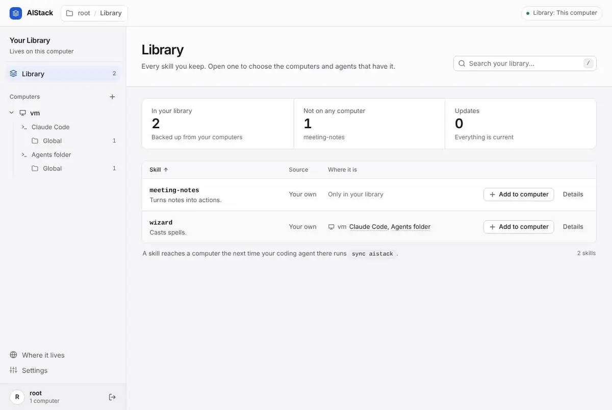

Related: [UX-02](ux.md#ux-02-a-sign-in-link-works-once-but-the-wording-says-five-minutes-and-reopening-it-says-you-are-not-signed-in-even-to-a-signed-in-browser).

### UI-10: Inputs, selects and the focused menu item fall below 3:1 non-text contrast

**Confirmed.** Severity **Medium**, effort **S**. Hurts: Low-vision users: they cannot find the text fields (full name, team name, invite code, search) or see which Manage menu item is focused

**Where.** src/aistack/bundled/dashboard.html:370 (.input border: var(--border-strong)), :52 and :97 (--border-strong #cdcdd4 / #41434a), :580 and :582 (.menu-item:focus-visible { outline:none; background: surface-2 / danger-soft })

**What is wrong.** Text inputs and selects are told apart from the card only by a 1px --border-strong: 1.58:1 on white in light and 1.67:1 on #1e1f23 in dark (WCAG 1.4.11 needs 3:1). The checkboxes and radios already use --track (3.3:1) for exactly this reason. A focused menu item drops its outline and shows only --surface-2 behind it: 1.15:1 in light and 1.10:1 in dark, and 1.11/1.08 for the danger item. Keyboard focus in 'Manage' is close to invisible.

**How it was confirmed.** contrast_tokens.py (in my folder) computes WCAG ratios from the token values in dashboard.html, using color-mix in srgb: input border 1.58 and 1.67, menu-item focus 1.15 and 1.10. probe_keyboard.py step 8: the focused 'Move to group…' item has outline 'none 0px' and background rgb(239,239,242).

**Proposed fix.** Give `.input` and `select.input` `border-color: var(--track)`, or add a `--border-input` token at 3:1 or more in both themes and record it in docs/design-system.md. For `.menu-item:focus-visible`, keep the background but add `outline: 2px solid var(--accent); outline-offset: -2px`.

**Done when.** contrast_tokens.py reports at least 3:1 for the input border and the menu focus indicator in both themes. A UI test sees a non-'none' outline on a focused menu item.

### UI-11: Icon-only controls the design system forbids: the member Remove trash, and the phone's Library pill whose name becomes ', connected'

**Confirmed.** Severity **Medium**, effort **S**. Hurts: Team admins removing a member; phone users of a screen reader or voice control; anyone who does not know what a bare green dot opens

**Where.** src/aistack/bundled/dashboard.html:2068-2081 (trash icon button, aria-label and title only), :749 (`.place-pill .label {display:none}` under 820px) with :1299-1301, :984 (toast Dismiss ×, no tooltip), :1073 (dialog Close ×, no tooltip), :833 (drawer button, no tooltip)

**What is wrong.** docs/design-system.md allows icon-only controls only for the close ×, the drawer button and the sidebar +, 'which all carry an aria-label and a tooltip'. (1) The Members table's Remove control is a bare trash icon. (2) On a phone, the top bar's 'Library: Server' pill hides its label with display:none. That leaves a 28×30px green dot, and it removes the label from the accessibility tree: the link's accessible name becomes ', connected' (from the sr-only span). (3) The dialog Close ×, toast Dismiss × and drawer button have an aria-label but no tooltip, contrary to the stated exception.

**How it was confirmed.** probe_keyboard.py step 11 at 390px: phone_place_pill = {visibleText: ', connected', w: 28, h: 30}. aria_snapshot of .top-right shows `link ", connected"`. Code read at :2070 (btn(null, …,'trash')), :1073 and :984.

Seen in the team Members screenshots.

**Proposed fix.** Members: use `btn('Remove…', {class:'btn ghost sm', 'aria-label': `Remove ${m.username} from ${team.name}…`}, 'trash')`, and on a phone let it wrap with the row actions. Place pill on a phone: keep a short visible word ('GitHub', 'Server') instead of hiding the label, or hide it with the .sr-only pattern so the name stays 'Library: Server, connected'. Add `title` (or data-tip) to the three permitted icon buttons.

**Done when.** At 390px, get_by_role('link', name='Library: Server, connected') resolves. The Members table has no button whose visible text is empty except permitted ones. The UI test finds the member removal by its visible text 'Remove…'.

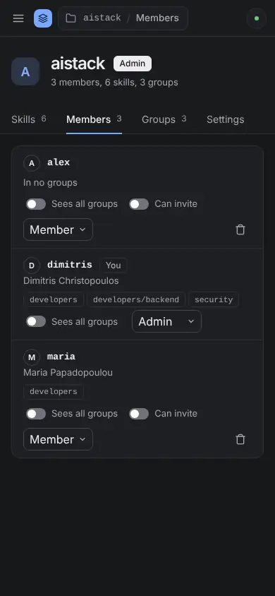

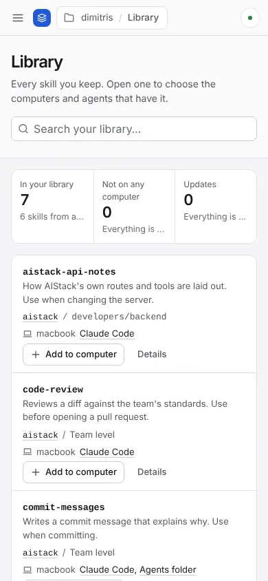

### UI-23: Explanations sit on the page where one line and a click would do: dialogs, footnotes and zero-value tiles clutter the screens people open most

**Confirmed.** Severity **Medium**, effort **M**. Hurts: everyone who opens the dashboard for its two-minute job: the design system's 'a calm tool someone opens for two minutes' is crowded by text written for the first visit

**Where.** dashboard.html: the invite dialog (Team settings, Create invite link), Add a computer (`ADD_COMPUTER`), the notes under the Library and computer tables, `storageView`'s card body, facts and footnote, the Library's three stat tiles, the team header vs the 'About this team' card, the top bar's 'Library: Server' pill, page subtitles

**What is wrong.** Read in the screenshots at 1440 and 390px:
- The invite dialog puts about 60 words before the link and a 50-word paragraph about local addresses after it.
- Add a computer is three numbered steps (about 60 words) for one sentence of action.
- Each table carries a two-sentence note under it ('Removing a skill here keeps it in your library and on your other computers. The folder is asked about at the next sync aistack, never deleted unasked.') that belongs in the confirmation that already exists.
- Where it lives stacks a paragraph, a facts list and a footnote (the footnote also misleads, UX-04).
- The Library's stat tiles say '0, Everything is in use' and '0, Everything is current' on a normal day, and on a phone their captions are cut off (UI-21).
- A team's members, skills and groups are counted in the header and again in 'About this team'.
- On a server the 'Library: Server' pill can only ever say that.
None of it is wrong to say once; repeated on every visit it is what the eye has to skip.

**How it was confirmed.** Read every screen in the audit's screenshots (desktop and phone, both themes) and counted the words before the first control in each dialog.

**Proposed fix.** One rule for the design system: a surface shows one short line; the explanation is one click away (a 'More about …' disclosure using `
`, or the confirm dialog of the action it explains). Then: invite dialog 'Send this link. It works once, for seven days, and is shown only now.' with the rest under 'More about invites'; Add a computer 'Say this on a computer that is already connected, then run the command it answers with on the new one.'; move table notes into their Remove confirmations; show a stat tile only when its number asks for action (or collapse to one line, '7 skills, all on a computer, all current'); drop the counts from 'About this team' or from the header; hide the Library pill on a server; keep each page subtitle to its first sentence. Add the rule and a word budget (dialog intro ≤ 25 words) to docs/design-system.md 'Patterns'.

**Done when.** docs/design-system.md states the rule; every dialog's intro is at most 25 words before its first control; no page has text under a table that repeats a confirmation; the UI tests still find each control by its words.

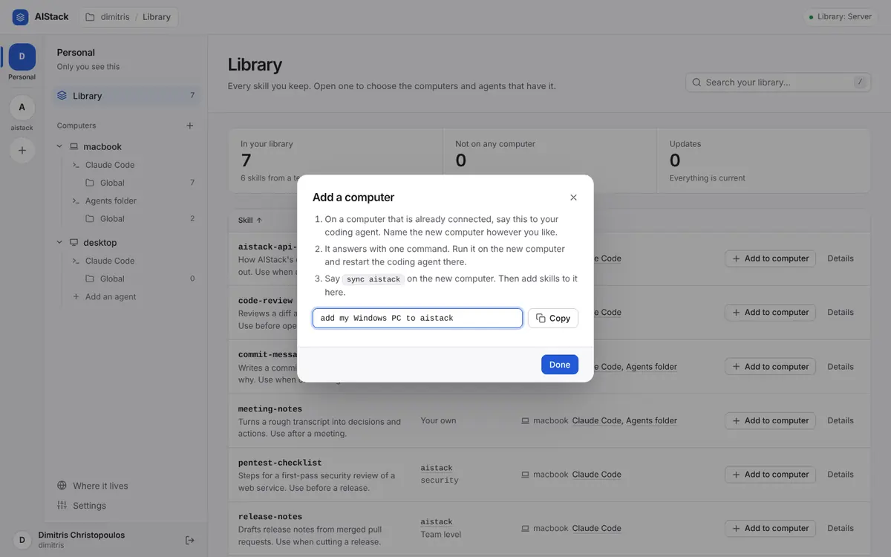

### UI-12: The Back button leaves an open (destructive) dialog on top of a different view

**Confirmed.** Severity **Low**, effort **S**. Hurts: Anyone who presses Back or a mouse back button, or swipes back, while a dialog is open

**Where.** src/aistack/bundled/dashboard.html:2504 (hashchange → render(), with no dialog handling), :1092-1097

**What is wrong.** With 'Remove release-notes from aistack?' open, Back changes the hash and the Library renders underneath, but the confirm stays open and actionable over a page that has nothing to do with it. The same happens with every dialog, including the skill panel. Usually a person presses Back to get out of the dialog.

**How it was confirmed.** probe_misc.py (in my folder), on the demo page: go to #/library, then #/t/aistack/skills, Manage release-notes → Remove from team, then page.go_back(). back_with_dialog = {hash:'#/library', dialogOpen:true, dialogTitle:'Remove release-notes from aistack?', h1:'Library'}. Screenshot taken.

**Proposed fix.** In the hashchange listener, close every `dialog[open]` before render(). Or have openDialog push a history entry and close the dialog on popstate, which makes Back close the dialog as on mobile.

**Done when.** A UI test that opens a confirm and calls go_back() finds no dialog[open].

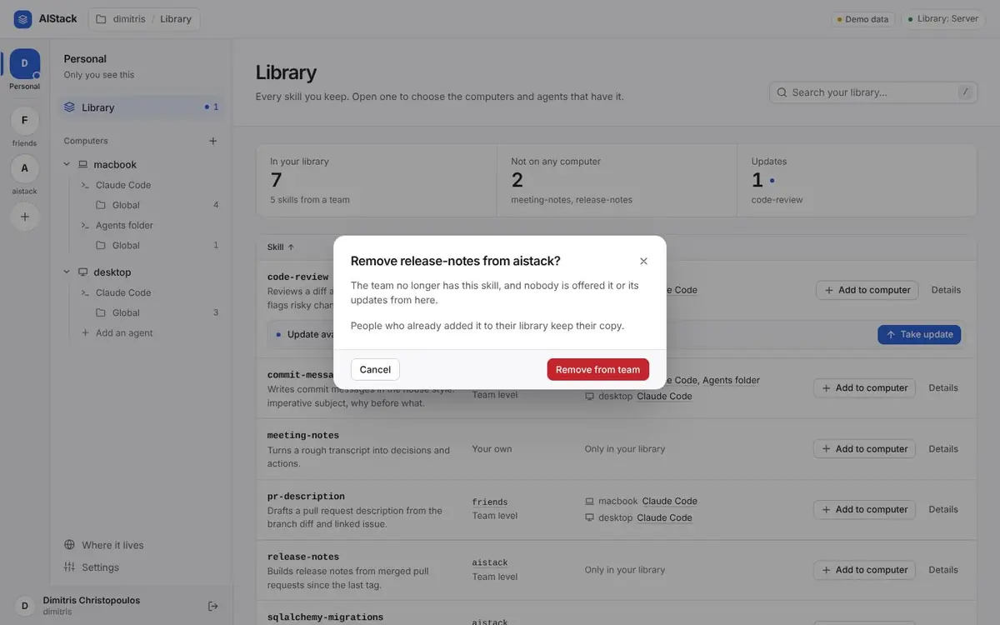

### UI-13: Switches: the name contradicts the visible word when off; a disabled switch's explanation cannot be reached; tooltips cannot be dismissed

**Confirmed.** Severity **Low**, effort **S**. Hurts: Voice-control and keyboard users managing subscriptions and members; people whose screen magnifier is covered by a tooltip

**Where.** src/aistack/bundled/dashboard.html:1870-1886 (subscribeSwitch: label 'Subscribed to &lt;path&gt;', text 'Unsubscribed' when off), :1876 and :418-419 (a disabled switch drops out of the tab order), :421-430 ([data-tip] ::after with pointer-events:none, shown on :focus-visible)

**What is wrong.** (1) When unsubscribed, the switch reads 'Unsubscribed' on screen, but its accessible name is 'Subscribed to developers'. A voice user who says 'click Unsubscribed' hits nothing (WCAG 2.5.3). (2) When a parent group is unsubscribed, the child's switch is `disabled`. Its tooltip, 'Unsubscribed through developers. Subscribe to developers…', is the only explanation, and a disabled button cannot be focused or tapped, so keyboard and touch users never see it. (3) The tooltip stays after Escape and disappears when the pointer moves onto it (WCAG 1.4.13).

**How it was confirmed.** probe_keyboard.py step 9: unsub_switch_name_vs_text = ['Subscribed to developers','Unsubscribed','false']; disabled_switch = {disabled:true, tabbable:false, tip:'Unsubscribed through developers…'}; switch_tip_after_escape still shows the tooltip content.

**Proposed fix.** Give the switch a stable visible label that matches its name ('Subscribed', with aria-checked carrying on or off). Say the state in the tooltip instead of swapping the label. Replace `disabled` with `aria-disabled="true"`, which keeps the switch focusable, ignore its click, and show the reason as visible text next to it ('Off through developers'). Add a document keydown handler that sets a `.tip-hidden` class on Escape, removed on blur or pointerleave, and drop pointer-events:none from the tooltip.

**Done when.** get_by_role('switch', name='Subscribed to developers') shows the visible text 'Subscribed' whatever its state. The child switch can be focused and its reason is in the accessibility tree. Pressing Escape hides the tooltip.

### UI-14: Row buttons whose names do not say which skill or group: 'Add to computer', 'Take update', 'Add to library', 'People…'

**Confirmed.** Severity **Low**, effort **S**. Hurts: Screen-reader users who move by buttons or form controls, and voice-control users

**Where.** src/aistack/bundled/dashboard.html:1611 (Add to computer), :1619 and :1963 (Take update), :1966 (Add to library), :2132 (People…)

**What is wrong.** Each Library row has an 'Add to computer' button, and each offered skill has 'Take update' or 'Add to library', with identical accessible names. A buttons list reads 'Add to computer, Add to computer, Add to computer…'. The page already does this right for 'Details of &lt;skill&gt;', 'Remove &lt;skill&gt; from …' and 'Manage &lt;skill&gt;', so this is inconsistent. 'People…' in Groups has the same problem.

**How it was confirmed.** aria_snapshot of the Library table in probe_misc.py: `button "Add to computer"` and `button "Take update"` with no skill name, next to `button "Details of code-review"`. In the tree: `button "Add to library"`.

**Proposed fix.** Add `'aria-label': `Add ${s.name} to a computer…``, `Take the update to ${name}`, `Add ${name} to your library`, `People in ${g.path}…`, each starting with the visible words so label-in-name holds. Update tests/ui in the same commit.

**Done when.** get_by_role('button', name='Add code-review to a computer…') resolves, and no two buttons in a table share an accessible name.

### UI-15: Table and landmark semantics: rows with different cell counts, aria-label on a plain div, avatar letters read aloud, the account bar outside every landmark

**Confirmed.** Severity **Low**, effort **S**. Hurts: Screen-reader users reading the Library, the team skills tree, and Members

**Where.** src/aistack/bundled/dashboard.html:1613 (update-cell is a 5th cell under a 4-column header), :1893-1906 and :1890 (group and hint rows have 1 cell), :2061 (aria-label on a div with no role), :1859, :2056, :2163 (avatar letters not aria-hidden), :847 and :1371-1375 (.account sits in a div, outside nav and aside)

**What is wrong.** In table navigation, the Library row that has an update gets a 5th cell with no column header. In the team tree, each group header row is a single cell under 'Skill', and the following rows are read against headers that don't apply. The 'Groups of maria' label sits on a generic div, where ARIA prohibits a name. The member and team avatars are read as part of the name ('d dimitris You'). The account bar (name, username, Sign out) is outside every landmark, which is axe's 'region' violation on every screen, and on the phone drawer too.

**How it was confirmed.** probe_misc.py: library_rows_cells = [4,5,4,…]; tree_rows_cells = [4,1,4,4,1,…]; members aria_snapshot `cell "d dimitris You"`; chips_aria_label_on_div = [['DIV', null, 'Groups of dimitris'], …]. axe.json (desktop) and my axe_phone.json (drawer open) both report region on '.who'.

**Proposed fix.** Give the update row's cell `aria-colspan` (or render the update as part of the first cell). Give group header rows `role="row"` with one `role="rowheader"` that has `aria-colspan="4"`. Add `role="list"` with listitems on `.chips`, or drop its aria-label. Set `aria-hidden="true"` on every `.avatar`. Move `.account` inside the `<aside>`, or make `.nav-shell` a landmark (an `<aside aria-label="Navigation">` that wraps the rail, sidebar and account).

**Done when.** axe reports no 'region' on any screen, desktop or drawer. Every [role=row] has the same number of cells as the header or declares aria-colspan. Members' first cell is named 'dimitris You'.

### UI-16: Page titles: the team tabs share one title, and titles are joined with ' · ', which the design system forbids

**Confirmed.** Severity **Low**, effort **S**. Hurts: Screen-reader users (the title is how a view change is noticed), and anyone with several tabs or a history list

**Where.** src/aistack/bundled/dashboard.html:1243-1249 (TITLES.team ignores r.tab), :1258 (TITLES + ' · AIStack'), :2478 ('Session ended · AIStack'); src/aistack/mcp/routes/invite.py:34 ('{title} · AIStack')

**What is wrong.** Members, Groups and Team settings are all titled '&lt;team&gt; · AIStack', identical to Skills, so the history list and a screen reader cannot tell them apart. A group view is '&lt;path&gt; · &lt;team&gt; · AIStack', exactly the 'A · B · C' string docs/design-system.md lists under Avoid ('join with commas').

**How it was confirmed.** Code read at :1244. probe_misc.py on my server: the 8-deep group view's title is 'engineering/…/nightly · platform-engineering-and-developer-experience-guild-europe-west1 · AIStack'.

**Proposed fix.** TITLES.team: `${TAB_LABELS[r.tab]}, ${r.group ? r.group + ' in ' : ''}${r.team.name}`, and join every title as `<view>, AIStack` (or 'AIStack: &lt;view&gt;'). Do the same for 'Session ended' and the invite page.

**Done when.** A UI test sees the titles 'Members, aistack, AIStack' and 'Groups, aistack, AIStack', and no title contains '·'.

### UI-17: The signed-out and invite pages have no lang, no dark theme, no main landmark, and the signed-out page's title does not say signed out

**Confirmed.** Severity **Low**, effort **S**. Hurts: A person whose session ended at night (a bright white page after a dark dashboard), screen-reader users (wrong language voice, no landmark), and a newcomer opening an invite link

**Where.** src/aistack/api/dashboard.py:370-381 (_signed_out_page), src/aistack/mcp/routes/invite.py:33-36 (_PAGE)

**What is wrong.** Both pages start with `<!doctype html><meta charset=utf-8>` with no `<html lang>`, no `<main>` and no `color-scheme`. They render black on white even when the system is dark and the dashboard was dark. The signed-out page is titled just 'AIStack' while it answers 401. axe flags html-has-lang (serious), landmark-one-main and region on both, in both themes. The in-app 'Your session has ended.' page is themed, so the experience depends on how you arrive.

**How it was confirmed.** probe_misc.py: anonymous GET /app in a dark-scheme context gives {status:401, title:'AIStack', lang:'', colorScheme:'normal', main:false}; /invite/aistinv_not-a-real-code gives {status:404, lang:''}. See the existing shots signed-out-phone-dark.png and invite-wrong-phone-dark.png, and axe.json.

**Proposed fix.** Share one small page shell in both routes (a function in api/ or mcp/routes/): `<html lang=en>`, `<meta name=color-scheme content="light dark">`, a `<main>` around the body, and a `@media (prefers-color-scheme: dark)` block in the existing inline style using the dashboard's --bg and --text values. Title the signed-out page 'Signed out, AIStack'. The CSP already allows inline style, and nothing secret is added.

**Done when.** axe on /app (signed out) and /invite/&lt;wrong&gt; reports no violations, and with color_scheme='dark' the body background is #161719.

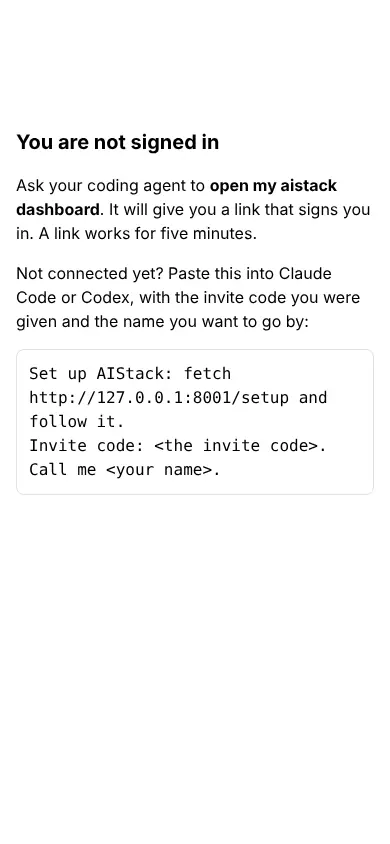

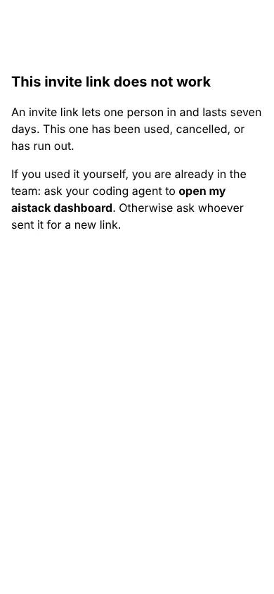

Related: [STD-18](industry-standards.md#std-18-the-pages-a-newcomer-sees-first-fail-wcag-22-level-a-and-dashboard-messages-disappear-on-a-timer).

### UI-18: Type rules broken: rail names at 10.5px, avatars at 11px, monospace uppercase letters, and usernames in monospace

**Confirmed.** Severity **Low**, effort **S**. Hurts: Everyone reading the rail on desktop; it also sets precedents that drift from the design system

**Where.** src/aistack/bundled/dashboard.html:229 (.rail-name 10.5px), :316 (.avatar 11px, uppercase), :216 (.rail-btn font var(--mono), uppercase), :494 (.name is mono) used for usernames at :2057, plus :2117, :2164, :2335, :2374-2375

**What is wrong.** docs/design-system.md says 'Nothing smaller than 11.5px' and 'Monospace only for things a person might type or paste … Never for labels, counts, or people's names'. The team names under the rail are 10.5px. Avatar letters are 11px and set in monospace capitals. In Members, the group people dialog, the invites list and 'About this team → Admins', usernames are set in monospace, while 'Pushed by' and 'Last pushed by' set them in the body font, so a person's name changes font from screen to screen.

**How it was confirmed.** Code read at the cited lines, and the team-members-desktop-light.png screenshot (usernames bold mono, full names in body font).

**Proposed fix.** Set `.rail-item .rail-name` to 11.5px and `.avatar` to 11.5px or more. Use `var(--font)` for `.rail-btn` and `.avatar`. Show usernames in the body font, with a `.person` class instead of `.name` and `.mono`, everywhere.

**Done when.** Searching the dashboard's CSS finds no font-size below 11.5px. A UI test reads the computed font-family of the member name cell and finds it is not the --mono stack.

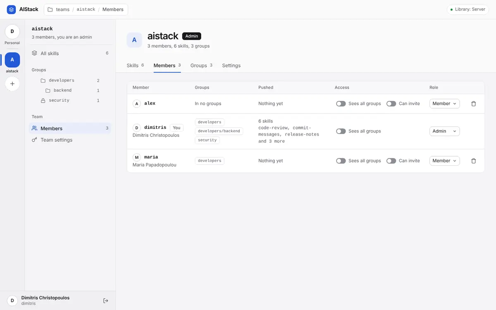

### UI-19: With the Graphite accent, the current sidebar item looks the same as a hovered one

**Confirmed.** Severity **Low**, effort **S**. Hurts: People who choose Graphite in Settings (light theme mostly): 'where you are' in the sidebar is lost

**Where.** src/aistack/bundled/dashboard.html:76 (--accent-soft = 11% accent on surface), :127 (graphite #18181b), :286-288 (current item = accent-soft background + accent-text icon), :285 (hover = --active)

**What is wrong.** For Graphite in light, --accent-soft is #e6e6e6 and the hover --active is #e7e7eb (1.01:1). --accent-text equals --text, so the icon colour does not change either. The only difference left is font-weight 550. For the other accents the gap is 1.03–1.19:1 in light. In practice the accent tint does the work there, but Graphite has none. The design system says the accent marks 'action and place'.

**How it was confirmed.** contrast_tokens.py, row 'current sidebar item (accent-soft) vs hover (active)': graphite light 1.01:1. probe_graphite.py computed backgrounds: current color(srgb 0.900 0.900 0.902), hovered rgb(231,231,235). Screenshot attached.

**Proposed fix.** Mark the current item independently of the accent tint: add a 2px inset bar `box-shadow: inset 2px 0 0 var(--accent)` to `.nav-item[aria-current=page]`, or raise the mix for graphite (`[data-accent=graphite]{--accent-soft: color-mix(in srgb, var(--accent) 18%, var(--surface))}`) and keep hover on --active.

**Done when.** Hovering 'Where it lives' while 'Library' is current under Graphite light shows a visible difference in the screenshot, with a 3:1 or better indicator.

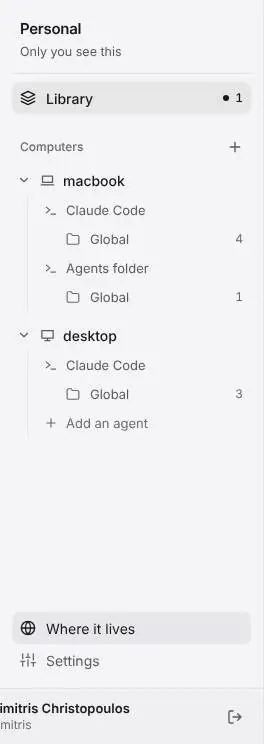

### UI-20: 'Add an agent' cannot be undone: a picked agent stays on that computer in this browser forever

**Confirmed.** Severity **Low**, effort **S**. Hurts: Someone who picks the wrong agent, or a computer that never gets that agent

**Where.** src/aistack/bundled/dashboard.html:1384-1397 (pickAgent only adds; nothing removes from aistack.picked-agents.v1), :1416 (the only control), :1711-1712 (the empty folder page offers only 'Add skills')

**What is wrong.** A picked agent shows under its computer as 'Global 0' and a page that says 'Nothing in … yet'. Nothing anywhere removes it. The only way out is to clear site data, which also resets the theme. The design system frames picking as 'local until it matters', so it should also be revocable locally.

**How it was confirmed.** Code trace: PICKED_KEY is written only by pickAgent (:1388-1392), and no other function writes or deletes it. In the folder view an agent with zero placements has no remove control.

**Proposed fix.** On the folder page, when the agent is not in `m.harnesses` (that is, picked only here) and has no placements, show 'Remove from this list' (ghost button). It deletes the agent from `pickedAgents()[m.id]` in try/catch and goes to #/library.

**Done when.** A UI test picks 'Agents folder' on a computer without it, clicks 'Remove from this list', and the tree no longer shows it after a reload.

### UI-21: Phone details: the current place in the path is cut to one letter, and the Library stat tiles hide their content behind hover titles

**Confirmed.** Severity **Low**, effort **S**. Hurts: Phone users with a long team or user name; phone users looking for which skills are on no computer

**Where.** src/aistack/bundled/dashboard.html:182 and :751 (path parts shrink equally; on a phone only the last two parts are kept), :450 and :1564-1565 (.stat .s single-line ellipsis, content only in title), :1373 (the account bar's title is the username, not the truncated full name)

**What is wrong.** With a 64-character team name, the phone top bar shows 'platform-engineering-a… / M…', so the part that says where you are ('Members') is the one that vanishes. The stat tiles on a phone read '2 skills from a…', 'Everything is …' and 'meeting-notes,…'. The list of skills on no computer is only in a title attribute, which touch cannot show. In the account bar a 100-character full name is truncated, and hovering it shows the username instead of the full name.

**How it was confirmed.** Screenshots long-team-members-390.jpg (path 'platform-engineering-a… / M…') and library-phone-light.png (truncated stat tiles). probe_misc.py account_who = {title: &lt;username&gt;, truncated: true}.

**Proposed fix.** Give the last path segment `flex-shrink: 0; max-width: 60%` and let earlier parts take the ellipsis. Under 820px, let `.stat .s` wrap to two lines (`-webkit-line-clamp: 2`), or make the 'Not on any computer' tile a button that filters the table. Set the `.who` title to `${full_name} (${username})`.

**Done when.** At 390px the last path segment is fully visible for the long team. The stat sub-lines are not truncated for the demo data. The account bar's title contains the full name.

### UI-22: No icon is declared, so every page load asks for `/favicon.ico`, gets 404, and the browser tests fail in a full browser

**Confirmed.** Severity **Low**, effort **S**. Hurts: everyone (a blank tab icon, a console error on every load), and contributors who run the browser tests in a full Chromium

**Where.** src/aistack/bundled/dashboard.html `<head>` (no `<link rel=icon>`), the signed-out page in src/aistack/api/dashboard.py:370-381, the invite page in src/aistack/mcp/routes/invite.py; tests/ui/test_dashboard_page.py asserts `console_errors == []`

**What is wrong.** Nothing declares an icon, so a browser requests `/favicon.ico`, which answers 404. The tab shows a blank page icon, and the console logs an error on every load. The browser tests assert an empty console, so they pass in CI only because Playwright's headless shell skips the favicon request; in a full Chromium, 19 of the 38 browser tests fail on that one console line.

**How it was confirmed.** `curl -s -o /dev/null -w '%{http_code}' http://127.0.0.1:8000/favicon.ico` printed 404. Running `tests/ui` against the full Chromium build installed here (the pinned Playwright's headless shell was not available) gave '19 failed, 19 passed', and every failure was `assert ['Failed to l... (Not Found)'] == []`.

**Proposed fix.** Declare the logo as an inline SVG data URI in the page's `<head>` (`<link rel="icon" href="data:image/svg+xml,…">`, which the CSP's `img-src 'self' data:` already allows), and the same on the signed-out and invite pages. Optionally answer `/favicon.ico` with 204.

**Done when.** The browser tests pass when launched with `channel="chromium"` (a full browser); `/app` loads with no console error.

Related: [IMP-17](improvements.md#imp-17-no-static-check-guards-the-python-or-the-pages-1876-line-script-and-the-page-ships-an-untested-200-line-fake-backend).

## Checked and holding up

- Accent contrast: axe color-contrast was clean on 12 screens (Library, skill panel, team skills, Members, Groups, team settings with an invite, Where it lives, Settings, a computer folder, Add a team, an open Manage menu, an error toast), each with all 6 accents in light and dark. Results: &lt;scratch&gt;/ui/axe_accents.json.
- Token arithmetic (contrast_tokens.py): every accent-derived text pair is at least 4.9:1, and every non-text accent use (focus ring, checked box, switch, tab underline) is at least 4.9:1 in both themes. The off-switch track is 3.34 and 3.49:1, faint on head and on surface-2 are at least 4.68:1, and Private purple is at least 7:1.
- Full axe at 390px in both themes for the same 12 screens: no violations except 'region' on .who with the drawer open (see UI-15). Results: axe_phone.json.
- Ellipses: every label that opens a further step uses '…' ('Copy from…', 'Move here…', 'Share with a team…', 'Remove from library…', 'Move to group…', 'People…'), and so do the placeholders. No '...' is left in dashboard.html.
- No '→' on any button label. 'r2 → r3' appears only in text and in a title attribute.
- No ALL-CAPS labels or eyebrows. text-transform: uppercase applies only to single avatar letters (see UI-18).
- prefers-reduced-motion: the drawer transition is 0s and the dialog animation is 'none' under reduce ('slide' otherwise).
- Escape closes dialogs (native showModal), the Manage menu (focus returns to its trigger) and the phone drawer (focus returns to 'Open navigation'). Dialog focus returns to its opener ('Add a computer').
- Dialogs carry aria-labelledby, and showModal gives them modality. Form errors use role=alert. #toasts is role=status aria-live=polite, with error toasts as role=alert.
- The '/' shortcut moves to search from a button, is ignored in inputs, selects, contenteditable and open dialogs, and is hidden with the search hint on a phone.
- Visible focus: every one of the first 40 tab stops on the Library shows a 2px accent outline, inputs use the accent border and glow, and theme and accent cards ring their label through :has(:focus-visible). The only exception is the menu items (UI-10).
- Tabs: role=tablist/tab/tabpanel with aria-selected and aria-controls, a roving tabindex, and arrow keys that move and keep focus.
- Settings accent and theme pickers: native radio groups inside fieldsets with legends, labels give the names, arrow keys work, and the choice is applied before paint with every localStorage access in try/catch.
- The Library sort headers expose aria-sort on the columnheader, and the buttons inside keep focus after sorting.
- Page widths of 390, 600 and 820px with the demo data's short names do not scroll sideways (only long names do, UI-02 and UI-03), and 1024–1440px is fine with short names.
- The setup page (/setup) is text/markdown meant for an agent. Chromium renders it as a plain-text document and themes it dark by itself, so I did not treat its axe title and lang results as a page defect.
- The local-mode screens hide the rail and team text as designed (state.server === false).
- My test server (port 8200, PID 9516) was stopped after the probes. Nothing in /home/user/AIStack was changed (git status is clean). The probe scripts, seed, JSON results and screenshots are in &lt;scratch&gt;/ui/.

## The screens as audited

A fresh server seeded with `scripts/demo_seed.py`, and local mode in a scratch home, at 1440×900 and 390×844.

The Library, light

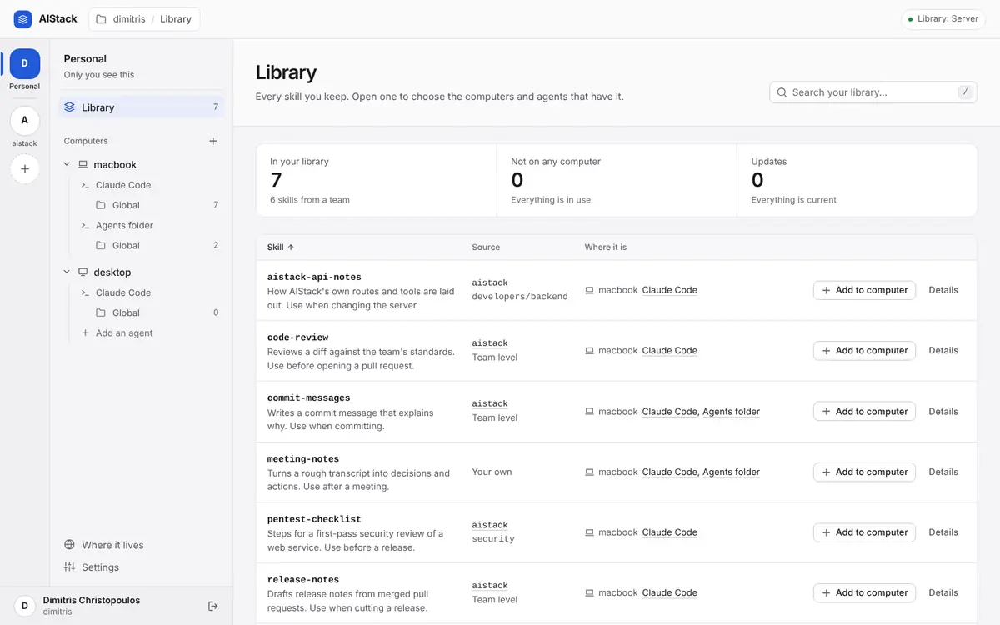

The Library, dark

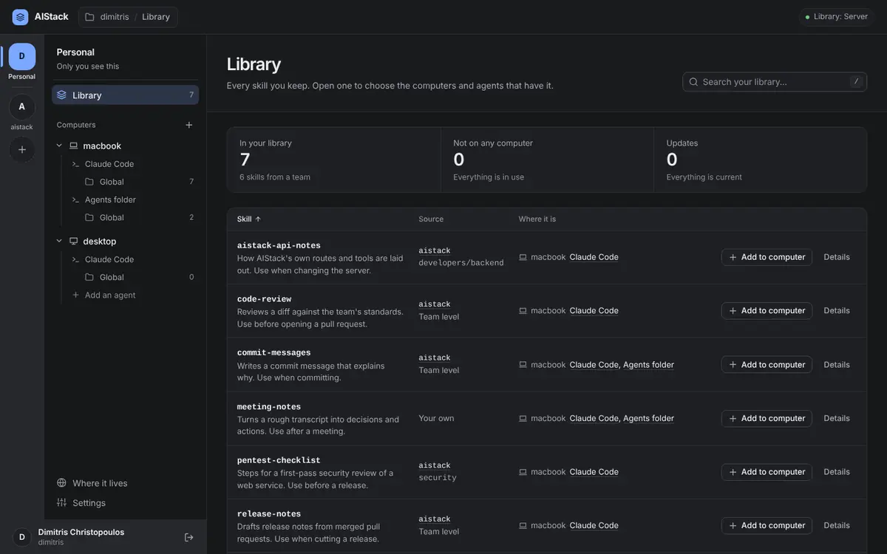

One computer's Claude Code folder, dark

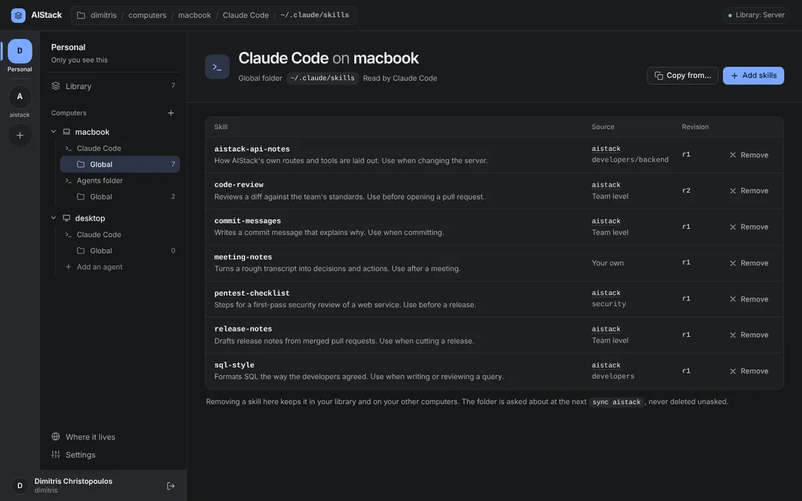

A team's skills by group

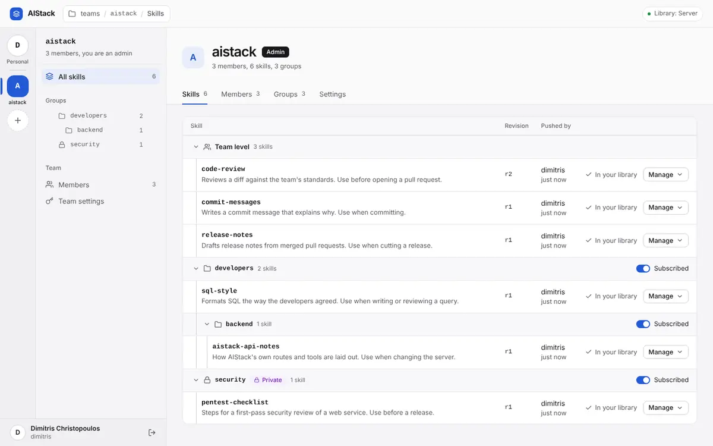

Team members (note the icon-only remove buttons, UI-11)

A skill's side panel

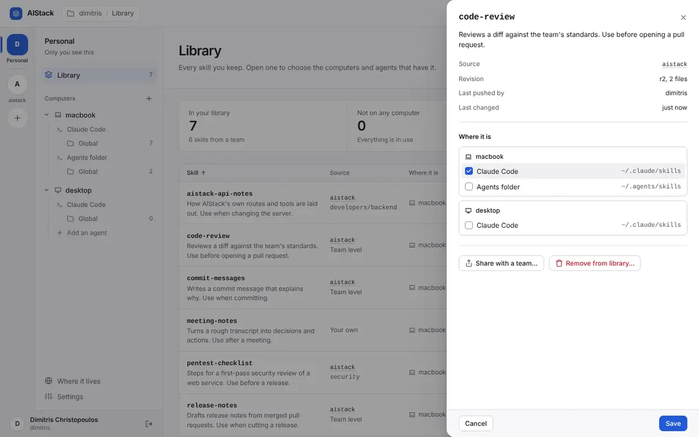

An update offered from a team

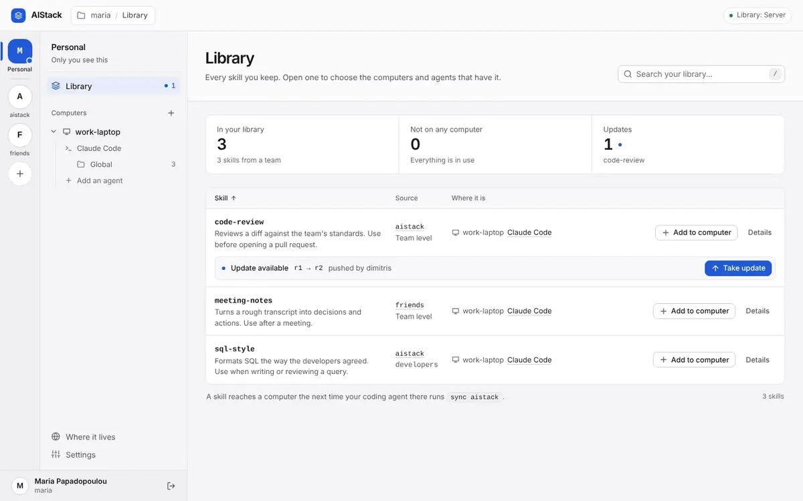

A member who is in no group: the private group is absent

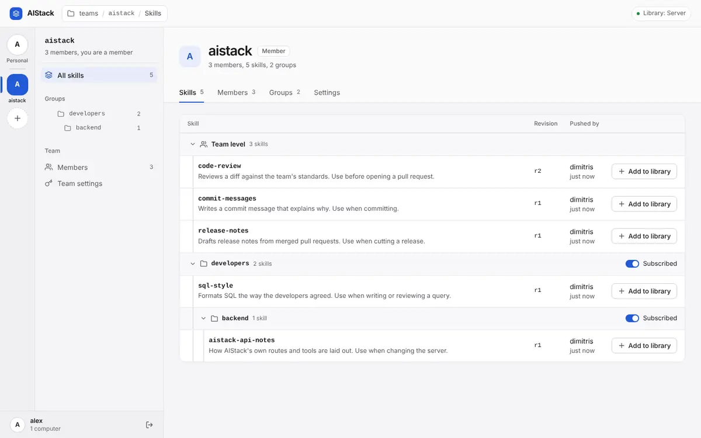

The Library at 390px, dark (stat tiles cut off, UI-21)

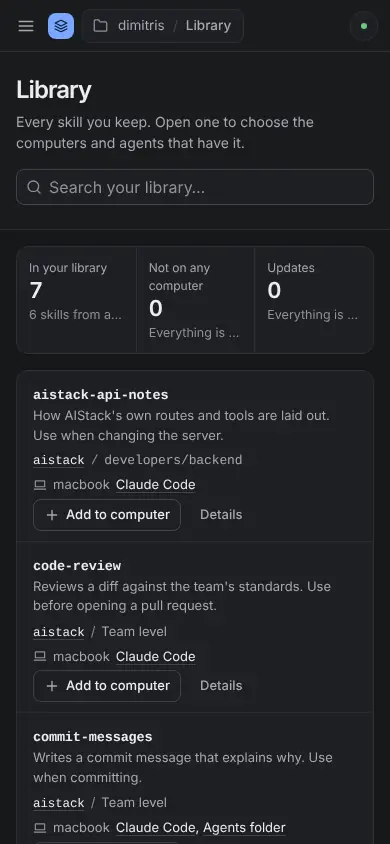

A team at 390px

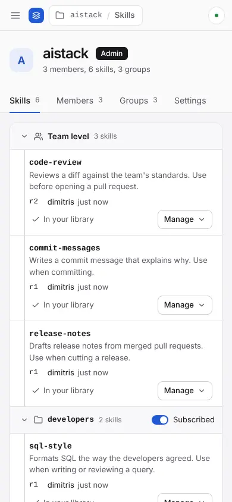

The phone drawer, with Add a computer still open after moving to a team page (UI-12)

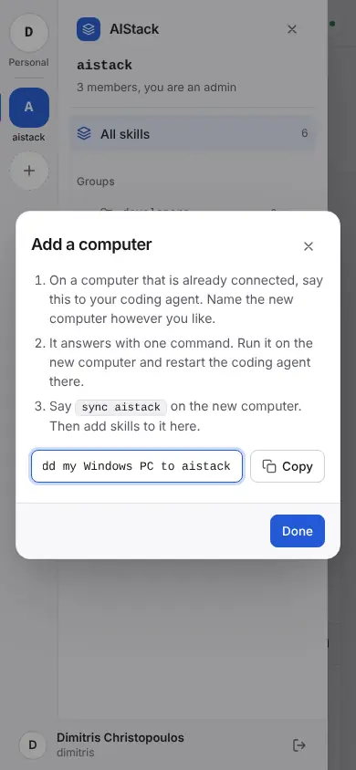

Local mode, an empty Library on this computer

Local mode, Where it lives, dark

The signed-out page ignores dark mode (UI-17)

