# UX

Wording, flows, empty states, errors, what a newcomer misunderstands, and what the agent says in chat. This area had its second pass: each finding carries the verifier's verdict.

| Id | Finding | Severity | Status | Effort |
|---|---|---|---|---|
| [UX-V01](#ux-v01-add-to-library-on-a-team-skill-named-like-an-unrelated-skill-of-your-own-replaces-yours-on-every-computer-with-no-warning-and-the-toast-says-added) | 'Add to library' on a team skill named like an unrelated skill of your own replaces yours on every computer, with no warning, and the toast says 'Added' | High | Confirmed | M |
| [UX-01](#ux-01-taking-a-team-update-replaces-the-persons-own-backed-up-edits-on-every-computer-and-the-offer-never-says-so) | Taking a team update replaces the person's own backed-up edits on every computer, and the offer never says so | Medium | Confirmed | M |
| [UX-02](#ux-02-a-sign-in-link-works-once-but-the-wording-says-five-minutes-and-reopening-it-says-you-are-not-signed-in-even-to-a-signed-in-browser) | A sign-in link works once, but the wording says 'five minutes', and reopening it says 'You are not signed in' even to a signed-in browser | Medium | Confirmed | S |
| [UX-03](#ux-03-a-team-made-by-mistake-can-never-be-removed-its-only-member-cannot-leave-and-nothing-deletes-or-renames-a-team-or-group) | A team made by mistake can never be removed: its only member cannot leave, and nothing deletes or renames a team or group | Medium | Confirmed | M |
| [UX-04](#ux-04-where-it-lives-on-a-server-says-everyone-on-this-server-shares-it-about-a-private-library-and-suggests-setting-aistack-up-again) | 'Where it lives' on a server says 'Everyone on this server shares it' about a private Library, and suggests setting AIStack up again | Medium | Confirmed | S |
| [UX-07](#ux-07-a-second-computer-that-has-only-codex-never-gets-the-sync-skill-or-the-first-sync-library-offer-and-the-dashboard-shows-it-a-claude-code-folder-before-it-syncs) | A second computer that has only Codex never gets the sync skill or the first-sync Library offer, and the dashboard shows it a Claude Code folder before it syncs | Medium | Confirmed | S |
| [UX-08](#ux-08-for-a-github-library-the-dashboard-says-connected-and-each-computer-picks-up-the-change-when-github-cannot-be-reached) | For a GitHub Library the dashboard says 'Connected' and 'each computer picks up the change' when GitHub cannot be reached | Medium | Confirmed | M |
| [UX-10](#ux-10-the-dashboard-and-the-local-sync-skill-hand-out-uvx-aistack-mcp-setup-and-uv-tool-install-aistack-mcp-which-fail-today) | The dashboard and the local sync skill hand out 'uvx aistack-mcp setup' and 'uv tool install aistack-mcp', which fail today | Medium | Confirmed | S |
| [UX-P01](#ux-p01-a-library-kept-on-this-computer-only-is-never-shown-as-at-risk-propose-a-nudge-not-a-gate) | A Library kept on this computer only is never shown as at risk; propose a nudge, not a gate | Medium | Confirmed | S |
| [UX-05](#ux-05-skills-you-wrote-and-shared-show-in-your-library-as-coming-from-the-team-n-skills-from-a-team) | Skills you wrote and shared show in your Library as coming from the team ('N skills from a team') | Low | Confirmed | S |
| [UX-06](#ux-06-sharing-over-a-teammates-unrelated-namesake-is-flagged-only-afterwards-and-teammates-who-took-the-original-are-offered-it-as-an-ordinary-update) | Sharing over a teammate's unrelated namesake is flagged only afterwards, and teammates who took the original are offered it as an ordinary update | Low | Confirmed | M |
| [UX-09](#ux-09-tool-specific-error-sentences-reach-local-mode-and-the-dashboard-call-get_skill-with-its-team-the-server-holds-no-decision-a-python-function-name) | Tool-specific error sentences reach local mode and the dashboard ('call get_skill with its team', 'the server holds no decision', a Python function name) | Low | Confirmed | S |
| [UX-11](#ux-11-joining-asks-for-the-name-you-want-to-go-by-but-join-needs-a-lowercase-username-and-has-no-place-for-the-full-name) | Joining asks for 'the name you want to go by', but join needs a lowercase username and has no place for the full name | Low | Confirmed | S |
| [UX-12](#ux-12-an-existing-user-who-pastes-the-invite-pages-setup-sentence-may-never-be-put-in-the-team-setup-has-no-branch-for-a-team-code) | An existing user who pastes the invite page's setup sentence may never be put in the team: setup has no branch for a team code | Low | Suspected | S |
| [UX-13](#ux-13-pending-invites-made-close-together-cant-be-told-apart-and-the-invite-dialog-says-to-send-one-link-to-the-people) | Pending invites made close together can't be told apart, and the invite dialog says to send one link 'to the people' | Low | Confirmed | S |
| [UX-14](#ux-14-with-an-empty-library-add-skills-says-everything-in-your-library-is-here-already-and-still-offers-add) | With an empty Library, 'Add skills' says 'Everything in your library is here already.' and still offers Add | Low | Confirmed | S |
| [UX-15](#ux-15-removal-confirmations-and-toasts-misstate-what-happens-and-leave-out-what-stays-and-what-is-irreversible) | Removal confirmations and toasts misstate what happens and leave out what stays and what is irreversible | Low | Confirmed | S |
| [UX-18](#ux-18-the-move-here-dialog-says-the-same-thing-for-every-destination-wrong-for-only-this-computer-silent-on-history-and-restart) | The 'Move here…' dialog says the same thing for every destination: wrong for 'Only this computer', silent on history and restart | Low | Confirmed | S |
| [UX-19](#ux-19-ticking-computers-in-the-skill-panel-and-then-clicking-share-with-a-team-or-remove-from-library-discards-the-ticks-without-a-word) | Ticking computers in the skill panel and then clicking 'Share with a team…' or 'Remove from library…' discards the ticks without a word | Low | Confirmed | S |
| [UX-20](#ux-20-add-my-other-computer-never-tells-the-person-the-command-they-carry-to-the-other-computer-is-a-permanent-key) | 'Add my other computer' never tells the person the command they carry to the other computer is a permanent key | Low | Confirmed | S |

I re-checked all 20 UX findings on my own server (port 8490, demo users only), over local-mode stdio, and in a GitHub Library where a local bare repo stands in for GitHub and is moved away to simulate going offline. Scripts are in &lt;scratch&gt;/ux-verify/ (vlib.py, s1.py with its output s1.out, s2.py, s3.py, s4_github_offline.py, s5.py, s6_take_over_namesake.py). Every reproduction behaved as the finder reported. Results: 7 kept as written, 9 corrected, 2 dropped, and 1 new finding.

Corrections fall into three groups:
- **Overstated because an ADR already decides part of it:**
  - UX-01: ADR-0015 and README:338 decide on purpose that taking a team's copy replaces your latest. History you can't reach is the known "no version pinning" limit. What's missing is a warning when the offer is made. High → Medium.
  - UX-06: ADR-0015:22 chose to flag sharing over an unrelated skill only after it happens. So the finder's "refuse, and share again with replace" fix needs a new ADR. What the ADR leaves open is the teammates' offer and a check the dialog can make before sharing. Medium → Low.
- **Severity inflated:** UX-05, UX-09, UX-12 and UX-13 → Low. UX-12 also moves to Suspected, because the result depends on how the agent reads setup's "stop".
- **Sub-claims removed:** UX-04's operator-backup line is accurate, since OPERATING.md has a Backups section. UX-09's "echoes UUIDs" is the caller's own input, echoed as AGENTS.md asks.
- **UX-08 strengthened:** the finder only traced the code; I ran it offline. /api/state returns 200, a placement returns {"ok": true} with 1 event unpublished, and the Storage page and pill both still say "Connected".

**Dropped:** UX-16 and UX-17 are naming nitpicks. DESIGN.md decides "Personal" and "team level". CONTEXT.md:9 says to avoid "Codex" as the label for the agents folder. The one real part of UX-16, team revision numbers shown next to your own, is already in UX-01's fix.

**New (UX-V01, High):** clicking "Add to library" on a team skill whose name matches an unrelated skill of your own silently replaces yours on every computer. The toast says "Added". Your next sync then overwrites the folder as an ordinary update, without asking.

### UX-V01: 'Add to library' on a team skill named like an unrelated skill of your own replaces yours on every computer, with no warning, and the toast says 'Added'

**Confirmed.** Severity **High**, effort **M**. Hurts: Any member whose Library has a skill with a common name (code-review, commit-messages, deploy-steps) that a teammate also shared. Their own skill is replaced everywhere by one click or one 'install X from team'.

**Where.** src/aistack/bundled/dashboard.html:1958-1965 (teamSkillRow: in_library false gives a plain 'Add to library', with no check that state.skills already has that name) and :1760-1767 (toast 'Added X to your library'); src/aistack/services/skill_service.py:203-223 (take_from_team stores the team's revision on top of the existing unlinked own skill); src/aistack/mcp/tools/skills.py:236-242 (get_skill's description warns of nothing for team takes); src/aistack/services/reconciliation.py:97

**What is wrong.** take_from_team finds the caller's own skill by name and stores the team's latest revision as its next revision, whether or not the two are related. The team row cannot show that the person already has a different skill of that name: in_library is false because their copy is not linked. So the button reads 'Add to library' and fires with no confirmation. Afterwards the person's own skill is the teammate's content (pushed_by the teammate), the toast says 'Added', and the next sync on each of their computers finds their own folder matching an older revision and overwrites it as an ordinary update, without asking. The same happens in chat with 'install X from web', and get_skill's result carries no hint. ADR-0015:45 covers replacing when 'your copy and the team's have both changed', meaning the same lineage. ADR-0015:22 flags unrelated namesakes only on share; take has no equivalent, so README:133's 'says so first' is broken here.

**How it was confirmed.** s6_take_over_namesake.py on my server (127.0.0.1:8490, demo users):
1. ben pushes his own oncall-notes ('ben's own pager checklist', his r1, source null). ana pushes an unrelated oncall-notes and shares it to web.
2. In ben's /api/state the team row has in_library false.
3. Playwright on #/t/web/skills: the row reads 'oncall-notes | … | r1 | ana | just now | Add to library'. Clicking it toasts 'Added oncall-notes to your library. Add it to a computer to use it there.'
4. /api/state now has ben's oncall-notes at revision 2, pushed_by ana, source web.
5. ben's sync with his own r1 still on disk returns update [{oncall-notes, from 1, to 2, pushed_by ana}] and ask [].
Screenshots: ux-verify/ben-team-row-before.png, ben-after-add-to-library.png.

**Proposed fix.** Ask first, the way ADR-0006 asks before overwriting.
1. In skill_service.take_from_team, when the caller has a non-archived own skill of that name that was not created now and whose source_skill_id is not this source, raise Conflict unless the call passes replace=True: 'You already have your own oncall-notes (revision 1, last pushed by you) that was not taken from web. Taking web's replaces yours on every computer; yours stays in your history.'
2. Add replace: bool = False to get_skill (mcp/tools/skills.py) and to the /teams/{team}/take action body.
3. Have the server sync-aistack skill tell the agent to ask before retrying with replace.
4. In dashboard.html's teamSkillRow, when `state.skills.find(x => x.name === s.name)` exists and its source is not this team, label the button 'Replace yours…' and open a confirmDialog naming the person's revision before calling take with replace: true.
This does not reverse ADR-0015, which decides replacement only for the same lineage, but it adds an argument to a tool: record it in DESIGN.md's tool list.

**Done when.** A service test: take_from_team over an unlinked own skill raises Conflict and leaves the person's revisions unchanged; with replace=True it proceeds. A UI test: the team row of a namesake reads 'Replace yours…', its dialog names the person's own revision, and /api/state is unchanged until it is confirmed.

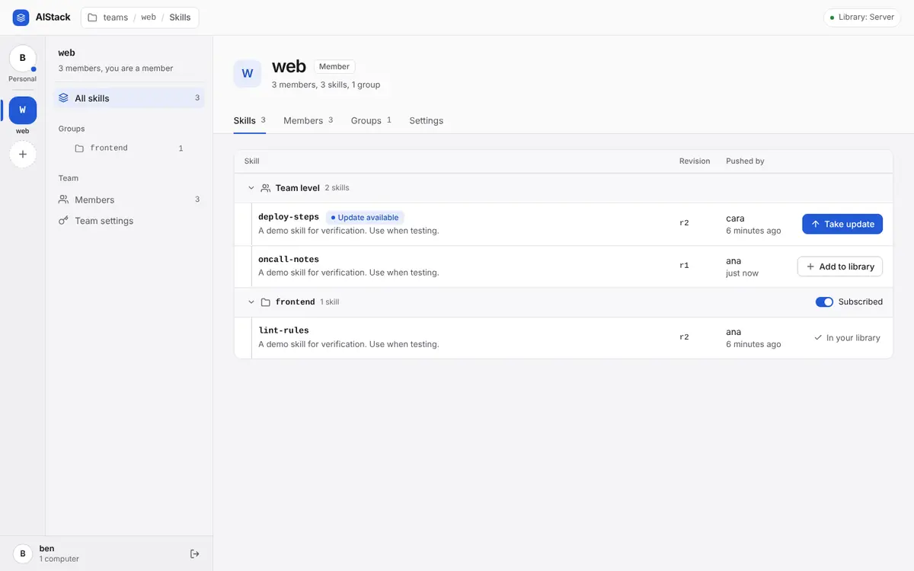

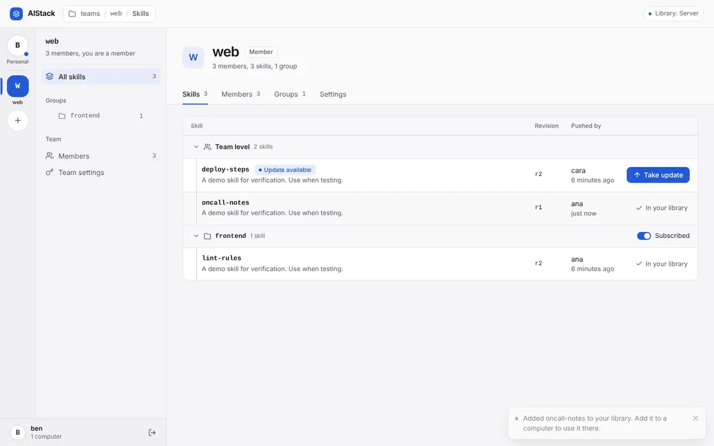

Related: [PH-01](plot-holes.md#ph-01-taking-a-team-skill-whose-name-matches-one-of-your-own-silently-replaces-yours-on-every-computer), [PH-03](plot-holes.md#ph-03-sharing-an-edit-of-an-older-team-revision-silently-overwrites-a-teammates-newer-one), [PH-08](plot-holes.md#ph-08-it-stays-in-your-history-is-a-promise-nothing-can-keep-no-tool-page-or-script-reads-or-restores-an-older-revision), [UX-01](#ux-01-taking-a-team-update-replaces-the-persons-own-backed-up-edits-on-every-computer-and-the-offer-never-says-so), [UX-06](#ux-06-sharing-over-a-teammates-unrelated-namesake-is-flagged-only-afterwards-and-teammates-who-took-the-original-are-offered-it-as-an-ordinary-update).

### UX-01: Taking a team update replaces the person's own backed-up edits on every computer, and the offer never says so

**Confirmed.** Severity **Medium**, effort **M**. Hurts: A member who took a skill from a team, then edited it and backed it up (sync does that without asking), and then accepts a teammate's update with Take update or a yes in chat

**Where.** src/aistack/bundled/dashboard.html:1613-1619, :1663-1665 and :1760-1767 (Take update fires with no confirmation; 'r1 → r2' sits above 'Revision r2'); src/aistack/bundled/dashboard.html:1962 (the same button on the team row); src/aistack/services/skill_service.py:203-223; src/aistack/services/reconciliation.py:97; src/aistack/bundled/skills/sync-aistack/SKILL.md:126-133; README.md:133

**What is wrong.** The offer is worded the same whether or not the person changed the skill since taking it. The row reads 'Update available r1 → r2, pushed by ana', directly above their own 'Revision r2, last pushed by ben'. One click stores the team's content as their r3. Their other computers still hold their r2, which now matches an older revision, so the next sync there overwrites it as a silent update. Replacing the latest is deliberate (ADR-0015:45, README:338), and the earlier revision staying out of reach is the known 'no version pinning' limit. The defect is that neither the button nor the sync skill's team-update wording warns that the person's own changes since taking will be replaced everywhere. README:133 promises 'Every answer that would overwrite your files or discard edits says so first.'

**How it was confirmed.** s1.py on my server at 127.0.0.1:8490 (output in ux-verify/s1.out):
1. ben runs get_skill(lint-rules, team=web) and gets his r1. He pushes an edit, which becomes r2 pushed_by ben. ana pushes v2 and shares it, making the team's r2.
2. ben's sync with local = sha256 of his r2 returns team_updates [{lint-rules, web, 1→2, ana}] and ask [].
3. ben's /api/state has revision 2, pushed_by ben, source {revision 1, latest_revision 2, update_available true}.
4. POST /api/teams/web/take {name: lint-rules} answers {ok: true}. State is now (3, ana).
5. Syncing again with his r2 still on disk returns update [{lint-rules, from 2, to 3, ana}] and ask [], so the folder is overwritten without asking.
6. get_skill accepts only name, team and harness; calling it with revision=2 fails on the unexpected argument.
Re-read takeSkill (dashboard.html:1760-1767): no confirmDialog.

Second pass (corrected): Re-ran the whole flow on my own server and got identical numbers. Severity lowered from High to Medium:
- ADR-0015:45 and README:338 make 'taking replaces your latest' a deliberate decision.
- The edits are still in the database's history; that a person can't reach them is the README known limit 'No version pinning' (DESIGN.md:555).
So 'nothing can bring them back' is the known limit; the real gap is the missing warning when the offer is made. Dropped fix item 4 (roadmap). Noted the existing UI test that must change.

**Proposed fix.** Keep 1-3 of the finder's fix; drop 4.
1. In dashboard_service._my_skills, set source.own_changes when the user's latest content_hash differs from the team SkillVersion at (source_skill_id, source_revision). This is computable from existing columns, so no migration.
2. In sync_service._team_updates, add the same flag to TeamUpdate and TeamUpdateEntry. Have the server and local sync-aistack skills say 'You changed X since you took it (your revision N); taking ana's replaces yours on every computer.'
3. In dashboard.html, when own_changes is set, make Take update open a confirmDialog naming the revision it replaces. Label numbers by whose they are ('web r1 → r2', 'your r2').
Update tests/ui/test_dashboard_page.py:58, which clicks Take update directly, in the same commit. Restoring an earlier revision is version pinning, a roadmap item, so leave it out. No new ADR needed: this applies ADR-0006's 'say so first' to the team path.

**Done when.** An API test runs take, edit and push, then has a teammate share; /api/state shows source.own_changes true, and sync's team_updates carries the flag. A Playwright test clicks Take update on that row and finds a dialog naming the person's revision; /api/state is unchanged until it is confirmed.

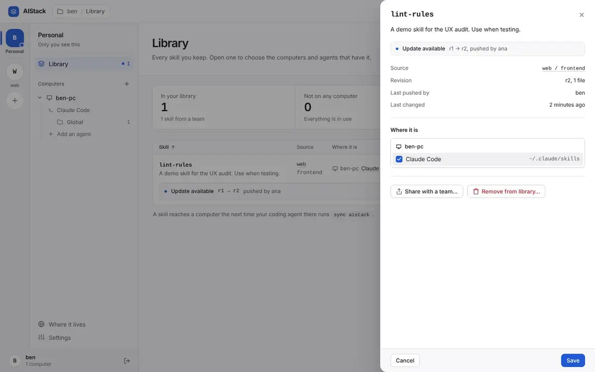

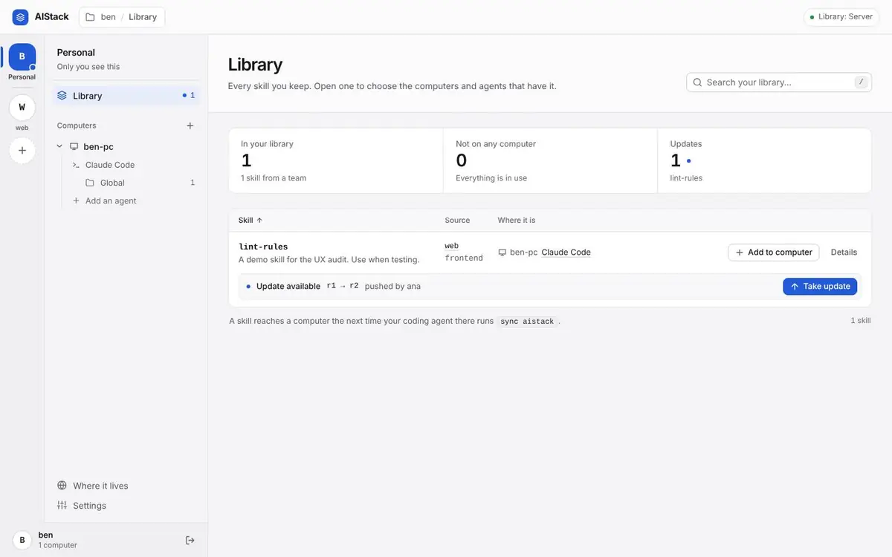

Related: [PH-01](plot-holes.md#ph-01-taking-a-team-skill-whose-name-matches-one-of-your-own-silently-replaces-yours-on-every-computer), [PH-03](plot-holes.md#ph-03-sharing-an-edit-of-an-older-team-revision-silently-overwrites-a-teammates-newer-one), [PH-08](plot-holes.md#ph-08-it-stays-in-your-history-is-a-promise-nothing-can-keep-no-tool-page-or-script-reads-or-restores-an-older-revision), [UX-06](#ux-06-sharing-over-a-teammates-unrelated-namesake-is-flagged-only-afterwards-and-teammates-who-took-the-original-are-offered-it-as-an-ordinary-update), [UX-V01](#ux-v01-add-to-library-on-a-team-skill-named-like-an-unrelated-skill-of-your-own-replaces-yours-on-every-computer-with-no-warning-and-the-toast-says-added).

### UX-02: A sign-in link works once, but the wording says 'five minutes', and reopening it says 'You are not signed in' even to a signed-in browser

**Confirmed.** Severity **Medium**, effort **S**. Hurts: Anyone who opens a dashboard link twice or comes back to it. In local mode it hits everyone whose browser opened by itself: open_dashboard and `aistack dashboard` both open the link and also hand it to the person.

**Where.** src/aistack/api/dashboard.py:95-99 and :370-381; src/aistack/mcp/tools/local.py:288-290 and :302-306 (webbrowser.open, then 'also give the user the link'); src/aistack/bootstrap/__main__.py:97-99 (prints the link 'good for five minutes' and opens it); src/aistack/mcp/tools/teams.py:164-165 ('for a few minutes', never 'once'); scripts/demo_seed.py:91 and :154

**What is wrong.** Links are single-use since a47a636, but nothing a person reads says so. A used link gets HTTP 401 and the generic 'You are not signed in … A link works for five minutes' page. On a server that page adds 'Not connected yet?' setup text. This happens even when the same browser holds a valid session, so /app works one click away. The precise reason ('has been used, or has expired') is computed in transfer_ticket._invalid_dashboard_link and thrown away.

**How it was confirmed.** s2.py, server half (my server, 8490): one httpx client opened ana's open_dashboard link and got 303. The same URL again in the same client got 401 with 'You are not signed in … A link works for five minutes. Not connected yet? …'. /app in that client then got 200.
Local half (a copy of local2, BROWSER set to a script that only records the URL): open_dashboard handed webbrowser.open the same URL it returned. In one Playwright context, the first goto got 200 /app 'Library'; the same link in a second tab got 401 'You are not signed in … A link works for five minutes.'; /app in that context got 200 'Library'.

Second pass (kept): Re-ran both halves myself. In local mode I used the same browser context for the auto-open and the click, so the browser demonstrably held a valid session (/app 200) while the link said 'not signed in'. Small accuracy note: the two open_dashboard descriptions say 'a few minutes' rather than 'five minutes'. The defect stands: none says 'once'. Also found that `aistack dashboard` (__main__.py:97-99) prints and auto-opens the same link, so the same problem occurs there. tests/api/test_dashboard_over_http.py:141 only covers the cookieless stranger.

**Proposed fix.** 1. In api/dashboard.sign_in, on InvalidTicket: if _signed_in(request) succeeds, redirect 303 to /app. Otherwise render a page saying 'This sign-in link has already been used or has expired. Ask your coding agent to open my aistack dashboard for a new one.', without the 'Not connected yet?' block.
2. Say 'works once, within five minutes' in: open_dashboard (teams.py and local.py), serve_dashboard's print, _signed_out_page, and demo_seed.
3. In local.open_dashboard, return opened: bool from webbrowser.open, and tell the agent to show the link only when opened is false. serve_dashboard can print only the /app address once the browser has opened.
Keep test_a_link_signs_a_browser_in_once: a client without the cookie must still get 401.

**Done when.** A test in tests/api/test_dashboard_over_http.py opens a link, then opens it again with the same client and gets a 303 to /app; a fresh client still gets 401, with 'already been used' in the page. A local-mode test asserts open_dashboard reports opened.

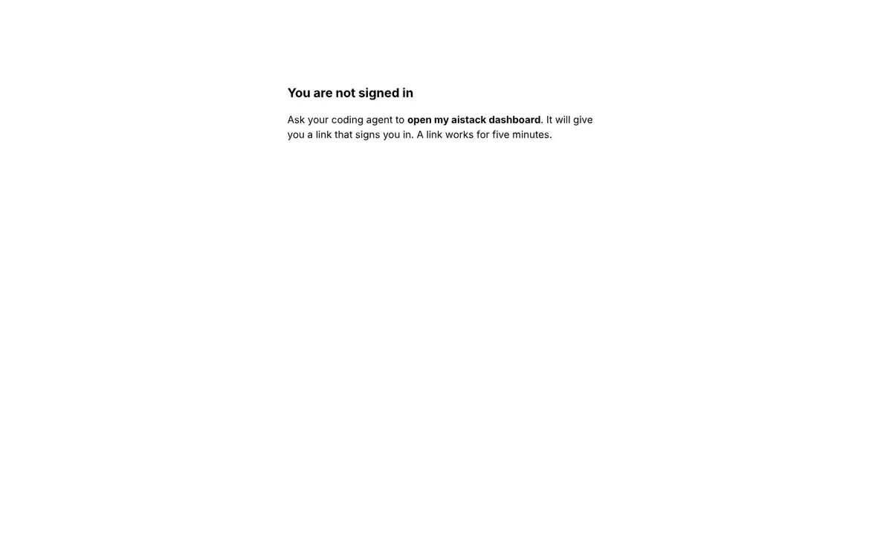

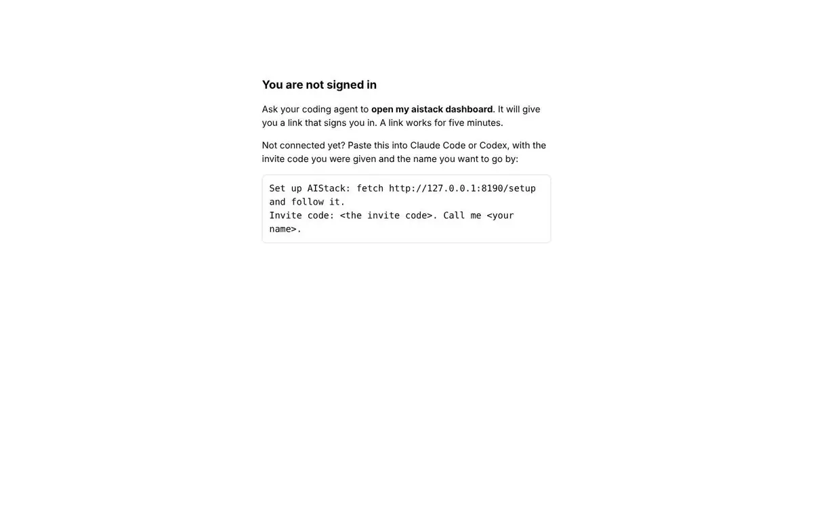

Related: [UI-09](ui.md#ui-09-local-mode-forgets-the-theme-accent-and-picked-agents-every-run-each-dashboard-gets-a-new-port-and-so-a-new-origin).

### UX-03: A team made by mistake can never be removed: its only member cannot leave, and nothing deletes or renames a team or group

**Confirmed.** Severity **Medium**, effort **M**. Hurts: Anyone who tries 'create a team called …' or mistypes the name; an admin with a stale group

**Where.** src/aistack/services/team_service.py:317-322, :350-352 and :487-496 (_keep_an_admin refuses even a lone member); src/aistack/services/team_service.py:95-104 (the name stays taken 'by a team or a user'); no delete function in team_service.py or api/dashboard.py; src/aistack/bundled/dashboard.html:2350-2360 (Leave card) and :2636-2640 (the demo lets a lone admin leave); docs/OPERATING.md:99

**What is wrong.** The only member of a team cannot leave it ('That would leave team … with no admin. Make someone else an admin first.') and cannot demote themselves. Nobody can be promoted, and no team or group can be deleted. The team keeps its rail button, its 'Leave team' card that cannot work, and its name, which shares a namespace with usernames. The page's own demo lets a lone admin leave, so the demo teaches behaviour the server refuses.

**How it was confirmed.** s1.py on my server: cara ran POST /api/teams with cara-solo (200). POST /api/teams/cara-solo/leave answered 409 with the sentence above. POST /api/teams/cara-solo/members/cara {role: MEMBER} also answered 409. Read team_service.py: there is no delete or rename for a team or group. Read the demo leave rule at dashboard.html:2638: it fails only when `t.members.length > 1`.

Second pass (kept): Re-ran leave and demote on my server: both 409. Confirmed the name stays reserved (create_team's Conflict message) and the demo discrepancy at dashboard.html:2638. Checked DESIGN.md (268, 282, 555) and ADR-0015: neither decides that a lone team must persist, so this is a gap, not a decision. Added the FK detail the fix depends on.

**Proposed fix.** 1. In team_service.leave_team, when the leaver is the last member, delete the team. Invites, groups and members cascade (team.py FKs). Delete the team's SkillFile/SkillVersion/Skill rows the way remove_skill does. People's copies survive because skill.source_skill_id is ON DELETE SET NULL (skill.py:39-40).
2. Make the Leave dialog say 'You are its only member, so leaving deletes &lt;team&gt; and its skills. Copies in your Library stay yours.'
3. Optionally add team_service.delete_group (its skills move to the parent) as an admin @_action with a confirmDialog, and list the routes in DESIGN.md's dashboard routes table.
4. Make the demo's leave rule match the server.
DESIGN.md:268's 'a team keeps at least one admin' still holds. No new ADR needed.

**Done when.** A service test: a lone admin's leave_team removes the team, and create_team with the same name then succeeds. A UI test: the lone member leaves through the dialog and the team is gone from /api/state.

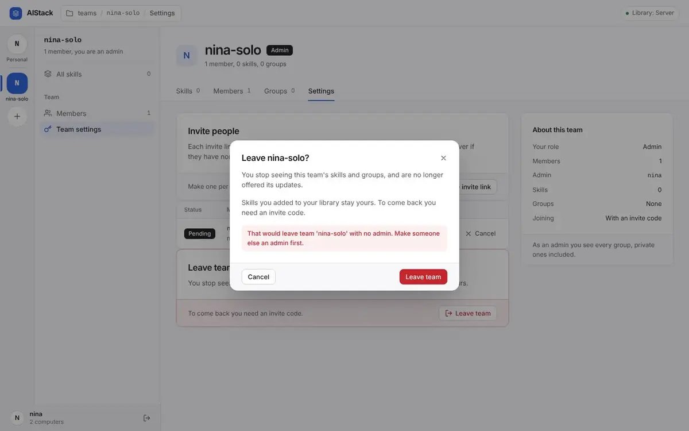

Related: [AUTHZ-05](security.md#authz-05-the-only-member-of-a-team-can-never-leave-it-and-no-team-can-be-deleted-the-pages-own-demo-lets-them), [PH-04](plot-holes.md#ph-04-a-team-or-group-can-never-be-deleted-or-renamed-a-lone-admin-can-never-leave-team-names-take-usernames-for-good), [PH-16](plot-holes.md#ph-16-a-username-is-permanent-shares-a-namespace-with-team-names-and-a-taken-one-is-always-explained-as-this-is-you-on-a-new-computer).

### UX-04: 'Where it lives' on a server says 'Everyone on this server shares it' about a private Library, and suggests setting AIStack up again

**Confirmed.** Severity **Medium**, effort **S**. Hurts: Every server user who opens the 'Library: Server' pill; most of all a newcomer deciding whether the backups sync already made of their skills are private

**Where.** src/aistack/bundled/dashboard.html:2258 (the server note); :2257 (local note: lowercased 'an aistack server', repeats itself)

**What is wrong.** On a server the Library is private: the sidebar on the same screen says 'Only you see this', and sync backs up every skill without asking because that space is private. The Storage page says 'Everyone on this server shares it. To keep a Library of your own instead, set AIStack up again on your computer…'. That tells the person their Library is shared. It also pushes them toward local mode, which loses their teams and whose install command fails today. In local mode the 'Want a team?' note lowercases the brand and gives no next step.

**How it was confirmed.** Read dashboard.html:2216-2259. The server branch is the else of `elsewhere.length` (a server's Library has no 'elsewhere'), so every server user sees line 2258. The finder's storage-desktop-light.png shows that text next to the 'Only you see this' sidebar.

Seen on a fresh demo server (screenshot below).

Second pass (corrected): Kept the main claim and its severity: a privacy statement that contradicts the sidebar and what sync does. Removed the sub-claim about 'The operator of this server backs it up': docs/OPERATING.md:232 (Backups) makes that the operator's documented job, so it is not a false promise. The fix no longer changes that line.

**Proposed fix.** In storageView(), replace the server note with 'Your Library on this server is private: only you see it. Teams and groups are where you share.' For local mode: 'Want a team? A team needs an AIStack server everyone reaches. To move your Library onto one, export it and connect this computer to the server.', linking README#connecting-a-computer-to-a-server. Stop lowercasing STORAGE.server.title. Keep 'The operator of this server backs it up.': docs/OPERATING.md has a Backups section, so it is accurate.

**Done when.** tests/ui/test_dashboard_page.py asserts that the server's storage page shows 'only you see it' and not 'Everyone on this server shares it'.

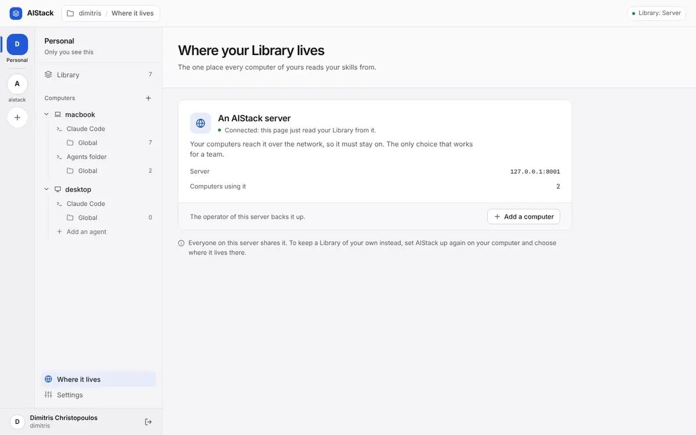

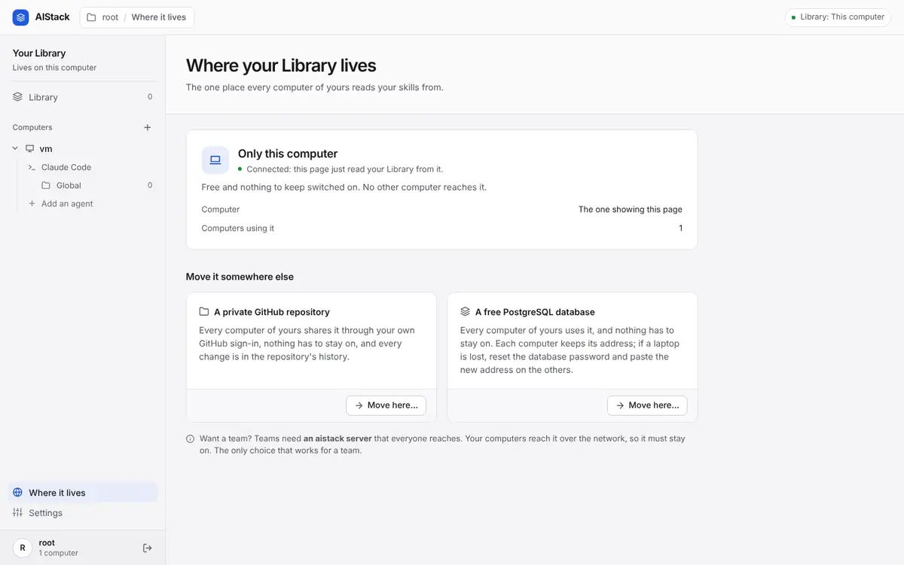

### UX-07: A second computer that has only Codex never gets the sync skill or the first-sync Library offer, and the dashboard shows it a Claude Code folder before it syncs

**Confirmed.** Severity **Medium**, effort **S**. Hurts: Someone with two computers whose second one runs only Codex or another ~/.agents/skills agent

**Where.** src/aistack/services/sync_service.py:172-174; src/aistack/mcp/tools/sync.py:98; src/aistack/mcp/tools/onboarding.py:93-119; src/aistack/services/dashboard_service.py:126-147; README.md:343 vs :293

**What is wrong.** add_machine returns a Codex config block, but on that computer sync with harness agents never returns sync_skill_url. The ADR-0021 marker ('setup put it there') never happens for a computer added by add_machine. So sync-aistack is never installed, and the first_sync instruction 'See the sync-aistack skill' points at nothing. The Library offer for a computer's first sync lives only in that skill, so the second computer's first 'sync aistack' reports nothing to do. A just-added computer shows 'Claude Code' in the dashboard until it syncs, inviting placements in a folder no agent there syncs. README:343 still says a Codex-only second computer 'is not connected that way yet', which contradicts README:293.

**How it was confirmed.** s1.py on my server: cara ran add_machine(name='cara-codex-box', os=LINUX). With the new token, sync(local={}, harness='agents') returned first_sync true and sync_skill_url null; a second call returned null again. s5.py: right after ana ran add_machine('ana-second'), /api/state showed harnesses ['claude_code'] for it.

Second pass (kept): Re-ran add_machine and two agents-harness syncs: sync_skill_url null both times. Confirmed the claude_code default for a just-added machine. Checked ADR-0021's marker rule (sync_service.py:168-174): its precondition never occurs for an add_machine'd computer, so this is not deliberate. Clarified that the dashboard fix leaves legacy machines with decisions alone.

**Proposed fix.** 1. In sync_service, also refresh the sync skill for harness agents when this machine has no claude_code MachineHarness row. That keeps ADR-0021's intent: the caller is an agent connected through that folder. Alternatively, have add_machine's codex_config instructions include the curl of /setup/sync-aistack/SKILL.md into ~/.agents/skills.
2. Put the first_sync Library offer into the sync tool's description itself.
3. In dashboard_service._machines, return no harness for a computer with no MachineHarness and no MachineSkill row, and show 'Not synced yet: say sync aistack there'. Legacy computers with decisions keep claude_code from their MachineSkill rows.
4. Rewrite README:343.

**Done when.** A sync_service test: the first agents-harness sync on a machine with no claude_code record returns refresh_sync_skill true. An API test: a just-added machine shows no harness in /api/state.

Related: [AUTO-09](automation.md#auto-09-a-computer-connected-with-add_machine-is-never-offered-the-session-start-hook-and-a-codex-only-one-never-gets-the-sync-skill), [PH-06](plot-holes.md#ph-06-a-codex-only-second-computer-added-with-add_machine-never-gets-the-sync-skill-or-the-offer-of-the-library), [PH-15](plot-holes.md#ph-15-the-sync-tools-sync-skill-download-fails-on-exactly-the-computers-it-exists-for).

### UX-08: For a GitHub Library the dashboard says 'Connected' and 'each computer picks up the change' when GitHub cannot be reached

**Confirmed.** Severity **Medium**, effort **M**. Hurts: Someone whose Library is in a private GitHub repository and who uses the dashboard offline or with gh signed out

**Where.** src/aistack/services/library_sharing.py:28-37; src/aistack/api/dashboard.py:138-142 and :172-174 (library_after_write's False is dropped); src/aistack/bundled/dashboard.html:1299-1301, :1645 and :2245

**What is wrong.** push_skill learned to say when a change has not reached GitHub (shared: false); the dashboard did not. With the repository out of reach, /api/state silently serves the local copy. The Storage page and pill still say 'Connected: this page just read your Library from it.' and ', connected'. A dashboard change answers {ok: true} and toasts 'Each computer picks up the change at its next sync', while the event stays unpublished.

**How it was confirmed.** Ran s4_github_offline.py: build_local_context with aistack_library_repo pointing at a local bare repo, the same stand-in tests/mcp/test_library_github.py uses.
1. push_skill online: shared true, unpublished 0.
2. open_dashboard, then I moved the repo away as the tests' offline() does.
3. GET /api/state: 200 with library {kind: github}; the server logged 'could not be reached'.
4. POST /api/skills/wizard/machines/&lt;id&gt; {enabled: true, harness: agents}: 200 {ok: true}, with 1 event left unpublished.
5. Playwright on /app#/storage: 'A private GitHub repository | Connected: this page just read your Library from it.' The pill read 'Library: GitHub, connected'. Screenshot gh/storage-offline.png.

Second pass (kept): The finder confirmed this only by tracing code ('Not run against an unreachable repository'). I ran it end to end against a bare-repo stand-in moved out of reach, and every claimed symptom reproduced. Status stays Confirmed, now by execution.

**Proposed fix.** 1. Have LibrarySharing remember the outcome of the last pull and publish (reached: bool, unpublished: int), and return it with library_description() or as a 'sync_state' field in /api/state.
2. In the _action wrapper, return {'shared': library_after_write()} merged into the result in local mode.
3. In dashboard.html, show 'Could not reach GitHub: showing this computer's copy; N changes go out when it is back' instead of 'Connected', switch the pill dot to amber, and end the save toast with 'It reaches your other computers once GitHub is reachable again.'

**Done when.** A local-dashboard test with the bare-repo stand-in moved away: /api/state reports reached false, a placement change returns shared false, and a UI test sees the amber status text.

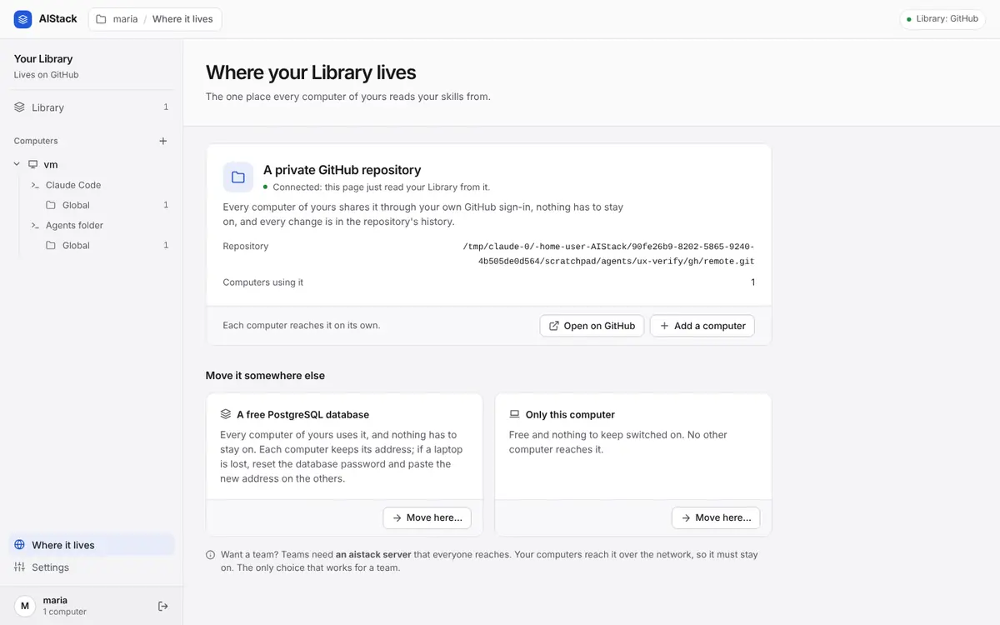

### UX-10: The dashboard and the local sync skill hand out 'uvx aistack-mcp setup' and 'uv tool install aistack-mcp', which fail today

**Confirmed.** Severity **Medium**, effort **S**. Hurts: Someone with a local Library adding a second computer from the dashboard; someone whose local install broke and follows the sync skill's recovery line

**Where.** src/aistack/bundled/dashboard.html:1462, :1478 and :1483; src/aistack/bundled/local/sync-aistack/SKILL.md:15; src/aistack/bundled/local/setup.md:25

**What is wrong.** This follows from the known fact that aistack-mcp is not on PyPI. Besides the README, the product itself hands out the failing command: the GitHub and PostgreSQL 'Add a computer' dialogs give a ready-to-paste sentence built on SETUP, and the local sync skill gives it as recovery advice. A person following them gets a uv resolution error with no hint why.

**How it was confirmed.** Grepped src/aistack/bundled: dashboard.html:1462 holds `uvx aistack-mcp setup`; local/setup.md:25 and local/sync-aistack/SKILL.md:15 hold `uv tool install aistack-mcp`. https://pypi.org/pypi/aistack-mcp/json still answers 404 today (re-checked with curl).

Second pass (kept): Re-grepped every shipped install command and re-checked PyPI (404). This reports what follows from the known fact in the shipped UI and skill, as the brief allows. bootstrap/self_update.py depends on the same publication, but that belongs to another area.

**Proposed fix.** Publish through the existing pypi job on a v&lt;version&gt; tag, the real fix. Until then, let every product-shipped install sentence come from one constant (dashboard SETUP, both local bundled files, README), so release day touches one place. Add a test that greps src/aistack/bundled and README.md for install commands and finds only that form.

**Done when.** `uvx aistack-mcp setup` resolves on a clean machine, and the grep test finds a single install form across bundled files and README.

Related: [AUTO-19](automation.md#auto-19-every-way-to-set-up-another-computer-in-local-mode-and-the-self-updater-depend-on-pypi), [IMP-01](improvements.md#imp-01-the-windows-job-gates-neither-merging-nor-publishing-and-local-mode-then-updates-itself-from-pypi), [IMP-05](improvements.md#imp-05-setup-can-run-from-github-today-but-the-steps-it-prints-still-install-from-pypi-follows-from-the-known-missing-release), [LH-01](plot-holes.md#lh-01-local-mode-cannot-be-installed-aistack-mcp-is-not-on-pypi-and-no-release-has-ever-been-tagged), [STD-02](industry-standards.md#std-02-the-pypi-name-every-setup-sentence-runs-aistack-mcp-is-unregistered-and-anyone-can-take-it).

### UX-P01: A Library kept on this computer only is never shown as at risk; propose a nudge, not a gate

**Confirmed.** Severity **Medium**, effort **S**. Hurts: a person who took the default 'Only this computer' to try AIStack and kept using it: a lost or wiped laptop takes the Library with it

**Where.** Local dashboard, Library and Where it lives (screenshots); src/aistack/bundled/dashboard.html `libraryView`, `storageView`, `ADD_COMPUTER`

**What is wrong.** The only place the page says a Library on this computer cannot leave it is the Add a computer dialog, which a one-computer person never opens. The Library page is the same whether its skills live on one disk or in a private repository. One option is to hide the Library until storage is set up. That would make things worse: there is no 'not set up' state (setup asks before the dashboard can open, and 'only this computer' is a deliberate choice), the Library is the screen where the first sync's backups show and the product makes sense, and moving later is not yet cheap (AUTO-06), so pressing people into a choice early only helps once moving is one step.

**How it was confirmed.** Opened the local dashboard with a Library on this computer, empty and with skills: no notice on the Library or the computer pages; the Where it lives page offers 'Move here…' with no reason given. The Add a computer dialog is the only text that says another computer cannot reach it.

**Proposed fix.** While `state.library.kind` is `this_computer` and the Library holds at least one skill, show one dismissible notice above the Library table: 'Your Library lives only on this computer. If it is lost, so are these skills. Move it to a private GitHub repository: about two minutes.' with a button to Where it lives; dismissing it hides it for 30 days (`localStorage`, versioned key, as the design system says). Keep the hard stop where it already is, in Add a computer. Make setup recommend GitHub by default. Once moving is one command (AUTO-06), the notice's button runs it.

**Done when.** A UI test on the localhost dashboard with one skill finds the notice by its words, follows its button to Where it lives, dismisses it and does not see it after a reload; with a GitHub Library the notice is absent.

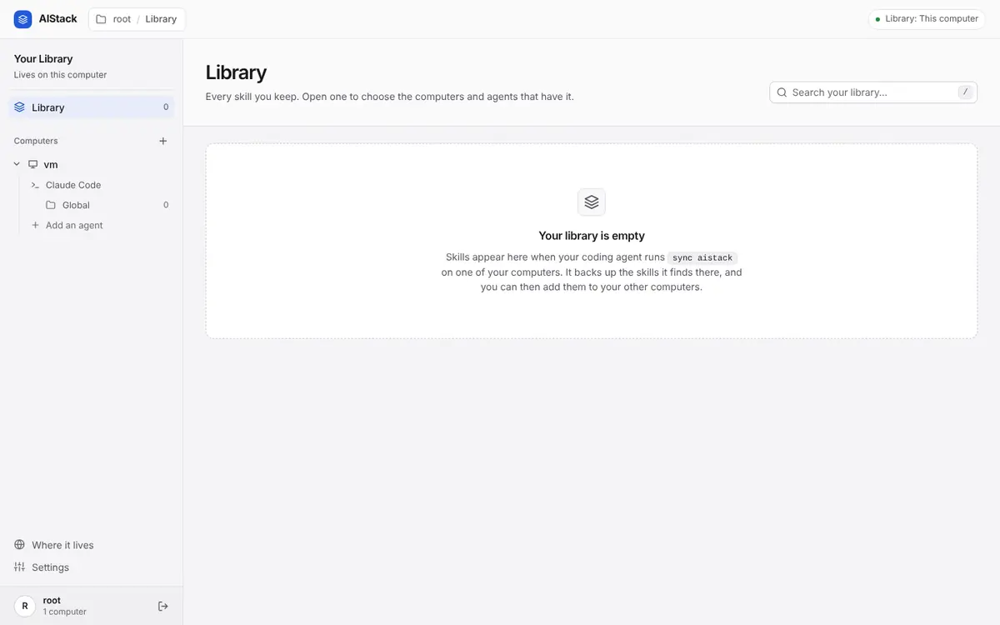

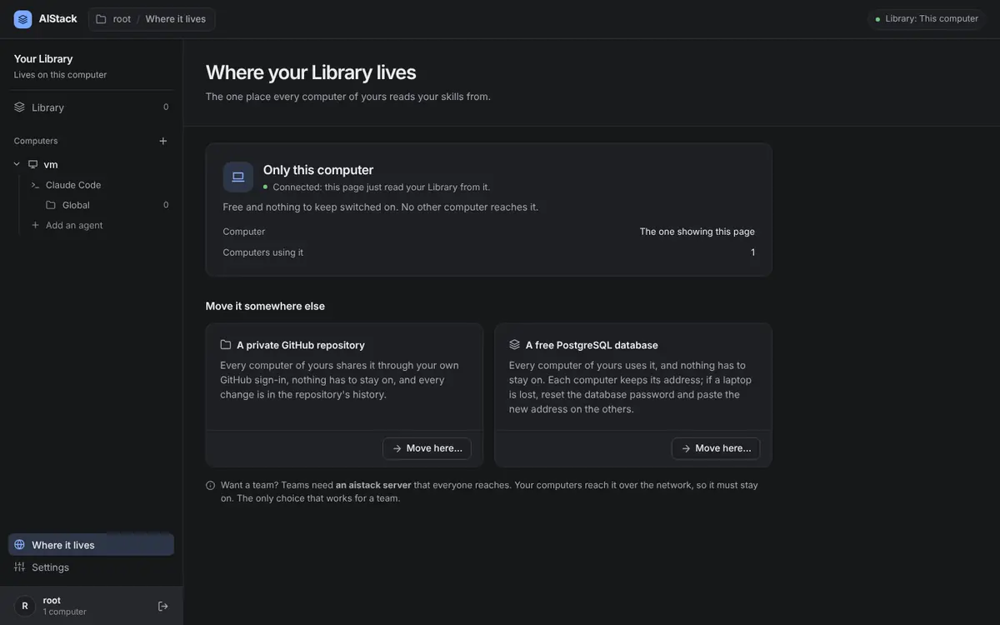

### UX-05: Skills you wrote and shared show in your Library as coming from the team ('N skills from a team')

**Confirmed.** Severity **Low**, effort **S**. Hurts: Anyone who shares their own skills, team admins above all

**Where.** src/aistack/services/skill_service.py:284-286; src/aistack/services/dashboard_service.py:215-232; src/aistack/bundled/dashboard.html:1576 (stat), :1584-1587 (Source cell), :1667 (panel 'Source')

**What is wrong.** share() links the sharer's own skill to the team's copy, so that copy becomes the skill's 'source'. The link is intended (skill.py:36-38 'taken from or shared to'; sync needs it for team_updates), but the page renders every source as provenance. The Source column shows 'web / Team level' for a skill the person pushed themselves, and the stat counts it under 'skills from a team'.

**How it was confirmed.** s1.py on my server: ana pushed deploy-steps and lint-rules, then shared both to web. Her /api/state lists both with pushed_by ana and source {team: web, group: null or frontend}. dashboard.html:1576 counts `state.skills.filter(s => s.source)` as '… from a team'.

Second pass (corrected): Reproduced on my server. Severity lowered from Medium to Low: a misleading label with no data effect, and 'Last pushed by' on the same row shows the person's own name. Replaced the fix's pushed_by heuristic, which breaks when the team revision was pushed by the user, with a neutral-wording option and a compatible nullable column.

**Proposed fix.** Cheapest, with no schema change: label by relation rather than direction. Source cell 'Linked to web / Team level', stat 'N linked to a team'.
Precise: a nullable `source_kind` column ('taken' | 'shared') on skill, set by take_from_team and share. That is a new migration with older_releases_compatible=True; older releases ignore it. Then render 'Shared to …' or 'From …', and count only taken skills in the stat.
The finder's heuristic (first revision's pushed_by is not the user) misclassifies a copy taken from a team revision the user pushed themselves.

**Done when.** An API test: after push and share, /api/state reports the skill as shared, and a taken skill as taken (or both say 'Linked to'). A UI test reads the new Source-cell wording.

### UX-06: Sharing over a teammate's unrelated namesake is flagged only afterwards, and teammates who took the original are offered it as an ordinary update

**Confirmed.** Severity **Low**, effort **M**. Hurts: Members who took the original skill, and the original sharer, whose copy is linked to it; the member who shared by mistake

**Where.** src/aistack/services/skill_service.py:244-297; src/aistack/services/sync_service.py:299-330 (TeamUpdate has no hint); src/aistack/bundled/dashboard.html:1784-1813 (shareDialog checks nothing before submit)

**What is wrong.** ADR-0015:22 deliberately reports sharing over a skill you never took after it happens (possibly_unrelated in the result). Two things the ADR leaves open are missing:
- Teammates who took the original, and the original sharer, get the unrelated content as an ordinary team_updates offer ('deploy-steps r1 → r2 pushed by cara') with no hint that it is a different skill.
- The Share dialog could warn before submitting from state it already holds (team.skills names and the skill's source), but does not.

**How it was confirmed.** s1.py on my server: ben ran get_skill(deploy-steps, team=web) on ana's copy. cara pushed her own unrelated deploy-steps and called share_skill into web: revision 2, possibly_unrelated true, previous_pushed_by ana. ben's next sync returned team_updates [{deploy-steps, web, 1→2, pushed_by cara}] with nothing else to tell it apart.

Second pass (corrected): Reproduced exactly. ADR-0015:22 (and DESIGN.md:146) decide that the sharer is told after, via possibly_unrelated, so the finder's 'ask first by refusing on the server' relitigates an ADR. Narrowed the finding to what the ADR does not decide (the teammates' offer, and a client-side warning before submitting), reworded the fix, and lowered severity from Medium to Low.

**Proposed fix.** 1. Dashboard, no server change: in shareDialog, when the chosen team's skills include s.name and the skill's source is not that team, show before Share: 'web already has a different deploy-steps, last pushed by ana. Sharing puts yours on top for everyone who took it.' Use submitLabel 'Share anyway'.
2. Downstream: add a nullable boolean on skill_version (e.g. shared_over_unrelated), set by share when possibly_unrelated. That is a new migration, older_releases_compatible=True. Carry it in TeamUpdate and TeamUpdateEntry, and have both sync-aistack skills say 'cara's revision replaced the skill you took with a different one of the same name.'
The finder's server-side Conflict plus replace=true reverses ADR-0015's chosen flag-after design and needs a new ADR first.

**Done when.** A UI test opens Share for a skill whose name the team already holds unlinked and sees the warning before anything is stored. A sync test: after an unrelated share, the teammate's team_updates entry carries the flag.

Related: [PH-01](plot-holes.md#ph-01-taking-a-team-skill-whose-name-matches-one-of-your-own-silently-replaces-yours-on-every-computer), [PH-03](plot-holes.md#ph-03-sharing-an-edit-of-an-older-team-revision-silently-overwrites-a-teammates-newer-one), [PH-08](plot-holes.md#ph-08-it-stays-in-your-history-is-a-promise-nothing-can-keep-no-tool-page-or-script-reads-or-restores-an-older-revision), [UX-01](#ux-01-taking-a-team-update-replaces-the-persons-own-backed-up-edits-on-every-computer-and-the-offer-never-says-so), [UX-V01](#ux-v01-add-to-library-on-a-team-skill-named-like-an-unrelated-skill-of-your-own-replaces-yours-on-every-computer-with-no-warning-and-the-toast-says-added).

### UX-09: Tool-specific error sentences reach local mode and the dashboard ('call get_skill with its team', 'the server holds no decision', a Python function name)

**Confirmed.** Severity **Low**, effort **S**. Hurts: Local-mode users, whose agent is pointed at a team argument local get_skill does not have; dashboard users who read tool names in a toast

**Where.** src/aistack/services/visibility.py:66-67 and :172-173; src/aistack/services/skill_service.py:329-333; src/aistack/mcp/routes/route_error_handler.py:48-50

**What is wrong.** required_my_skill tells every caller 'Call list_skills to see yours and your teams'; to take one from a team, call get_skill with its team.' Local mode has no teams, and its get_skill has no team argument. The dashboard shows the same text, and membership's 'Call list_teams …', in toasts. In local mode disable_skill says 'the server holds no decision about it there' and names the harness key. An unexpected failure in any route answers '&lt;python function name&gt; failed unexpectedly.'

**How it was confirmed.** s2.py and s3.py over stdio against my copy of the local2 Library:
- get_skill('ghost') returned the team sentence above; the local get_skill schema has only name and harness.
- disable_skill('meeting-notes', harness='agents') returned "… in harness 'agents' … the server holds no decision about it there."
s1.py on my server: POST /api/skills/ghost/machines/&lt;id&gt; answered 404 'Call list_skills …'; POST /api/teams/nope/leave answered 404 'Call list_teams …'.
Read route_error_handler.py:48-50: f"{func.__name__} failed unexpectedly."

Second pass (corrected): Re-ran both local texts and both dashboard 404s. Removed the sub-claim that two paths 'echo UUIDs': team_service.py:224 and dashboard_service.py:120 echo the caller's own input through loggable(), which AGENTS.md asks for ('say … what was received'). Lowered from Medium to Low: the agent sees the real schema and recovers, and the dashboard cases need a stale page.

**Proposed fix.** Catch NotFound in api/dashboard._action and in the local tools (mcp/tools/local.py), and re-raise with wording without tool names: 'Nothing called ghost is in your Library. Refresh the page.' / 'You are not in a team called nope any more.' Alternatively, pass an audience flag into visibility. In local mode use the no-team sentence. In skill_service.disable_skill say 'AIStack holds no decision about it in that folder' and name the folder path. In route_error_handler use a fixed 'Something went wrong on the server; it is in the server log.'

**Done when.** A local-mode test asserts get_skill's NotFound text does not mention 'team'. An API test asserts a dashboard 404 body contains no tool name (list_skills, get_skill, list_teams).

### UX-11: Joining asks for 'the name you want to go by', but join needs a lowercase username and has no place for the full name

**Confirmed.** Severity **Low**, effort **S**. Hurts: A newcomer following the signed-out page or an invite link

**Where.** src/aistack/api/dashboard.py:395-398; src/aistack/mcp/routes/invite.py:57-63; src/aistack/bundled/setup-aistack.md:9-11; src/aistack/mcp/tools/onboarding.py:59

**What is wrong.** Both paste-ready sentences say 'Call me &lt;your name&gt;' and 'with the name you want to go by'. join refuses a name like 'Nina Petrova' as a username, so the agent has to ask again or invent a handle. The full name the person gave is dropped, and setup's finish never mentions the dashboard's Full name setting.

**How it was confirmed.** s1.py: join(username='Nina Petrova') with the server's invite code returned "A username is a short lowercase handle … Received: 'Nina Petrova'." The signed-out page fetched in s2.py ends with 'Call me &lt;your name&gt;.'; the invite page fetched in s5.py says the same. join's signature takes only username, machine_name and os.

Second pass (kept): Re-ran the join rejection and read both pages' text on my server. Severity stays Low.

**Proposed fix.** Change both sentences to 'Invite code: &lt;code&gt;. My username is &lt;a short handle like maria&gt;, and my name is &lt;full name&gt;.' Add an optional full_name to join that calls onboarding_service.set_full_name in the same transaction (the column exists, so no migration), and have setup step 3 pass it. Mention Settings → Full name in setup's finish.

**Done when.** An over-HTTP join test with full_name shows it in /api/state, and the signed-out and invite pages ask for a username and a name separately.

Related: [AUTO-11](automation.md#auto-11-running-setup-in-the-second-agent-on-an-already-connected-computer-registers-the-same-computer-twice-and-the-two-then-undo-each-other), [AUTO-21](automation.md#auto-21-joining-drops-the-name-the-person-gave-and-asks-questions-local-mode-answers-itself), [ENT-11](concurrency-and-reliability.md#ent-11-a-lost-join-response-locks-a-newcomer-out-of-their-username), [PH-09](plot-holes.md#ph-09-setup-step-1-stops-at-already-connected-for-any-aistack-connection-a-pasted-team-invite-is-dropped-and-another-server-or-local-mode-dead-ends), [PH-10](plot-holes.md#ph-10-a-setup-that-stops-after-join-locks-the-newcomer-out-the-re-run-refuses-the-used-invite-then-the-username), [UX-12](#ux-12-an-existing-user-who-pastes-the-invite-pages-setup-sentence-may-never-be-put-in-the-team-setup-has-no-branch-for-a-team-code).

### UX-12: An existing user who pastes the invite page's setup sentence may never be put in the team: setup has no branch for a team code

**Suspected.** Severity **Low**, effort **S**. Hurts: Someone already on the server who receives a team invite link and pastes its first block

**Where.** src/aistack/mcp/routes/invite.py:57-67; src/aistack/bundled/setup-aistack.md:31-33 (step 1 stops at 'already connected') and :72 (taken username → stop)

**What is wrong.** The invite page leads with the setup sentence carrying the aistinv_ code. On a computer that is already connected, setup step 1 says to stop and tell the user they can say 'sync aistack'. On a new computer, join answers that the username is taken and setup stops again. Neither branch tells the agent to call join_team with the aistinv_ code it holds. The page does name the right path ('Already have an account? Say join a team with this code …') directly below the block.

**How it was confirmed.** Fetched a fresh invite page from my server (s5.py, code redacted): the setup block first, then 'Already have an account? …'. Read setup-aistack.md step 1 and step 3's taken-username branch: neither mentions join_team or an aistinv_ code. No agent was run, so whether an agent drops the code depends on how literally it follows 'stop'.

Second pass (corrected): Text traced and the page re-fetched. Status lowered from Confirmed to Suspected because the outcome is agent behaviour that was not run. Severity lowered from Medium to Low because the invite page names the existing-account route right under the block.

**Proposed fix.** In setup-aistack.md step 1, add: 'If it shows a server and the user gave a team invite code (it starts with aistinv_), call join_team with it and tell them which team they joined.' In step 3's taken-username branch add: 'if the code starts with aistinv_, tell them to say "join a team with this code" on a computer that is already connected.' Optionally put the existing-account line first on the invite page.

**Done when.** /setup shows the join_team branch in step 1, and a headless agent given the invite sentence on a connected computer ends up in the team.

Related: [AUTO-11](automation.md#auto-11-running-setup-in-the-second-agent-on-an-already-connected-computer-registers-the-same-computer-twice-and-the-two-then-undo-each-other), [AUTO-21](automation.md#auto-21-joining-drops-the-name-the-person-gave-and-asks-questions-local-mode-answers-itself), [ENT-11](concurrency-and-reliability.md#ent-11-a-lost-join-response-locks-a-newcomer-out-of-their-username), [PH-09](plot-holes.md#ph-09-setup-step-1-stops-at-already-connected-for-any-aistack-connection-a-pasted-team-invite-is-dropped-and-another-server-or-local-mode-dead-ends), [PH-10](plot-holes.md#ph-10-a-setup-that-stops-after-join-locks-the-newcomer-out-the-re-run-refuses-the-used-invite-then-the-username), [UX-11](#ux-11-joining-asks-for-the-name-you-want-to-go-by-but-join-needs-a-lowercase-username-and-has-no-place-for-the-full-name).

### UX-13: Pending invites made close together can't be told apart, and the invite dialog says to send one link 'to the people'

**Confirmed.** Severity **Low**, effort **S**. Hurts: Team admins and members who can invite

**Where.** src/aistack/bundled/dashboard.html:2366-2385 (row: status, maker, age, expiry only); :2404 ('Send this link to the people you want in the team'); src/aistack/mcp/tools/teams.py:103 and :107-108

**What is wrong.** Each invite row shows only status, who made it, when, and expiry. Invites made within minutes of each other look identical, so 'cancel the link that reached the wrong person' (invite_to_team's description) means guessing or cancelling them all. The invite dialog says to send the link 'to the people you want in the team', which contradicts the card right above it ('Each invite link lets one person … Make one per person'): everyone after the first gets 'This invite link does not work'. invite_to_team's team argument says 'A team the user is an admin of', though members an admin lets invite may call it too.

**How it was confirmed.** s1.py on my server: three invites by ana; /api/state invites differ only in created_on (milliseconds or seconds apart), all PENDING with used_by null. Read the dialog text at dashboard.html:2404 and the card text at :2343-2344.

Second pass (corrected): Reproduced the identical rows. Lowered from Medium to Low: invites made at different times are told apart by 'made N minutes ago'; the card on the same screen already says one per person; and the failure recovers (ask for a new link).

**Proposed fix.** Show a short non-secret tag derived from invite_id (e.g. '#3f2a') in the dialog and in the list, with no schema change. Or add an optional nullable 'for' note on invite (migration with older_releases_compatible=True) asked for in the dialog and in invite_to_team. Change the dialog sentence to 'Send this link to one person. Make another for each person you invite.' Fix teams.py:107-108.

**Done when.** A UI test creates two invites, cancels the one whose tag the dialog showed, and /api/state shows only that one CANCELLED. The dialog text contains 'one person'.

### UX-14: With an empty Library, 'Add skills' says 'Everything in your library is here already.' and still offers Add

**Confirmed.** Severity **Low**, effort **S**. Hurts: A newcomer who opens a computer's folder, whose empty state tells them to 'Add skills'

**Where.** src/aistack/bundled/dashboard.html:1711-1712 and :1718-1735

**What is wrong.** addSkillsDialog filters out only skills already placed, so an empty Library reads 'Everything in your library is here already.' That is false and gives no next step. The primary 'Add' still renders, and clicking it closes the dialog doing nothing. 'Copy from…' shows whenever another target exists, even with no skills anywhere.

**How it was confirmed.** Code trace: `rows = state.skills.filter(s => !isPlaced(s, t))` is empty for an empty Library, so the body becomes the 'Everything in your library is here already.' paragraph. openDialog always renders the submit button (dashboard.html:1069), and onSubmit returns null with nothing picked. folderView renders 'Copy from…' on `others.length` alone (:1695).

Second pass (kept): Re-traced the code path. The finder's Playwright run matches it. Low.

**Proposed fix.** In addSkillsDialog, when state.skills is empty, show 'Your Library is empty. Say "sync aistack" on a computer to back up its skills' (on a server: 'or add one from a team'), with submitLabel 'Done' and cancelLabel null. Distinguish 'every skill is already here' from 'no skills'. Hide 'Copy from…' when no other target has skills.

**Done when.** A UI test with a fresh user sees 'Your Library is empty' in the Add skills dialog and no Add button.

### UX-15: Removal confirmations and toasts misstate what happens and leave out what stays and what is irreversible

**Confirmed.** Severity **Low**, effort **S**. Hurts: Anyone removing a skill from a computer, from their Library, or from a team

**Where.** src/aistack/bundled/dashboard.html:1708 vs :1713-1714; :1815-1830; :1999-2012; src/aistack/services/team_service.py:420-433

**What is wrong.** - **Computer page:** the Remove toast says '&lt;skill&gt; leaves &lt;agent&gt; on &lt;computer&gt; at its next sync'. Sync asks instead (reconciliation.py:102: DISABLED + CURRENT → keep or remove), as the page's own footer says.
- **Remove from library:** it says the skill 'is removed … from all your computers' and lists every computer, including ones that never had it, which sync will not ask about.
- **Remove from team:** it doesn't say the team's revision history is deleted for good, though remove_skill deletes every SkillVersion and SkillFile of the team copy.

**How it was confirmed.** Code trace: dashboard.html:1708 vs reconciliation.py:102. removeMineDialog builds its list from state.machines (:1816), not from s.placements. A computer without the skill is DISABLED + ABSENT, which is NOTHING (reconciliation.py:101). team_service.remove_skill deletes the versions and files (:426-430); removeTeamSkillDialog's lines (:2004-2005) don't mention it.

Second pass (kept): Re-traced each claim against reconciliation.py and team_service.remove_skill. All hold.

**Proposed fix.** Computer toast: 'Removed from &lt;agent&gt; on &lt;computer&gt;. Its next sync asks whether to delete the folder; it stays in your Library.' Library dialog: list only computers in s.placements, and say 'Nothing is deleted from a computer until you answer there. Say "install &lt;name&gt;" to bring it back.' Team dialog: add 'Its history in the team is deleted and cannot be restored.'

**Done when.** UI tests read the new sentences, and the Library dialog lists only computers that have the skill.

### UX-18: The 'Move here…' dialog says the same thing for every destination: wrong for 'Only this computer', silent on history and restart

**Confirmed.** Severity **Low**, effort **S**. Hurts: Local-mode users moving their Library between this computer, GitHub and PostgreSQL

**Where.** src/aistack/bundled/dashboard.html:2203-2214; src/aistack/bundled/local/sync-aistack/SKILL.md:72-78

**What is wrong.** Moving to 'Only this computer' also says 'Your other computers then need the same setup, pointed at the new place', but no other computer can reach that place. The dialog doesn't say that revision history stays in the old place (the sync skill's step 3 says so), or that the agent connection is replaced and the agent restarts once.

**How it was confirmed.** Code trace: moveLibraryDialog renders the same two sentences for every key (:2209-2212). Compared with the local sync-aistack 'Moving the Library' steps 1-3, which remove the old connection, need a restart, and say 'Revision history stays behind in the old place.'

Second pass (kept): Re-read moveLibraryDialog and the local skill's move steps. Holds.

**Proposed fix.** Give each STORAGE entry its own 'after' sentence (none for this_computer; 'On each other computer, paste the setup and choose the same repository' for github; the database equivalent for postgresql). Add: 'Revision history stays in the old place. Your coding agent restarts once.'

**Done when.** A UI test of the local dashboard opens 'Move to only this computer' and does not find 'other computers then need'.

Related: [AUTO-03](automation.md#auto-03-terminal-commands-silently-open-a-different-empty-library-unless-the-agents-settings-are-repeated), [AUTO-05](automation.md#auto-05-after-moving-a-library-the-other-computers-stop-at-setup-step-1-and-quietly-stay-on-the-old-one), [AUTO-06](automation.md#auto-06-moving-a-library-is-a-hand-re-import-that-loses-history-placements-and-removals-though-publishing-the-existing-log-already-works), [PH-14](plot-holes.md#ph-14-readmes-move-to-a-teams-server-starts-with-an-export-that-cannot-see-a-github-or-postgresql-library-and-reports-exported-0-skills).

### UX-19: Ticking computers in the skill panel and then clicking 'Share with a team…' or 'Remove from library…' discards the ticks without a word

**Confirmed.** Severity **Low**, effort **S**. Hurts: Anyone using the skill panel to place a skill and share it in one go

**Where.** src/aistack/bundled/dashboard.html:1654 and :1674-1675; :1078-1090

**What is wrong.** after() closes the open sheet with dialog.close(), which bypasses the form's submit handler, the only place the placement picker's save() runs. Ticks made in 'Where it is' are lost, and the follow-up dialog opens as if nothing happened.

**How it was confirmed.** Code trace: `const after = then => () => { document.querySelector('dialog[open]').close(); then(s); }` (:1654). openDialog calls onSubmit only from form.addEventListener('submit', …) (:1078-1090); dlg.close() fires only the 'close' listener, which removes the dialog.

Second pass (kept): Re-traced openDialog. close() never reaches onSubmit. Low.

**Proposed fix.** In skillSheet, have after() await save() first when any box changed (placementPicker could expose a `dirty()`). Or disable the two buttons with 'Save first' while ticks are unsaved.

**Done when.** A UI test ticks a computer, clicks 'Share with a team…', and finds the placement in /api/state.

### UX-20: 'Add my other computer' never tells the person the command they carry to the other computer is a permanent key

**Confirmed.** Severity **Low**, effort **S**. Hurts: Someone adding a second computer who moves the command through a chat or notes app

**Where.** src/aistack/mcp/tools/onboarding.py:111-118; src/aistack/bundled/dashboard.html:1464-1470

**What is wrong.** add_machine's description tells the agent to show the claude command and/or the Codex block 'exactly as returned'. Both carry the new machine's bearer token. It doesn't tell the agent to say this is a permanent key to paste only on that computer and delete wherever it was carried. The dashboard's steps ('It answers with one command. Run it on the new computer') say nothing about it being a credential.

**How it was confirmed.** s1.py: add_machine for cara-codex-box; the token parsed from codex_config appears in both `command` and `codex_config` (true, true). Read the description at onboarding.py:111-118 and ADD_COMPUTER.server at dashboard.html:1464-1470.

Second pass (kept): Re-ran add_machine and confirmed the bearer is in both outputs. DESIGN.md accepts the token being in the local transcript; this is only about telling the person it is a credential while they move it.

**Proposed fix.** Add to add_machine's description: 'Tell the user in one line that this contains a permanent key for that computer: paste it only there, and delete it from anywhere it was carried. If it leaks, the operator revokes the machine (docs/OPERATING.md).' Ask which agent the other computer uses before showing both. Add the same sentence as step 2's help text in ADD_COMPUTER.server.

**Done when.** The tool description and the dialog contain the sentence, and a tool-description test pins it.

## Checked and holding up

- My verification server on 127.0.0.1:8490 (uvicorn PID 14558, shell wrapper 14545) was stopped after the runs, and its log shows 'Finished server process'. The demo server on 127.0.0.1:8000 still answers ok. `git status` in /home/user/AIStack is clean.
- A reused or expired sign-in link still gives a stranger without the cookie 401 and no Set-Cookie (tests/api/test_dashboard_over_http.py:141). Any UX-02 fix must keep that test passing.
- possibly_unrelated is computed correctly: false for ana re-sharing her own linked copy (revision 2), true for cara sharing an unlinked namesake, with previous_pushed_by set to the earlier pusher.
- Revision arithmetic across take, edit and share is consistent: the person's own counter (1, 2, 3) and the team's counter (1, 2) advance independently, and sync's update reports from 2 to 3 correctly.
- The local stdio server lists only the six Library tools (disable_skill, get_skill, list_skills, open_dashboard, push_skill, sync), and local get_skill has no team argument.
- The invite page for a valid code shows the team name and the existing-account route, and the code appears only where it is meant to (I redacted it from my output).
- With a GitHub Library offline, a placement change is recorded as one unpublished event and is not lost. Only what the dashboard says about it is wrong (UX-08).
- On the server, unknown skills, teams and invites answer 404 with the same sentence whether the thing is missing or hidden.

## Raised and dropped on the second pass

Kept here so a later session does not chase them again.

- **UX-16** Jargon a newcomer meets before it is explained: 'Global', 'Agents folder', 'Team level', 'r1 → r2', 'Library: Server', 'harness'. Naming nitpicks, which the brief says to skip:
- 'Team level' is DESIGN.md's own term (DESIGN.md:310, 'null for team level').
- The proposed 'Codex & other agents' label runs into CONTEXT.md:9, which says to avoid 'Codex' for the agents folder.
- The Add-an-agent dialog already shows '~/.agents/skills, read by Codex, Gemini CLI, …'.
The one substantive part, team revision numbers shown next to the person's own, appears only when they changed their copy, which is UX-01's case; UX-01's fix item 3 already labels revisions by whose they are.
- **UX-17** One thing, several names: Library/library/Personal/'the user's own skills', Settings/Team settings, join_team's 'used once' clause, kind SHARED. Naming nitpicks:
- 'Personal' is the rail label DESIGN.md:284 decides ('Personal on top … For Personal that is the Library').
- 'the user's own skills' is not on CONTEXT.md's _Avoid_ list for Library (only My skills, personal vault, private team, workspace, home).
- join_team's 'which they used once to connect this computer' is slightly off for team-invite joiners but changes no agent decision.
- list_teams already documents kind as always SHARED.
